# JRock

A minimal, dependency-free Swing GUI desktop client (playground) for **Amazon Bedrock**,
built as a single Java source file. It calls the OpenAI-compatible **Chat Completions
API** on the **`bedrock-mantle`** endpoint using a lightweight **Bedrock API key**, and
keeps every prompt and conversation only on your local disk, as plain, visible files.

> The Amazon Bedrock desktop GUI playground in Java that just works: every prompt and 
> session is saved to disk so nothing is ever lost, and your credentials stay put with no
> repeated sign-ins, so it keeps out of your way and lets you focus on the models.

**A Swiss army knife rather than a chat box — and ahead of time.** One file that unfolds into a
workbench for documents, pictures and speech, in and out; and as with the knife, the carrying is
the point, since it all folds back into `JRock.java`. Ahead, because a picture or a recording
that comes *back* from a model is handled here already, while **not one model card on
`bedrock-mantle` lists an image or an audio output modality**: every model it serves answers in
text. The day one of them doesn't, nothing here will need to change.

**JRock in the world of AI workbenches is like Vim in the world of text editors.** Keyboard
first, one artifact you can carry anywhere, plain files on your own disk, and no server to ask
permission from — small to start and deep when you need it, with the whole of it readable in one
place. It asks something of you in return, as Vim does: the keys are worth learning
([there are twenty](#keyboard-shortcuts) §34), the files are yours to keep, and nothing is hidden
behind a service that could change its mind.

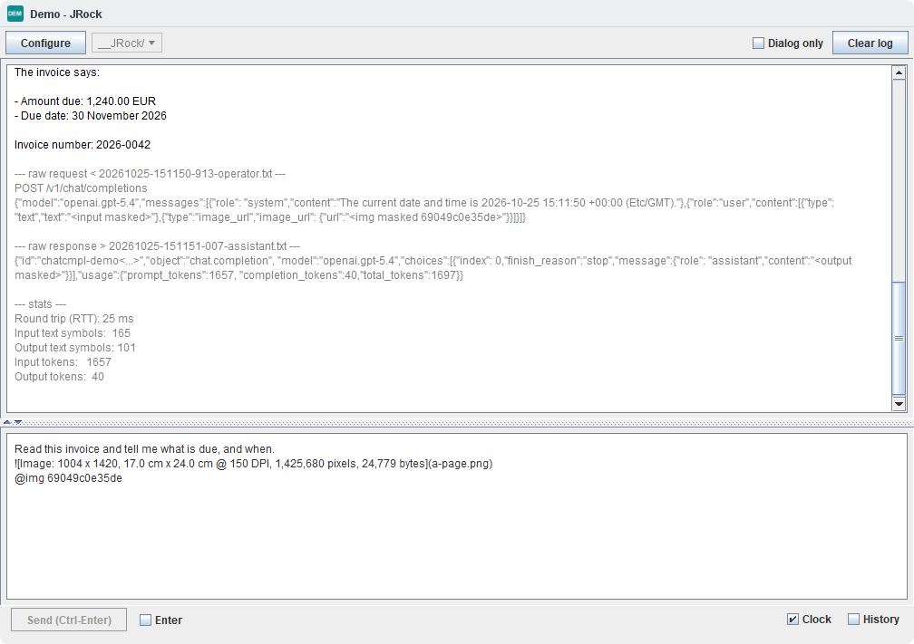

*One turn, in a folder called `Demo` — which is also where the window title and its `DEM` icon
come from. The question and the attached page are still in the prompt; the answer is above it,
with the masked raw request and response and the token stats under it. Every picture in this
README is taken by the build, by driving this program through its own automation API.*

By Ivan Khvostishkov, with assistance of Kiro and JetBrains IntelliJ IDEA.

---

<!-- toc:start -->
## Contents

- **§01** [Highlights](#highlights)
- **§02** [Paper in, typeset out](#paper-in-typeset-out)
- **§03** [Requirements and recommended tooling](#requirements-and-recommended-tooling)
  - [Requirements](#requirements)
  - [Recommended tooling (FAQ)](#recommended-tooling-faq)
- **§04** [Getting started](#getting-started)
  - [The prompts directory](#the-prompts-directory)
  - [The working directory (`--working-dir`)](#the-working-directory---working-dir)
- **§05** [JRock Web (in the browser)](#jrock-web-in-the-browser)
- **§06** [Mobile support for iOS and Android](#mobile-support-for-ios-and-android)
  - [Working with PDFs](#working-with-pdfs)
  - [What native mobile support would take](#what-native-mobile-support-would-take)
- **§07** [The endpoint, the transport and the models](#the-endpoint-the-transport-and-the-models)
  - [Endpoint & API design](#endpoint--api-design)
  - [HTTP transport](#http-transport)
  - [Models](#models)
- **§08** [The conversation log, and the prompt cache](#the-conversation-log-and-the-prompt-cache)
  - [Conversation log](#conversation-log)
- **§09** [Clock](#clock)
- **§10** [Persistence (crash recovery + full local history)](#persistence-crash-recovery--full-local-history)
- **§11** [Settings files](#settings-files)
  - [Extra request fields (`request-extra`)](#extra-request-fields-request-extra)
- **§12** [Keeping the folder: backup, restore, cleaning up](#keeping-the-folder-backup-restore-cleaning-up)
  - [Backup and restore](#backup-and-restore)
  - [Cleaning up (the window menu)](#cleaning-up-the-window-menu)
- **§13** [Merging PDFs: plainly, and two-sided scans](#merging-pdfs-plainly-and-two-sided-scans)
  - [Merging PDFs (Ghostscript)](#merging-pdfs-ghostscript)
  - [Merging duplex scans (Ghostscript)](#merging-duplex-scans-ghostscript)
- **§14** [Multimodal includes (Ctrl+I)](#multimodal-includes-ctrli)
  - [What an audio include is sent as](#what-an-audio-include-is-sent-as)
  - [A picture or a recording in the reply](#a-picture-or-a-recording-in-the-reply)
  - [Fetching a URL](#fetching-a-url)
  - [Includes that outlive the session](#includes-that-outlive-the-session)
- **§15** [Converting what you include: PDF, RTF, DOCX, XLSX](#converting-what-you-include-pdf-rtf-docx-xlsx)
  - [PDF conversion (Ghostscript)](#pdf-conversion-ghostscript)
  - [PDF as HTML or text (xpdf)](#pdf-as-html-or-text-xpdf)
  - [RTF and DOCX conversion (no external tool)](#rtf-and-docx-conversion-no-external-tool)
  - [XLSX conversion (no external tool)](#xlsx-conversion-no-external-tool)
- **§16** [Automation: prompts, flows and agents (`samples/`)](#automation-prompts-flows-and-agents-samples)
  - [The samples](#the-samples)
  - [The scenario: a PDF you can find again](#the-scenario-a-pdf-you-can-find-again)
  - [Using them](#using-them)
- **§17** [The first flow: doc inventory (`JRockDocInventory.java`)](#the-first-flow-doc-inventory-jrockdocinventoryjava)
- **§18** [A second flow: translating (`JRockTranslateToEnglish.java`)](#a-second-flow-translating-jrocktranslatetoenglishjava)
- **§19** [The first agent: push-to-talk (`JRockPushToTalk.java`)](#the-first-agent-push-to-talk-jrockpushtotalkjava)
- **§20** [A second agent: timer and alarm (`JRockTimer.java`)](#a-second-agent-timer-and-alarm-jrocktimerjava)
- **§21** [A third agent: geo location (`JRockGeoLocation.java`)](#a-third-agent-geo-location-jrockgeolocationjava)
- **§22** [A fourth agent: weather (`JRockWeather.java`)](#a-fourth-agent-weather-jrockweatherjava)
- **§23** [A fifth agent: Thunderbird, your calendar and your mail (`JRockThunderbird.java`)](#a-fifth-agent-thunderbird-your-calendar-and-your-mail-jrockthunderbirdjava)
  - [The mail half](#the-mail-half)
  - [Reading a message, and answering one](#reading-a-message-and-answering-one)
  - [Both halves, in one window](#both-halves-in-one-window)
- **§24** [A sixth agent: the web, by looking at it (`JRockBrowser.java`)](#a-sixth-agent-the-web-by-looking-at-it-jrockbrowserjava)
  - [Where is my parcel (`#parcel`)](#where-is-my-parcel-parcel)
  - [Looking something up in documentation (`#docs`)](#looking-something-up-in-documentation-docs)
- **§25** [A seventh agent: paper docs, in and out (`JRockPaperDocs.java`)](#a-seventh-agent-paper-docs-in-and-out-jrockpaperdocsjava)
- **§26** [Multi-agent collaboration](#multi-agent-collaboration)
- **§27** [The automation API](#the-automation-api)
  - [One breaking change in 5.1.0](#one-breaking-change-in-510)
  - [The cheat sheet: `JRock.Automation`](#the-cheat-sheet-jrockautomation)
- **§28** [Configure dialog (top-left button)](#configure-dialog-top-left-button)
  - [Help (the button on the first line)](#help-the-button-on-the-first-line)
- **§29** [The window: its size, place, title and icon](#the-window-its-size-place-title-and-icon)
  - [Window size and position (Configure → Window, Ctrl+M)](#window-size-and-position-configure--window-ctrlm)
- **§30** [Getting the answer out: printing, RTF and DOCX](#getting-the-answer-out-printing-rtf-and-docx)
  - [Printing / PDF (Ctrl+P)](#printing--pdf-ctrlp)
  - [Markdown export (RTF and DOCX)](#markdown-export-rtf-and-docx)
- **§31** [Narrate (Windows, and the browser)](#narrate-windows-and-the-browser)
  - [Narrating in the browser](#narrating-in-the-browser)
  - [Recording from the microphone (Ctrl+Space)](#recording-from-the-microphone-ctrlspace)
  - [Recording in the browser](#recording-in-the-browser)
  - [Mic always on](#mic-always-on)
- **§32** [Context menus (right-click / long tap)](#context-menus-right-click--long-tap)
- **§33** [Windows: the Explorer entries](#windows-the-explorer-entries)
  - [Windows: Explorer right-click integration](#windows-explorer-right-click-integration)
  - [Windows: agents and flows, one entry each](#windows-agents-and-flows-one-entry-each)
- **§34** [Keyboard shortcuts](#keyboard-shortcuts)
- **§35** [Tests](#tests)
- **§36** [The installer (`installer/InstallJRock.java`)](#the-installer-installerinstalljrockjava)
- **§37** [No window at all: `--cli`](#no-window-at-all---cli)
- **§38** [Finally: reproducible builds](#finally-reproducible-builds)

<!-- toc:end -->

## Highlights

- **Single file, zero dependencies.** Just `JRock.java`, no build tool, no jars, no AWS SDK.
- **Runs directly:** `java JRock.java`.
- **Bedrock API key auth** (Bearer token), no SigV4, no AWS SDK, no `~/.aws` credentials.
- **Everything local & transparent.** No server-side session state; all history lives in
  plain files under a `__JRock/` folder you own and can inspect — and the window itself lists
  every file and subfolder that folder can hold, under *What is in the JRock folder...* in the
  menu behind the **`__JRock/`** label beside *Configure*, so nothing JRock keeps has to be
  guessed at ([**Persistence**](#persistence-crash-recovery--full-local-history) §10).
- **Every control explains itself.** A right-click — or a long press on a touch screen — on any
  button or checkbox gives its name and a few plain sentences on what it does, which is what a
  tooltip cannot do on a phone ([**context menus**](#context-menus-right-click--long-tap) §32).
- **Crash-safe persistence** of the prompt and the full conversation.
- **Multimodal includes** (text, image and audio files, plus PDF-to-page-images via Ghostscript
  on the desktop and PDF.js in the browser, PDF-to-HTML or -text via xpdf on the desktop, and
  RTF/DOCX-to-Markdown, links and all, and XLSX-to-CSV, one file per sheet, with no external
  tool at all) referenced by hash; multi-select supported, with optional **copies kept under `__JRock/includes/`** — downscaled to the page they will be
  read on, so no tokens are spent on pixels nobody sees — and every include **reloaded from the
  log** in one menu item after a restart
  ([**includes that outlive the session**](#includes-that-outlive-the-session) §14).
- **Merge two-sided (duplex) scans** — the two passes a sheet feeder produces, the fronts in
  order and the backs in reverse, interleaved into one PDF by the same Ghostscript
  ([**merging duplex scans**](#merging-duplex-scans-ghostscript) §13) — **or merge PDFs plainly**,
  any number of them, in the order you pick them: *a* + *b* + *c* = *d*.
- **Fetch a URL** (Ctrl+U), not just a file: an address is downloaded into `__JRock/urls/` and
  attached as text or as a picture according to the `Content-Type` it answered with, with a
  Markdown link to where it came from above the token ([**fetching a URL**](#fetching-a-url) §14).
- **Clock**: the local time and the full time zone (`Europe/Berlin`, not an offset) go with
  every message, so a model that is asked what day it is has an answer
  ([**Clock**](#clock) §09).
- **Backup and restore the whole working folder** as one `.zip` - by hand, or by itself after
  five minutes of not touching the prompt ([**backup and restore**](#backup-and-restore) §12).
- **Markdown export** of an answer as **RTF or DOCX**, written in-process — the model replies in
  Markdown, and a selected reply becomes a document a word processor, or a layout application,
  opens with its headings, tables and **the pictures it was given** intact
  ([**Markdown export**](#markdown-export-rtf-and-docx) §30).
- **A prompt library in plain files** — a folder of `.txt` prompts you can chain into a
  workflow, which is Bedrock Prompt management without the cloud
  ([`samples/`](#automation-prompts-flows-and-agents-samples) §16) — and single-file **agents** that loop
  and **flows** that run once, each driving the real window the way AgentCore drives a hosted
  one, so you watch it work and carry on the conversation when it's done
  ([**automations**](#the-first-flow-doc-inventory-jrockdocinventoryjava) §17).
- **Keyboard-driven**, with a Configure dialog for API key, endpoint, model and working directory.
- **An installer**, one Swing wizard in one Java file, shipped beside the jar in every
  release: one folder for the lot, shortcuts, the agents and flows you pick, the settings
  and the key, the Explorer entries — and it removes no folder, no document and no settings
  file, ever ([**the installer**](#the-installer-installerinstalljrockjava) §36).
- **Paper is the unit**, in and out: what arrives is a scan or a PDF in a standard page size,
  and what leaves is a document ready for a printer — or for **Adobe InDesign**, by its style
  names ([**paper in, typeset out**](#paper-in-typeset-out) §02).

## Paper in, typeset out

JRock is built on an assumption about where written natural language actually comes from: **not
from a text box, but from paper**. A scanned letter, a contract, a form, an invoice, a spec, a
manual — printed once, filed, and now a PDF in a standard page size, A4 above all. And what you
want back is paper again — but **set**, and not merely printed: something to sign, file, hand
over or post, out of a layout you chose rather than out of whatever a converter felt like.

So the page is not a detail at the end of the pipeline here, it is **the unit of measure
throughout**:

- **Coming in**, a PDF is included as **page images** at *Images DPI* — the document as it
  looks, not as a text extractor guesses it ([PDF conversion](#pdf-conversion-ghostscript) §15).
  Two-sided originals are handled where they are actually produced: the **fronts and the
  reversed backs** a sheet feeder gives you, interleaved into one PDF
  ([merging duplex scans](#merging-duplex-scans-ghostscript) §13). An include's copy is
  **downscaled to what A4 at that DPI has room for**, because pixels past the page nobody reads
  and you pay for them twice ([includes that outlive the
  session](#includes-that-outlive-the-session)).
- **Going out**, an answer becomes **A4 portrait or landscape with 2 cm margins**, headings,
  tables and its pictures placed at their physical size in cm — a DOCX or RTF a word processor
  opens, not a Markdown file looking for a converter
  ([Markdown export](#markdown-export-rtf-and-docx) §30). Or **Ctrl+P**, which prints the
  transcript — or just the selected answer — to a printer or straight to PDF
  ([printing](#printing--pdf-ctrlp) §30).
- **And on into professional typesetting.** The DOCX is written to be **placed in Adobe
  InDesign**, which imports a Word file by mapping the document's style *names* onto your own
  paragraph styles — so the paragraphs carry them: *Normal*, *Heading 1–6*, *Code*, *Quote*,
  with the pictures already in the flow at their physical size. An answer lands in **your**
  template's typography instead of whatever a converter felt like, and the PDF that comes out
  of InDesign is **typeset**, not printed from a text editor. RTF is the same idea at the lower
  standard — no style names, but everything opens it.

The point of all this is a question you never have to ask: *what can this Markdown be converted
to, and with which tool?* The reply you are reading is **already one keystroke from the shape
you need it in** — whether that shape is a page out of the printer, a file somebody else can
edit, or copy flowing into a layout. And the loop closes, because a transcript printed to PDF
with Ctrl+P can be included straight back as page images in the next prompt.

**Which tools to keep beside JRock for all this** — and what to do with a scanned PDF too long to
send at all — is answered in [**Recommended tooling**](#recommended-tooling-faq) §03 below.

## Requirements and recommended tooling

### Requirements

- **Minimum: JDK 11** — needed for single-file source launch (JEP 330) and
  `java.net.http.HttpClient`. On JDK 8-10 it won't run as a single file.
- **Maximum: none** — uses only core JDK APIs (`javax.swing`, `java.net.http`). Runs on
  the latest JDK.

### Recommended tooling (FAQ)

JRock needs **a JDK and nothing else** to run. Three outside tools unlock features, and two
commercial ones are worth having if your work is paper — not because JRock is missing something,
but because OCR and typesetting are other people's trades and the files pass between them
cleanly.

**What JRock itself shells out to, and for what:**

| Tool | Needed for | Without it |
|---|---|---|
| **[Ghostscript](https://ghostscript.com/releases/gsdnld.html)** | a PDF included as **page images** ([PDF conversion](#pdf-conversion-ghostscript) §15), **[merging PDFs](#merging-pdfs-ghostscript) §13**, **[merging duplex scans](#merging-duplex-scans-ghostscript) §13** | the PDF filter and both merges say so and stop; everything else works |
| **[xpdf](https://www.xpdfreader.com/download.html)** (`pdftohtml`, `pdftotext`) | a PDF included **as HTML with its pictures**, or **as text** ([PDF as HTML or text](#pdf-as-html-or-text-xpdf) §15) | those two include modes say so; page images are unaffected |
| **`sqlite3`** | the **Thunderbird agent** only, which reads the mail and calendar index ([the Thunderbird agent](#a-fifth-agent-thunderbird-your-calendar-and-your-mail-jrockthunderbirdjava) §23) | that one agent says so |

Everything else is in-process on the bare JDK: RTF, DOCX and XLSX in **and** out, image sizing,
the A4 PDF a filed image gets, narration on Windows' own voices. In the browser there is no
process to start at all, and [PDF.js](#working-with-pdfs) §06 stands in for Ghostscript's reading
half.

#### How do I turn an answer into a PDF?

Two ways, and they are for different things.

- **Ctrl+P** prints the transcript — or just the selected answer — to a printer or to a PDF
  writer (*Microsoft Print to PDF* on Windows) ([printing](#printing--pdf-ctrlp) §30). This is the
  quick copy: a record of what was said, in the window's own font.
- **Ctrl+Shift+D** exports the selection as a **DOCX** ([Markdown
  export](#markdown-export-rtf-and-docx)) — A4 portrait or landscape, 2 cm margins, headings and
  tables as real formatting, pictures placed at their physical size, and the paragraphs under
  **named styles** (*Normal*, *Heading 1–6*, *Code*, *Quote*). That DOCX is the file you hand to
  whatever makes the finished page:
  - **Adobe InDesign** — place the DOCX and it maps the document's style *names* onto your own
    paragraph styles, so the copy lands in your template's typography rather than a converter's
    idea of it. Export from there and the PDF is **typeset**, and it is where a print-ready
    **PDF/X-4** comes from (fonts embedded, colour managed, transparency live) — which is what a
    printer asks for and what no "print to PDF" produces.
  - **Adobe Acrobat** — open the DOCX and save as PDF, or use *Create PDF*. No typesetting, but
    a correct, searchable PDF in one step, and Acrobat is where you would then sign, redact or
    combine it.

#### I have no InDesign or Acrobat. What then?

Word, Pages and LibreOffice all open the DOCX and all export PDF; LibreOffice does it from the
command line too (`soffice --convert-to pdf`). The typography is the application's rather than
yours, which for a letter nobody is going to typeset is the right trade. **Export selected
Markdown as RTF...** is the same idea one standard lower — no style names, but everything opens
an RTF.

#### A scanned PDF is too big for the model. What do I do?

OCR it, and send the text instead of the pictures. A scan goes in as **page images**, one PNG per
page, and a long document is the one case where that stops working: a hundred pages of A4 at the
default 150 dpi is far more than any model's context will hold, and even where it fits you are
paying for pictures of words. The way through is to turn the pages into a text document once, outside JRock,
with a tool whose whole job that is:

1. **OCR the scan.** **[ABBYY FineReader](https://www.abbyy.com/finereader/)** is the
   recommendation — it is the best of them on bad scans, multi-column pages and tables, and it
   keeps the layout while it does it. **Acrobat**'s *Scan & OCR → Recognize Text* is the
   alternative you may already own.
2. **Save the recognised PDF beside the original, as `<name>_recognized.pdf`.** The original scan
   stays exactly as it came off the glass — OCR is a guess about letters, and the page images are
   the evidence — and the name says which is which.
3. **Export that to `<name>.docx`**, from ABBYY or from Acrobat (*Export to Word*).
4. **Include the DOCX** as [**DOCX as Markdown text**](#rtf-and-docx-conversion-no-external-tool) §15.
   Headings, bold, italic, tables **and the pictures** survive into the Markdown as structure the
   model reads, and one text include with a handful of pictures in it is an order of magnitude
   cheaper than sixty page images — with no DPI to choose and no page limit to run into.

   **A DOCX is enough to carry the graphics, which is why the 1:1 reading belongs out here.** A
   model shown a long document as page images does not reliably transcribe every one of them —
   it may summarise, or skip a section that repeats — and that is fine for a summary or for the
   [doc inventory flow](#the-first-flow-doc-inventory-jrockdocinventoryjava) §17, but a faithful page-for-page
   transcript of a PDF is work for ABBYY or Acrobat, which do it properly. Let them make the
   DOCX; JRock takes the DOCX whole, pictures included, and gives it back the same way.

**And those names are what the [doc inventory flow](#the-first-flow-doc-inventory-jrockdocinventoryjava) §17
is built for.** With `file.pdf`, `file_recognized.pdf` and `file.docx` in one folder, run the flow
on **`file.pdf`** (or on `file.docx`): it offers to **start from the `.docx`** — skipping the
page-image pass and its send altogether — and at the end it renames **all three together** to the
name it settles on, keeping `_recognized` on the one that carries it, since a suffix is how it
tells one file of a document from another. Start it on `file_recognized.pdf` and you get a
document of its own: the set is found from the **base** name outwards, so the name without a
suffix is the one to point it at.

#### When should a scan still go in as page images?

When the **layout carries meaning** and the document is short enough to fit: a form where the
boxes matter, a letter whose stamp, signature or handwritten note is half the answer, a table
whose rules an OCR might read wrongly. Page images are the document *as it looks* and no
extractor's guess sits between the model and the page — which is why they are JRock's default for
a PDF. The question is only ever size: a letter or a few dozen pages, images; a hundred-page
contract, OCR it first.

#### The PDF already has a text layer. Do I need OCR at all?

No — that is what **xpdf** is there for. A born-digital PDF (one exported from Word, or a bank
statement off a website) carries its text, and *Include a PDF as* → **HTML with pictures** or
**text** reads it out in-process and in a second, with no OCR and no page images
([PDF as HTML or text](#pdf-as-html-or-text-xpdf) §15). **A scan has no text layer at all**, and
`pdftotext` on one returns nothing: that empty answer is the test — if the text comes back blank
or as gibberish, the document is pictures of words and step 1 above is where to go.

## Getting started

1. **Get a Bedrock API key.** A short-term (recommended) key can be generated from the AWS
   console: https://console.aws.amazon.com/bedrock-mantle/api-keys
2. **Provide the key** by typing it into the in-app **Configure dialog** (top-left button),
   which writes it to `__JRock/bedrock-key.txt` in the working directory — or by putting it
   in that file yourself, one line and nothing else. Nothing is read from the environment;
   see [Settings files](#settings-files) §11.

3. **Run it:**

   ```powershell
   java JRock.java
   # optionally load a prompt file on startup (read-only):
   java JRock.java path\to\prompt.txt
   # point Load/Save prompt (Ctrl+O / Ctrl+S) at a prompt library:
   java JRock.java --prompts-dir D:\prompts
   # ...and then name a prompt in it directly:
   java JRock.java --prompts-dir D:\prompts review.txt
   # work in a folder other than the one you launched from (see Agents):
   java JRock.java --working-dir D:\HPScan
   ```

4. Type a prompt and press **Ctrl+Enter** (or the **Send** button).

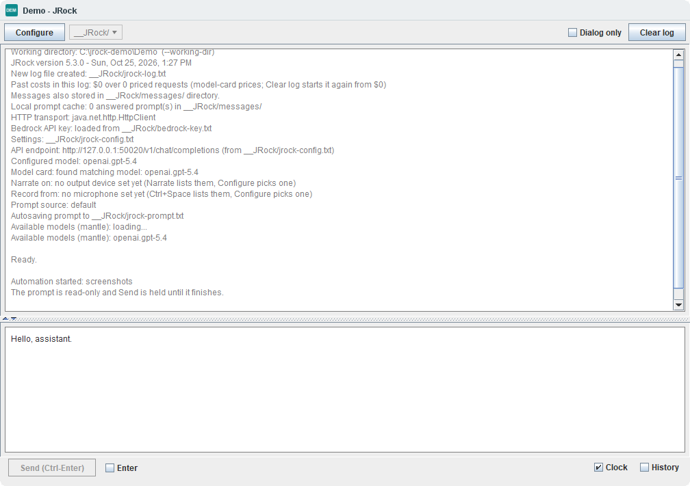

*What step 3 gets you. Everything above the prompt is JRock saying what it configured and where
it put your files — the folder it works in, the version and the local time, which log it loaded
or created, what this log has cost so far, the transport, where the key and the settings came
from, the endpoint and the model with its model card, the audio devices, and the models this key
can reach. Then `Ready.` and a blank prompt. Nothing here is a guess: every line is read back
from the folder it names.*

| The report line | What to check it against |
|---|---|
| `Working directory:` | [`--working-dir`](#the-working-directory---working-dir) |
| `Bedrock API key:` / `Settings:` | [Settings files](#settings-files) §11 |
| `API endpoint:` / `Configured model:` / `Model card:` | [Endpoint & API design](#endpoint--api-design) §07, [Models](#models) §07 |
| `HTTP transport:` | [HTTP transport](#http-transport) §07 |
| `Past costs in this log:` | [Conversation log](#conversation-log) §08 |
| `Narrate on:` / `Record from:` | [Narrate](#narrate-windows-and-the-browser) §31, [recording](#recording-from-the-microphone-ctrlspace) §31 |
| `Leftover folder(s) in __JRock/:` | [Persistence](#persistence-crash-recovery--full-local-history) §10 |

### The prompts directory

Prompts tend to live together in one folder, while the working directory is wherever
today's work is. The **prompts directory** separates the two:

- **Ctrl+O and Ctrl+S always open there.** Not "there the first time, then wherever you last
  browsed" — *every* time. A prompt library is a place you keep going back to, so a chooser
  that drifts adds a small navigation chore to every single load. If it's opening in the wrong
  place, that's a setting to change, not a folder to re-navigate.
- The **initial-prompt-file argument** is resolved relative to it, so it can be a bare file
  name. Absolute paths are unaffected.
- **Include (Ctrl+I)** and log exports are deliberately *not* affected — those files live
  wherever the source material is, so those choosers do remember where you last browsed.

| Dialog | Opens in | Remembers where you browsed |
|---|---|---|
| **Load prompt** (Ctrl+O), **Save prompt** (Ctrl+S) | the prompts directory, every time | no — on purpose |
| **Include** (Ctrl+I) | where you last included from | yes |
| **Save log as** (Ctrl+Shift+S), the exports, the backups | where you last saved | yes |
| the merges, the cleanup | the same | yes |

Set it in the **Configure dialog** (its own row, under the working directory), or on the
command line with `--prompts-dir <dir>`. The dialog wins: changing it there replaces
whatever the flag asked for, for the rest of the session.

Unset, prompts simply **follow the working directory** — which is what a plain launch gets,
and what setting the prompts directory equal to the working directory means. That state isn't
a path frozen at launch: change the working directory later and prompts come with it.

On Windows, the **"JRock here!"** entry the [installer](#the-installer-installerinstalljrockjava) §36
writes carries the install folder as `--prompts-dir`, so the library follows you into every
folder you right-click; see
[Explorer right-click integration](#windows-explorer-right-click-integration) §33.

For a ready-made one, point it at **`samples/`** in this repository — the prompts that chain
into a document-archiving workflow, the agents and flows that run them, and a template for a
library of your own. See
[Prompt library and chaining](#automation-prompts-flows-and-agents-samples) §16.

`--prompts-dir=<dir>` works too, and the flag can come before or after the prompt file. The
directory is reported in the startup log whenever it isn't just the working directory —
including when the path isn't usable, in which case it's reported and ignored rather than
silently applied.

The **agents and flows** — the `.java` automations that drive JRock through those prompts —
do **not** live here. Each is installed into a folder of its own with the prompts it reads
beside it, because that is where it looks for them; this directory is the library you read and
borrow from. See [agents and flows](#windows-agents-and-flows-one-entry-each) §33.

### The working directory (`--working-dir`)

`--working-dir <dir>` (or `=<dir>`) names the folder JRock works in — its `__JRock/` files, its
settings, its key — regardless of the directory the process was started in. A plain launch needs
it about as often as never: the working directory *is* where you launched from. What needs it is
an **agent**, because Explorer starts a right-click command in the folder that was clicked, and
an agent's whole point is to use one particular folder's settings on a file that may be anywhere
else. Reported in the startup log when it was given; a path that isn't a directory is reported
and ignored. The one exception is the browser, where the flag comes from the page's address
(see [JRock Web](#jrock-web-in-the-browser) §05). A missing folder under `/files` is created there,
as the Configure dialog would create it.

| Started from | Without the flag, JRock works in | With `--working-dir D:\HPScan` |
|---|---|---|
| a shell | that shell's directory | `D:\HPScan` |
| Explorer's **right-click on a folder** | the folder you clicked — which is the point of that entry | `D:\HPScan`, whatever you clicked |
| an **agent** installed from `D:\Agents\Mail` | wherever Explorer started it | `D:\Agents\Mail`, so its key, model and DPI are its own |
| the **browser** | `/files` | `/files/HPScan`, from `?HPScan` in the address |

## JRock Web (in the browser)

JRock also runs in your browser at **https://jrock.nosocial.net/** — no locally
installed JVM required. It loads the same unmodified `jrock.jar` and runs it entirely
**locally in your browser** via [CheerpJ](https://cheerpj.com/) (which executes JVM bytecode
as WebAssembly), so nothing runs on a server.

- **Real Bedrock calls work.** The browser has no socket layer, so JRock detects the browser
  runtime and sends its requests through the page's own `fetch()` instead — see
  [HTTP transport](#http-transport) §07.
- **The key goes where it goes on the desktop:** into JRock's own **Configure** dialog, which
  writes it to `__JRock/bedrock-key.txt` — in the browser, inside CheerpJ's own persistent storage
  (`/files/`). So it is **still there after a reload**, it is changed in the one place anybody
  would look for it, and there is no JavaScript credentials dialog interrupting a send to ask
  for it again. The page shows the jar's SHA-256 so you can confirm it matches the reproducible
  build before typing anything, and the key never goes anywhere but the Bedrock endpoint. The
  endpoint and model live beside it in `__JRock/jrock-config.txt`, the same as everywhere else.
- **A folder in the address starts JRock in it.** `https://jrock.nosocial.net/?fl` starts JRock
  as soon as the jar has loaded, without waiting for **Run JRock**, with `/files/fl` as its working
  directory; `?fl/foo` gives `/files/fl/foo`. That is the same as pressing **Run JRock** and
  choosing that folder in the Configure dialog, new folders included, which are created. So a
  bookmark per project opens straight into that project's settings, key and log. A query
  containing `=` is a parameter rather than a folder and is ignored, and so is one with a `.` or
  `..` segment. The page says so itself, under the Run button, with the whole address written
  out — `https://jrock.nosocial.net/?home` — as a link that is equally there to be clicked, or
  copied and bookmarked.
- **`Files...` browses CheerpJ's storage, and deletes from it.** `/files` lives in the browser's
  own storage, where no Explorer, Finder or shell can reach it: a folder of four thousand message
  files and a hundred converted PDF pages is invisible from outside, slows down every file dialog
  JRock opens, and used to be impossible to throw away — JRock's file chooser can *rename* a dead
  folder (hence the trick of calling it `junk~`) but a chooser does not delete, and the browser's
  own storage controls are all or nothing: clear the site's data and the key, the settings and the
  whole transcript go with it. So the page lists `/files` itself: one folder at a time with its
  entries' sizes, a folder's name being the way into it, **Delete** beside each entry — a folder
  with everything in it — and one button that sweeps **every name ending in `~`** out of the whole
  tree below where you are standing, after showing you the list and asking. It works through
  CheerpJ's [library mode](https://cheerpj.com/docs/guides/library-mode), calling the same
  `java.io.File` JRock itself uses, so a listing there is the listing the app sees. `uploads/` and
  `downloads/` are CheerpJ's own: you can look in them, and nothing in them is deleted from here.
  The button is **only there before JRock starts** — deleting the log, the prompt or the key out
  from under a running session would be a crash report rather than a cleanup.
- **Right-click is a long tap.** On touch devices, press and hold to open the context menus.
- **The page gets out of the way — and comes back.** A few seconds after launch the page hides
  its own header and footer, giving the Swing display the whole tab. That is what the **Hide
  header and footer after launch** checkbox says it will do — ticked by default, and there so the
  disappearance is something you were told about rather than something that happened to you. It
  sits in the main area under the text about the checksum and the Configure dialog, with the note
  that brings them back, and not in the header, where a label that long would be the whole
  header on a phone.
  To check the checksum again, the window's menu - the `__JRock/` label beside *Configure* - has
  **Show/hide the page header & footer**: it calls one function in the page, which flips the chrome and reports which way it
  went. The page owns that state, so JRock never has to guess.
- **Copy and paste reach other apps.** CheerpJ gives the JVM a clipboard of its own that
  nothing else can see, so JRock goes through the browser's clipboard instead: text moves
  between JRock and your mail or notes, by Ctrl+C/X/V or from the context menus. A browser
  may ask permission the first time a page reads the clipboard, and some refuse reads
  outright — paste then falls back to whatever was last copied inside JRock, and says so.
- **Image includes work too.** A browser JVM has no native libraries, so nothing here may
  depend on one — JRock reads an image's dimensions from its header rather than decoding it, and
  the downscale a processed copy gets is handed to the page, whose `canvas` decodes and
  re-encodes pictures in native code where CheerpJ's `ImageIO` and `Graphics2D` cannot (see
  [Multimodal includes](#multimodal-includes-ctrli) §14).
- **Fetch URL works too**, through the same page client as the Bedrock calls — one more method on
  `window.myBrowserHttp`, returning the bytes and the `Content-Type` so a picture stays a picture
  (see [fetching a URL](#fetching-a-url) §14). The browser's own rule applies: a site that does not
  allow cross-origin reads (**CORS**) cannot be fetched from a page, and is reported as refusing.

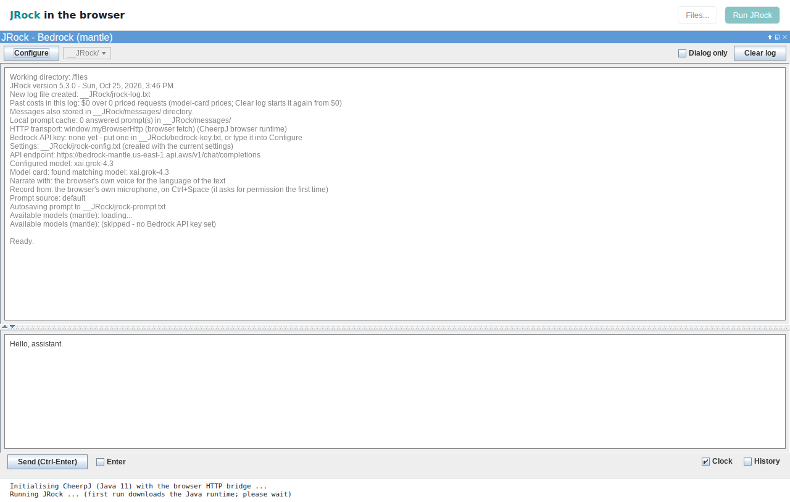

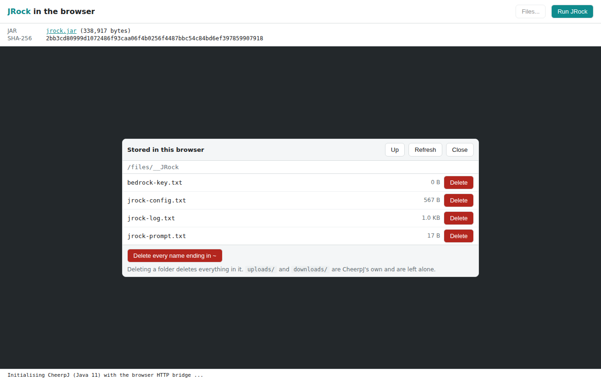

*The same jar in a browser tab — a Swing window, its own file chooser and all. Only the reply is
selected, so the context menu offers **Save selected text as...**; saving into `downloads` hands the
file to the browser as a download.*

## Mobile support for iOS and Android

Both work today, through [JRock Web](#jrock-web-in-the-browser) §05: the phone's browser runs the same
unmodified `jrock.jar`, so there is nothing to install and no app store in the way.

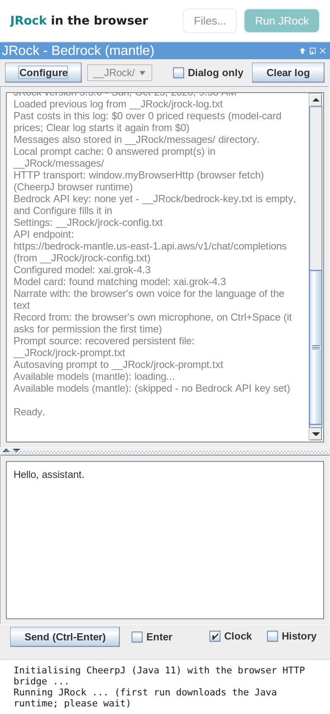

*Edge on an iPhone, with the page's own header and footer left showing: the jar's size and SHA-256
to check before typing a key, and a footer log ending in `GET .../v1/models -> 200` — a real Bedrock
call from a phone. In the window, the session report (`/files`, the page's `fetch()` as the transport,
the key read from `/files/__JRock/bedrock-key.txt`) and the prompt's context menu, opened with a long
tap because that is how a phone reaches everything the Ctrl shortcuts do.*

The UX is a little clumsy, and worth knowing about before you judge it:

- The on-screen keyboard sometimes needs a tap on the window **outside** the text area before it
  will come up. For a **masked** field it may not come up at all, which is why the
  [Configure dialog's](#configure-dialog-top-left-button) §28 API key row is an ordinary field in the
  browser and carries its own **Paste** button — the one row a phone cannot type its way out of.
  Every other row there has a long-tap menu with Copy, Paste and Select all.
- Scroll bars, text selection and the menus are Swing's own, drawn for a desktop and driven by a
  fingertip. It takes some learning — but you do get used to it.
- **Several files in one include** need the file dialog's **File Name** box: a tap selects one
  file and there is no Shift to hold, so the names go in by hand, each in quotes —
  `"cat.png" "dog.png"`. That box has its own long-tap menu with Copy, Paste and Select all.

For an app like this that is a fair trade: one jar, one build, no per-platform code and no store
review, and the phone gets the same client as the desktop, with the same plain files under
`__JRock/`.

### Working with PDFs

The PDF filter works in the browser too. Java ships no PDF support of its own, and a browser JVM
has no process to start, so where the desktop runs [Ghostscript](#pdf-conversion-ghostscript) §15 the
page hands the PDF to [PDF.js](https://mozilla.github.io/pdf.js/) — the renderer Firefox shows
PDFs with — and gets each page back as a PNG, drawn at the same **Images DPI**. JRock talks to
both through one PDF engine interface, so the include, the page files and the `@img` tokens are
the same either way. PDF.js is loaded from jsDelivr the first time a PDF is included, so a session
that never opens one never downloads it. Pages land in **`__JRock/includes/`**, named
`<pdfname>.pdfjs.NNN.png`.

| A PDF, in the browser | Runs | Pages named |
|---|---|---|
| included as **page images** | PDF.js, loaded from jsDelivr the first time one is included | `<pdfname>.pdfjs.NNN.png` |
| included as **HTML or text** | — xpdf is a program, and a tab has none | — |
| **merged**, or **duplex-merged** | — PDF.js only reads PDFs | — |
| as a **picture of one page** | nothing: an image include reads its own header | whatever your viewer saved |
| via **RTF or DOCX** | JRock's own reader, which needs nothing | `<name>.docx.md`, pictures beside it |

The [duplex merge](#merging-duplex-scans-ghostscript) §13 is the one PDF feature that stays on the
desktop: it writes a PDF, and PDF.js only reads them. Other ways to work with a PDF that run
in-process, in a tab as well as on the desktop:

- **Page images.** Screenshot the pages in whatever PDF viewer the phone already has and include
  them under **Image files** — useful for a single page out of a long document. Image includes
  need nothing native, JRock reading their dimensions straight out of the file header.
- **Via a word processor's format.** Export the PDF as RTF or as Word in Acrobat (which has a mobile
  app too), then include the file as [**RTF as Markdown text**](#rtf-and-docx-conversion-no-external-tool) §15 or
  [**DOCX as Markdown text**](#rtf-and-docx-conversion-no-external-tool) §15 — or, for an `.rtf`, under
  **Text files as is**, markup and all. All of them run in-process on the JDK's own RTF reader and
  XML parser.

Which one depends on the document: a scan or anything where the layout carries meaning goes as page
images, while a text document is better via RTF or DOCX, where headings, bold, italic and — from a
`.docx` — tables survive into the Markdown as structure the model reads.

**And the other direction: making a PDF.** Select the answer in the log, long-tap (or right-click)
and pick **Export selected Markdown with images as DOCX...** — the Markdown becomes a real
document, headings and tables and all (and the photographs from the phone's camera roll, if they
were included with a [Markdown reference](#multimodal-includes-ctrli) §14 and the model wrote it back),
under [named paragraph styles](#markdown-export-rtf-and-docx) §30. Place that in
**InDesign**, which imports a Word file by mapping its style names onto your own paragraph styles,
and the PDF that comes out is typeset rather than printed from a text editor. **Export selected
Markdown as RTF...** is the lower standard for the same idea: no style names, but anything that
opens an RTF — Word, Pages, LibreOffice, TextEdit, WordPad — will read it. Neither is mobile-only:
the two items are in the log's context menu wherever JRock runs, and on the desktop they are the
short way from an answer to a document somebody else can edit. See [**Recommended
tooling**](#recommended-tooling-faq) for the whole of that road — the DOCX, InDesign or Acrobat,
and PDF/X-4 at the end of it.

### What native mobile support would take

The compilers already exist. For iOS,
[MobiVM/RoboVM](https://github.com/MobiVM/robovm) translates Java bytecode ahead of time into a
native iOS binary; for Android, the platform's own toolchain compiles Java straight to DEX and runs
it natively, Android having been a Java platform from the start. What is missing on both is
**Swing**: an AWT/Swing backend plugged into UIKit and Android's own view primitives, so that a
`JFrame` is a native window and a `JTextArea` a native text view with the keyboard, selection and
scrolling that the platform already knows how to do. That is a months-long project in its own right,
and none of it is specific to JRock.

| | Compiler for Java | Swing on it | So today |
|---|---|---|---|
| **iOS** | MobiVM/RoboVM, ahead of time | missing — would need an AWT backend on UIKit | the browser runs it |
| **Android** | the platform's own, Java to DEX | missing — would need one on Android's views | the browser runs it |
| **A phone browser** | CheerpJ, already | Swing as it is, on a canvas | **this is the mobile support** |

**The two targets exist in this repository, and they fail on purpose.** [`android/`](android/) is a
minimal Gradle project that compiles the root `JRock.java` into an APK, and [`ios/`](ios/) is a
minimal MobiVM project that compiles the same file ahead of time into an iOS binary — one `Copy` task
each, pulling the single source file out of the repository root, which keeps its no-build-descriptor
rule intact. Neither one works: Android stops at `javac` on the first `javax.swing` import, and
MobiVM stops in the AOT compiler while linking. The
[Mobile builds (experimental)](.github/workflows/mobile.yml) workflow builds both — on
`ubuntu-latest` and on a `macos-latest` runner with Xcode — and is left red rather than hidden behind
`continue-on-error`, so the missing piece is a line in a log anybody can read instead of a claim in a
README. It is **manual**, run from the Actions tab: a job that is expected to fail would otherwise put
a red X on every commit and teach you to read past the two workflows whose colour means something.
The two directories' own READMEs list, in order of size, what replacing it would mean.

Which is also why it would be worth more than JRock. A Swing backend on native mobile primitives
would make plain Java a cross-platform UI target again — desktop, iOS and Android from one source —
and put Java and Swing back in the same row as Kotlin and Unity/C#. If that interests you, vote with
the **Sponsor** button at the top of this repository ;)

## The endpoint, the transport and the models

### Endpoint & API design

- Uses the **`bedrock-mantle`** endpoint. AWS recommends `bedrock-runtime` for new apps
  (where Amazon Nova, Meta Llama and other families are also available), but as of
  Sep 2026 several frontier models run on `bedrock-mantle` only. JRock prefers mantle for
  the simplicity of a single API surface.
  - What that costs us, concretely: `bedrock-runtime` has **`CountTokens`**
    (`POST /model/{modelId}/count-tokens` → `{"inputTokens": n}`), which prices a prompt
    *before* it is sent and is documented to match what the same input would be charged.
    Mantle has no such operation, and the Chat Completions schema has none either — token
    counts arrive only in a reply's `usage`, i.e. after paying for it. But not every model
    is on runtime (several of the cards below list no runtime APIs at all), so the count
    would be available for some models and not others — which is the same split that made
    mantle the choice in the first place.
- Uses **Chat Completions**, not the Responses API. Responses is *stateful* (the backend
  retains conversation state). JRock deliberately avoids that: it stores **nothing** on the
  backend. All history stays local, unlike a browser client where session data can hide
  non-transparently in cookies / sessionStorage / IndexedDB. Chat Completions is stateless,
  so each request carries its own context.

| | `bedrock-mantle` — what JRock uses | `bedrock-runtime` | Responses API |
|---|---|---|---|
| Model families | several frontier ones live **here only** | Nova, Llama and others too | — |
| API surface | one: **Chat Completions** | per-model operations | one, and *stateful* |
| Auth | **Bedrock API key**, a Bearer token | SigV4 or a key | — |
| Where the conversation lives | **in the request**, every time | in the request | on the **backend** |
| Price before sending | no — `usage` comes back **with the reply** | `CountTokens`, for the models that are on it | — |
| What JRock stores on anybody's server | **nothing** | — | a conversation id |

### HTTP transport

JRock issues two kinds of request to the model (`GET /v1/models` and
`POST /v1/chat/completions`), plus a plain `GET` of any address you give it with
[Fetch URL](#fetching-a-url) §14. Which transport carries them is decided once at startup and
reported in the log:

| Runtime | Transport | Credentials |
|---|---|---|
| Any normal JVM | `java.net.http.HttpClient` | `__JRock/bedrock-key.txt`, written by the Configure dialog |
| CheerpJ (browser) | the page's `window.myBrowserHttp` | the same file, in the browser's persistent storage |

In the browser there is no socket layer, so `HttpClient` cannot work at all and the hosting page
provides the transport instead. Any host page can serve JRock by providing two functions on
`window.myBrowserHttp`:

- **`fetch(url, options)`** resolving to `{ status, body }` — the model calls, whose bodies are
  JSON either way. The `options` include the headers JRock built, `Authorization` among them: the
  key is JRock's in the browser too, so one dialog sets it and one file keeps it.
  **A page configures nothing.** Its `browserHttpInfo()` reply names its client for the startup
  log, and that is all it is asked: it cannot pin the endpoint, and it cannot hold the Bedrock key
  and attach the header in JRock's place. Everything is in the working folder's files on every
  platform, so each setting has one home, a missing key is always reported in the one place you
  would fix it, and nothing a page does can make a setting arrive by a second way you cannot see.
- **`fetchUrl(url, options)`** resolving to `{ status, contentType, url, bytes }` — an arbitrary
  address, for which a body of *text* would not do: Fetch URL decides between a page and a
  picture by the response's own `Content-Type`, and an image has to arrive as bytes
  (`Uint8Array`) to be saved at all. No credentials are attached to these.

`jrock-web/index.html` is the reference implementation of both.

Credentials are deliberately **not** read from JVM system properties (`-Dname=value`) or from
environment variables: a key passed on a command line leaks into shell history and process
listings, and an environment variable is set in a shell that's gone by the time anything goes
wrong. The key lives in a file you can look at instead — see [Settings files](#settings-files) §11.

### Models

Known model "cards" record each model's modalities, supported APIs/endpoints, and the
correct mantle path (`/v1/...` vs `/openai/v1/...`). The **Model** field in Configure is
free-text with a dropdown pre-populated from the most recently fetched available models.

Model matching: exact model-id match wins; otherwise a **vendor-prefix** partial match
(e.g. any `anthropic.*`, `openai.*` or `google.*`); otherwise a default config is used. This is logged
at startup and after reconfiguration.

Built-in cards include:

| Model | Model ID | Chat Completions on mantle | Price per 1M tokens (in / out) |
|---|---|---|---|
| Grok 4.3 | `xai.grok-4.3` | yes (`/openai/v1`) | $1.25 / $2.50; GovCloud $1.50 / $3.00 |
| Grok 4.6 | `xai.grok-4.6` | yes (`/openai/v1`) | $2.20 / $6.60, at any input length (us-west-2, us-gov-east-1) |
| Kimi K2.5 | `moonshotai.kimi-k2.5` | yes (`/v1`) | — |
| Kimi K3 | `moonshotai.kimi-k3` | no (bedrock-runtime only) | — |
| GLM 5.3 | `zai.glm-5.3` | no (bedrock-runtime only) | — |
| DeepSeek-V3.1 | `deepseek.v3.1` | yes (`/v1`) | — |
| Qwen3 32B | `qwen.qwen3-32b` | yes (`/v1`) | — |
| GPT-5.4 | `openai.gpt-5.4` | yes (`/openai/v1`) | $2.75 / $16.50; past 272K input tokens $5.50 / $24.75 (us-east-1, us-east-2, us-west-2); GovCloud $3.375 / $20.25 up to 272K |
| GPT-5.5 | `openai.gpt-5.5` | yes (`/openai/v1`) | $5.50 / $33; past 272K input tokens $11 / $49.50 (us-east-1, us-east-2) |
| GPT-5.6 Sol | `openai.gpt-5.6-sol` | yes (`/openai/v1`) | $4.40 / $22; past 272K input tokens $8.80 / $33 (us-east-1, us-east-2) |
| GPT-5.6 Terra | `openai.gpt-5.6-terra` | yes (`/openai/v1`) | $2.20 / $13.20; past 272K $4.40 / $19.80; GovCloud $2.70 / $16.20 and $5.40 / $24.30 |
| GPT-6 Sol | `openai.gpt-6-sol` | yes (`/openai/v1`) | $2.20 / $11; past 272K input tokens $4.40 / $16.50 (us-east-1) |
| GPT-6.1 Sol | `openai.gpt-6.1-sol` | yes (`/openai/v1`) | $2.20 / $11; past 272K input tokens $4.40 / $16.50 (us-east-1) |
| GPT-6 Astra | `openai.gpt-6-astra` | yes (`/openai/v1`) | $11 / $55; past 272K input tokens $22 / $82.50 (us-east-1, us-west-2) |
| Voxtral Small 24B 2507 | `mistral.voxtral-small-24b-2507` | yes (`/v1`) | $0.10 / $0.30 in the US; by region elsewhere |
| Gemma 4 26B-A4B | `google.gemma-4-26b-a4b` | yes (`/openai/v1`) | — |
| Gemma 4 E2B | `google.gemma-4-e2b` | yes (`/openai/v1`) | — |
| Claude Opus 5 | `anthropic.claude-opus-5` | no (Messages API only) | — |
| Claude Fable 5.1 | `anthropic.claude-fable-5-1` | no (Messages API only) | — |

The prices are the Standard-tier, In-Region rates the model cards state — Voxtral's card points
to the Bedrock pricing page, whose regional rows are copied instead — and they are what the
[stats block](#conversation-log) §08 costs a request at. A card without a price, a region it has no
row for, or a model with no card at all gets **no cost line**: a figure in dollars reads as a
bill, and a guess is not one.

> **Kimi K3** and **GLM 5.3** are `bedrock-runtime` models: their cards show a red cross for
> `bedrock-mantle` altogether, and GLM 5.3 is cross-Region-only even there. JRock calls the
> mantle endpoint in Configure and nothing else, so selecting one reports that and sends
> nothing. Their cards price cross-Region inference alone (GLM 5.3's states no price at all),
> so there is no In-Region row to cost a request at either.

> Anthropic Claude models are served on mantle via the Anthropic **Messages API**
> (`/anthropic/v1/messages`), not Chat Completions. JRock doesn't implement Messages yet,
> so selecting a Claude model reports this and doesn't send a (broken) request.

> **Gemma 4 E2B** is the one built-in card whose input modalities include **Audio**, which
> makes it the model to point an [`@audio` include](#what-an-audio-include-is-sent-as) §14 at —
> its 26B-A4B sibling reads text, images and video and has a red cross in that row. Both are
> `bedrock-mantle`-only, both use the `/openai/v1` base rather than the default `/v1`, and both
> cap one request body at **3.5 MB** with attachments counted in, which a minute or two of wav
> reaches on its own. Their cards also note that Chat Completions returns no reasoning tokens
> even though these models reason — the reasoning happens, and is charged for, with nowhere in
> the API's response to put it.

## The conversation log, and the prompt cache

### Conversation log

- The transcript shows **branded role headers** (`[HUMAN OPERATOR]` / `[OPERATOR'S
  ASSISTANT]`) in a teal brand color, with the actual dialog text in black and all
  system/status output in gray. A header has a **blank line under it**, which is a Markdown
  decision rather than a cosmetic one: a selection is exported as Markdown
  ([Ctrl+Shift+D](#markdown-export-rtf-and-docx) §30), and in Markdown a line directly under
  another line is the *same paragraph* — so a header and the first line of the answer used to
  arrive in the DOCX run together in one sentence. The empty line makes the header a paragraph
  of its own. It is not stored in the main log: the renderer adds it, on every start.
- A send says **which model** it is calling, not just where:
  `Calling [xai.grok-4.3] at /openai/v1/chat/completions ...`. The path is the same for every
  model there is, and the model is the thing that differs between two sends — and the one the
  cost line below it is only meaningful next to.
- **Dialog only** mode (Ctrl+D) hides the gray system lines, leaving a clean, copy-pastable
  transcript.
- **History** mode (Ctrl+E): each send includes the prior dialog so the model sees a
  continuous conversation (stateless multi-turn) — or only its last requests, each with its
  answer, when a [**History limit**](#configure-dialog-top-left-button) §28 is set. In this mode role headers
  carry **the time and who said it**:

  ```
  [HUMAN OPERATOR] · Fri, 16 Oct 2026, 14:22 · Ivan
  [OPERATOR'S ASSISTANT] · Fri, 16 Oct 2026, 14:22 · JRock
  ```

  The time makes the order of stateless turns visible, **to the minute** — a header is read, not
  measured, and nobody ever wanted to know that an answer came back at 10:01:34 rather than
  10:01 (the seconds are still in the stamp that names every message file, where two sends in one
  minute must not be one file). The day and month are abbreviated and the names and their order
  are your locale's own: a header is a role and a date on one line, and spelled out in full it is
  wider than a phone's screen. **`JRock` is written after an answer's time, and your own name
  after a question's** — if you have given one in [Configure](#configure-dialog-top-left-button) §28;
  without it a question's header ends at the time. A transcript read a year later is a
  conversation between two parties neither of whom is otherwise named on it, and a log from a
  folder an agent works in is one where *who* is the question. That timestamp is also what
  History goes by:
  it sends **only the messages that were sent with History ticked**, and their answers. Untick
  it to ask a **side question**, and the question and its answer stay out of the conversation:
  tick it again and the dialog goes on as if they had never been asked. The headers are kept in
  `jrock-log.txt`, so this holds after a restart too.
- **Enter** — the checkbox beside the Send button, **off when JRock starts and never
  remembered**: when it is on, plain Enter sends as well as Ctrl+Enter. It earns its place
  twice over. Ticked, it is the fast way to talk; unticked, it answers in the one place you are
  already looking the question every new window raises — *what does Enter do here* — and the
  answer is "a new line, nothing else". It starts off, and stays off next time, so that answer
  never depends on a window that has already closed.
  **It goes when the bottom bar has no room for it**, and comes back when it has. That row is
  Send and Enter on one side, the microphone, Clock and History on the other, and a `BorderLayout`
  gives each side the width it asks for: narrower than the two together, it does not shrink either
  — they run into each other, and what you see is a checkbox clipped to *"E"* against the mic's
  red dot. Which happens at an ordinary width, because [the mic label](#mic-always-on) §31 appears
  and disappears while the window is not being touched.

  Enter is the one that gives way, being the least of the four: it starts unticked, it is never
  remembered, and what it does is also what Ctrl+Enter and Shift+Enter do whichever way it stands
  — while Clock and History say what goes out with the next message and the mic says the
  microphone is open. Hidden, the key types a new line, which is what the box says when it is
  unticked. The test is **measured**, not a width in pixels: the preferred widths of both sides
  against the room there is, re-checked on every resize and twice a second (the mic's own timer),
  with enough slack that it cannot flicker while a window is being dragged. Measured
  here: with the mic showing it goes at 400 px and returns at 460, and in
  [JRock Web](#jrock-web-in-the-browser) §05 on a phone that means it is simply never there.

  **Shift+Enter is a new line whichever way the checkbox is set**, so one key always types one
  and never sends — which is what makes the checkbox safe to tick. JRock binds it
  explicitly: a Swing text area has no binding for Shift+Enter at all and Windows sends no
  typed character for it either, so without that binding the key would do nothing. The newline is
  inserted directly rather than delegated to the editor kit's action, which is a look-up that
  can come back empty — and a key that silently does nothing is the one thing this checkbox
  exists to rule out.
- **Stats** per response: the **round trip**, input/output text symbols, and input/output tokens
  (from the API's `usage`) — and **what the request cost**, when that can be worked out: the
  token counts at the price the model's [card](#models) §07 states for the region.

  ```
  --- stats ---
  Round trip (RTT): 1,842 ms
  Input text symbols:  33
  Output text symbols: 128
  Input tokens:   8
  Output tokens:  1120
  Cost (model card): in $0.0031 + out $0.0018 = $0.0049
  ```

  **Round trip** is the call itself, end to end: from opening the connection to the last byte of
  the answer being read. It is the first line because it is the first thing anyone wonders about
  a send that felt slow — a reasoning model thinking, a cold connection, a network gone treacly —
  and it is measured on a monotonic clock, so a wall clock stepping sideways mid-request cannot
  turn it negative. A **failed** send gets this one line too, and nothing else: a refusal that
  came back at once and one that took the whole timeout are different problems.

  One line, and **nothing at all** when the cost is unknown — a card with no price for the
  model, a region it has no row for, a model there is no card for, or a reply that came back
  without `usage` counts to multiply. The rates themselves are not reprinted per request:
  they belong to the card, and the question a stats block answers is what this one cost. The
  smaller the amount, the more digits it gets — down to a hundredth of a cent — so a cheap
  request never reads as $0.00.
- **Past costs at startup.** The session report adds up every cost line already in
  `__JRock/jrock-log.txt` and says so in one line — `Past costs in this log: $1.2345 over 87
  priced requests` — which is every session since the log was last cleared. **Clear log**
  clears the lines it counts, so the total starts again from $0; requests to a model with no
  card price are not in it.
- **A line arriving never takes your place in the log.** Appending follows the end of the
  transcript only when **nothing is selected**: a selection is somebody about to copy a path, a
  hash or an error, and the caret move that scrolls the pane would collapse it. Select something
  and the view holds still until the selection is dropped.
- **Nothing that arrives on a timer scrolls the log either**, selection or not. The autobackup is
  the only thing in JRock that writes to the log without being asked, and its lines now appear
  without moving the view; a backup you asked for from the menu still scrolls to its own result,
  which is how you know it happened.
- The **raw request and raw response** are shown for debugging, but prompt/reply/attachment
  content is **masked** (shown by hash/placeholder) so the transcript isn't a noisy duplicate
  and included files stay referenced only by hash. The response `id` is elided after its
  first few characters (`"id":"chatcmpl-abcd<...>"`) — in full it is long enough on its own
  to put a horizontal scrollbar under the dump.
- **Long base64 values in the response are masked too**, under whatever field they arrive
  in, and replaced by their size — `"data":"<blob masked 2395720 chars>"`. A response can
  carry binary written out as text: a generated image is a megabyte of base64 on one line,
  a recording is the same again, and a model may add a signature of its own of a few
  hundred thousand characters beside either. Masked, what is left of such a response is one
  readable screen that still says what came back and where it sat in the reply:

  ```
  {"choices":[{"finish_reason":"stop","index":0,"logprobs":null,"message":{"audio":
  {"data":"<blob masked 2395720 chars>","extra_content":{"mime_type":"image/png"}},
  "content":null,"extra_content":{"signature":"<blob masked 1540924 chars>"},
  "role":"assistant"}}],...
  ```

  A value is masked when it is long (80 characters or more) and made up only of base64,
  base64url or hex characters, so a reply of prose is never touched — its spaces and
  punctuation are outside that alphabet. Field names are never masked, however long: the
  name is what makes the masked line mean anything. The payload itself is not lost by
  being masked here: a picture or a recording is [saved as an
  include](#a-picture-or-a-recording-in-the-reply) before the dump is built.
- Both headers **name the file that half of the exchange was written to** under
  [`__JRock/messages/`](#persistence-crash-recovery--full-local-history) §10, with the arrow the
  direction it went:

  ```
  --- raw request < 20260924-004543-348-operator.txt ---
  --- raw response > 20260924-004550-613-assistant.txt ---
  ```

  The dump is masked and those files are not, so this is one glance from the line in the log
  to the text it stands for, rather than a folder to be searched by the timestamp of a send. A
  send that failed wrote no reply file, and its response header stays bare.

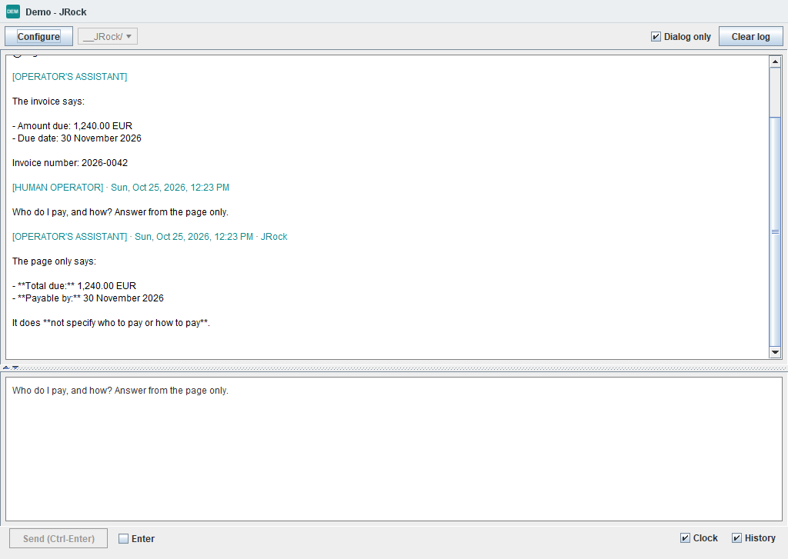

*History (Ctrl+E) with Dialog only (Ctrl+D): the second question — "Answer from the page only" —
is answered against the page attached to the first, because the whole prior dialog was resent.
Every gray line is hidden, so what's left is a clean, copy-pastable transcript, and the header
timestamps keep the order of these stateless turns visible.*

#### Local prompt cache

With **Local prompt cache** on in Configure — the default — a prompt that was answered before
is **answered again from that answer, with no call to Bedrock**:

```
Local prompt cache: this prompt was answered before - reusing __JRock/messages/20261009-101500-120-assistant.txt, with no call to Bedrock.
```

in place of the `Calling [xai.grok-4.3] at /openai/v1/chat/completions ...` line, and the reply is logged as a
reply like any other. "Answered before" means **any** message in `__JRock/messages/` — not only
the ones the log still shows: every `-operator.txt` there, by the SHA-256 of its text, paired
with the `-assistant.txt` written after it. A request that failed has no answer after it and is
not in the cache. The same text names the same files: its `@img`/`@txt` tokens are hashes, and
a send checks that each include's file still hashes to its token *before* the cache is asked —
so a changed file is a different prompt.

The table is built from the folder **once**, when a session begins with the setting on (the
session report says how many answered prompts it found), and kept up to date as each message
is written, so the folder is never read again and a hit reads only the one answer it reuses.
Turning the setting **off** empties the table; turning it back **on** builds it afresh from
the folder — which is also the moment to clean `__JRock/messages/` up by hand, if old answers
should not be reused.

Only for a prompt that goes **without** [History](#conversation-log)'s earlier messages: a
message file holds the one message, and nothing on disk says what conversation an answer was
given in. Nor does it say which model gave it, or what [Clock](#clock) §09 told it the time was —
an answer is reused exactly as it was given.

| Asked again with… | Cache |
|---|---|
| the same text, same includes, same bytes | **hit** — the old answer, no call, no charge |
| one character changed | miss: a different prompt |
| the same text, but an include's file edited since | miss — every token is re-hashed *before* the cache is asked |
| [History](#conversation-log) on | not consulted: the request is a conversation, not a prompt |
| after a send that **failed** | miss: no answer was written after that message |
| a different model, or [Clock](#clock) §09 now on | **hit** — nothing on disk records either, so an answer comes back exactly as it was given |
| the setting turned off and on again | rebuilt from `__JRock/messages/`, which is the moment to delete what should not come back |

## Clock

**Clock** — the checkbox left of *History*, **on by default** — sends the current
local time with each message, as one extra `system` message ahead of the dialog — and with it
**your name**, when one is set in [Configure](#configure-dialog-top-left-button) §28:

```
The current date and time is 2026-09-22 14:07:31 +02:00 (Europe/Berlin). The operator you are
talking to is called Ivan.
```

The zone is named in full (`Europe/Berlin`), not just offset: a model that knows the zone knows
about summer time, holidays and business hours, which an offset alone doesn't say. Without this
a model has no idea what day it is - the request carries no clock of its own.

**Plain sentences, not markup.** This used to be `<clock><now>…</now></clock>`, and the argument
for that shape was that tags mark injected context off from the conversation so that nothing in
it can be read as something you said. But the message is sent with role `system`, which marks it
off already — that is what the role is *for* — and tags buy nothing a model needs twice. What
they cost is read by everything else: a sentence is what a language model reads best, it is what
the smaller models read *at all* (the push-to-talk appendix is prose for the same reason), and it
is what you see in the raw request in your own log. Markup in a conversation with something that
speaks language is a habit rather than a requirement. The sentences are in **English** even where
the conversation is not: the model reads them, and a model asked in Russian answers in Russian
whatever language it was told the time in.

**Your name is optional and off until you set it.** *Your name:* in Configure's General tab,
kept per folder as `operator$` — because a folder is often an agent's rather than a person's: the
push-to-talk folder is *Ivan* and the one a flow files letters in is nobody. Empty is the whole
of "not set": no sentence is sent, and your header lines end at the time. With no name and Clock
unticked there is no `system` message at all.

The checkbox is kept per folder, as `clock$` in
[`__JRock/jrock-config.txt`](#persistence-crash-recovery--full-local-history) §10, so a folder whose
model cannot take a `system` message — Voxtral, say — stays unticked from one start to the next.

It is **not** part of the conversation. It is never shown as a turn, never resent by *Extend
conversation*, and never read back from disk: what goes with the request is always the time
**now**, not the time some earlier message was sent. It is saved once, for debugging, as
`__JRock/messages/<datetime>-clock.txt` beside the operator's and the assistant's own files, and
it appears verbatim (unmasked) in the raw request dump - the point of logging a clock being to
see what time was actually sent.

The clock goes with every request the checkbox is ticked for, whatever else that request carries
— text, images, a recording. Nothing is rearranged and nothing is switched off for you: if a
model turns out not to want a `system` message beside what you are sending it, untick Clock and
send again, which is one click in the same window.

**Clock is the only time the model is told.** It is not the date printed after a role header,
which [**History**](#conversation-log) §08 turns on: that one is written for you to read the transcript by
and is never sent, however many dates the log shows. Right-click (or long-press) either checkbox
and it says so itself — untick Clock and the model knows nothing about the time.

## Persistence (crash recovery + full local history)

Everything lives under a **`__JRock/`** subfolder of the working directory — git-ignored, and
written atomically, so a crash or a failed write never leaves a truncated file.

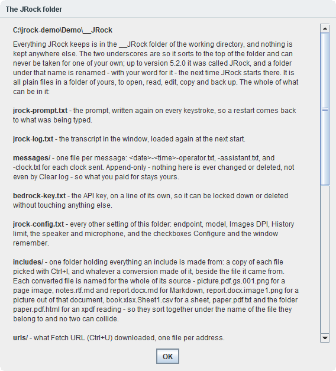

*The same list the window will show you, from the first item of the folder's own menu: nothing
JRock keeps has to be guessed at.*

**Why the two underscores.** The working directory is *your* folder — your documents, your
scans, your project — and a subfolder called `JRock` sat in the middle of it looking like one
more of your own, sorted in among them and easy to lose. `__JRock` sorts to the top of every
listing and reads as something the tool put there, the trick `__MACOSX` plays in a zip. It is
deliberately **not** `.jrock`: a leading dot hides the folder on macOS, on Linux and in most
file dialogs, and this is a folder you are invited to open, read, copy and back up.

**Up to 5.2.0 the folder was called `JRock/`.** Starting JRock 5.3.0 in such a folder offers
the rename and does not start until it is done: *Rename it now*, or quit and rename it in
Explorer yourself — nothing inside the folder is touched either way, only the folder's own
name. If the rename fails (usually something in there is open — an editor on the log, an
Explorer window inside the folder, a sync client), JRock says what failed and stops, with
nothing changed. It stops rather than starting beside the old folder on purpose: the log, the
transcript, the API key and your settings are all in there, and a session that quietly started
next to them would look exactly as though they had been lost. The same offer comes up when
*Configure* is pointed at a folder last used by an older version, and `--cli` / `--include`
— which nobody is watching — do the rename and report it. A folder holding **both** names is
refused outright: which of the two logs, configs and keys is yours is not a question a program
should answer for you, so move what you want to keep into `__JRock/` and delete the rest.
Backup zips written before 5.3.0, whose entries are all `JRock/...`, still load — their
contents land in `__JRock/`.

The folder holds:

- `__JRock/jrock-prompt.txt` — the prompt, autosaved on every keystroke (atomic temp-file swap,
  so a crash can't corrupt it).
- `__JRock/jrock-log.txt` — the conversation transcript, restored on startup so a session
  survives restarts.
- `__JRock/messages/` — one **append-only** file per human/assistant message
  (`<datetime>-operator.txt`, `<datetime>-assistant.txt`), plus a `<datetime>-clock.txt` for
  each clock that was sent (see [**Clock**](#clock) §09). These are never modified or deleted (not
  even by Clear log). `cat`-ing the operator's and the assistant's in order reproduces the
  dialog-only transcript.
- `__JRock/bedrock-key.txt` and `__JRock/jrock-config.txt` — the API key, and the endpoint, model and
  images DPI (see [**Settings files**](#settings-files) §11).
- `__JRock/includes/` — **one flat folder** holding everything an include is made from: a copy of
  each file picked with Ctrl+I (when **Include from processed copies** is on — see [**includes
  that outlive the session**](#includes-that-outlive-the-session)), and whatever a conversion made
  of it, beside the file it came from. Each converted file is named for **the whole of its
  source**, extension and all, so they sort together under the file they belong to and no two can
  collide:

  | included | written beside it |
  |---|---|
  | `scan.pdf` as page images | `scan.pdf.gs.001.png`, `…002.png`, … (`.pdfjs.` in the browser) |
  | `scan.pdf` as xpdf text / HTML | `scan.pdf.txt` / the folder `scan.pdf.html` |
  | `notes.rtf` as Markdown | `notes.rtf.md` |
  | `report.docx` | `report.docx.md`, and `report.docx.image1.png` … for its pictures |
  | `book.xlsx` | `book.xlsx.Sheet1.csv`, one per sheet |

  It is **flat**, with one exception: the names already guarantee uniqueness, so a subfolder per
  conversion would add nothing but a path to remember. The exception is an xpdf HTML reading,
  which `pdftohtml` writes as a folder of pages — that folder is one reading, and [**Cleanup JRock
  files...**](#cleaning-up-the-window-menu) deletes it whole.
- `__JRock/urls/` — what **Fetch URL** (Ctrl+U) downloaded, one file per address (see [**fetching a
  URL**](#fetching-a-url)).
- `__JRock/wav/` — the audio, a file of its own per narration and per recording, each named for
  the moment it was made: `narration-<date>-<time>.wav`, `recording-<date>-<time>.wav`, and
  `transcribe-<date>-<time>.wav` where a recording was transcribed into the prompt instead of
  included (see [**Narrate**](#narrate-windows-and-the-browser) §31 and
  [**recording from the microphone**](#recording-from-the-microphone-ctrlspace) §31).

  These three — `includes/`, `urls/` and `wav/` — are what [**Cleanup JRock
  files...**](#cleaning-up-the-window-menu) sweeps by age, along with the backup zips. They hold
  material; everything else in the folder is record, and is never touched.
- `__JRock/jrock-context-menus.reg` and `__JRock/jrock-context-menus-removed.reg` — on Windows,
  exactly what the [installer](#the-installer-installerinstalljrockjava) §36 applied to the registry
  and exactly what it took away first, kept so both can be read, run again or undone by hand.
  JRock itself writes no registry entries; `InstallJRock.java` does (see [**Explorer right-click
  integration**](#windows-explorer-right-click-integration)).
A `jrock<digits>.tmp` or a `scaling-<digits>` file is a save or a resize in progress and goes by
itself; neither is ever included or sent. The whole list is in the window too, under **What is in
the JRock folder...** in the menu behind the `__JRock/` label beside *Configure*, and in the
**Help** window's *The JRock folder* box — so nothing in there has to be guessed at.

**That is the whole list, the agents included.** Each agent keeps what it hands a model in a
folder of its **own**, beside `__JRock/` rather than inside it: `PTTFiles/` for
[push-to-talk](#the-first-agent-push-to-talk-jrockpushtotalkjava) §19, `TBFiles/` (with `mail/` and
`attachments/` in it) for the [mail
agent](#a-fifth-agent-thunderbird-your-calendar-and-your-mail-jrockthunderbirdjava). This folder
holds the API key, the settings and the whole transcript; somebody's mail has no business among
them, and a folder per agent can be found, synchronised, emptied or left out of a backup whole.

**And the list is checked.** A *folder* in there that is none of the above is named in the
session report at startup and then offered up: **Remove them**, with everything in them, or
**Keep them for now**. Older versions wrote `__JRock/gs-pdf/` and `__JRock/pdfjs-pdf/`, one
folder per converted PDF, before every conversion moved in beside the file it came from under
`includes/` — nothing reads those now, nothing sweeps them by age, and they are still holding
page images of documents from months ago, counted into every backup and, in the browser, against
the storage quota. It is an offer and not a tidy-up, because what is in them was converted from
your documents in your folder. **Nothing is remembered**, deliberately: keeping them is a fair
answer and you are asked again next start, because a "don't ask again" tick turns a folder nobody
wants into a folder nobody is ever told about again — which is how it became a hundred megabytes
in the first place. Move them out of there, by hand or with **Remove them**, and the question
stops for good. `--cli` names them and asks nothing. Files are left alone either way — a stray
one is a few hundred bytes, while a folder is a document's worth of page images.

*The prompt is written to `__JRock/jrock-prompt.txt` on every keystroke, through a temp file that
is then moved into place — so what is in the box survives a crash, a power cut and the close
button, and comes back as `Prompt source: recovered persistent file` in the next session report.
Nothing has been sent here; the log is still the startup report.*

The main log is a bit-perfect copy of the pane, except that each role header is followed by an
`@<datetime>` include-style reference to the message's own file under `__JRock/messages/`.

**Clear log** empties `jrock-log.txt` and the window but never touches `__JRock/messages/`, so
paid-for inputs/outputs are preserved. If the log has changed since it was last exported with
**Ctrl+Shift+S** (Save log as a copy), Clear log first asks for confirmation and suggests saving.

## Settings files

**Nothing is read from the environment.** Settings are files in the working folder, next to that
folder's log and prompt — files you can open, edit, copy, back up and delete. An environment
variable is the opposite: set in a shell that's gone by the time anything goes wrong, invisible
from inside the running application, and different for every way of launching it.

- **`__JRock/bedrock-key.txt`** — the Bedrock API key, on one line, and nothing else. Read at
  startup (trimmed of surrounding spaces) and written by the **Configure dialog** when you type
  a key into it. A folder that has none gets an **empty** file created, so there's an obvious
  place to put one; a key is never copied into a folder it wasn't typed for. It gets a file of
  its own because it's a credential: it can be locked down, kept out of a copy of the
  configuration, or deleted on its own.
- **`__JRock/jrock-config.txt`** — the **endpoint**, the **model** and the **images DPI**, so the
  next start comes up the way you left it. Seeded with the settings in effect when the folder
  has none. Per folder rather than per user on purpose: it is what lets one folder's
  [agent](#windows-agents-and-flows-one-entry-each) §33 run on one model, and another folder's run
  on a different one — or at a different DPI. An `images-dpi$` that isn't one of the values the
  Configure dropdown offers is reported in the startup log and ignored, since that dropdown
  could only show it as something else and then write that back. It also holds
  `narrate-device$` and `record-device$`, the one speaker [Narrate](#narrate-windows-and-the-browser) §31 plays on
  and the one microphone [Ctrl+Space](#recording-from-the-microphone-ctrlspace) §31 records from.
  Each is written only once one is set, and there is no default for either. On Windows,
  `narrate-voice$` is the voice Narrate reads in, by its Windows name; absent means whichever
  installed voice speaks the language of the text.
  `record-transcribe$` (`true`/`false`) says whether a recording is transcribed.
  `record-always-on$` (`true`/`false`) is [Mic always on](#mic-always-on) §31.
  `clock$` (`true`/`false`) is the [**Clock**](#clock) §09 checkbox; absent is `true`.
  `operator$` is your own name, written after the time on your header lines and sent with
  the clock; absent is not set, and nothing is sent or shown.
  `history$` (`true`/`false`) is the [**History**](#conversation-log) §08 checkbox; absent is `false`.
  `history-limit$` is the [**History limit**](#configure-dialog-top-left-button) §28, a number of
  requests; absent is unlimited, and it is written only once there is a limit.
  `request-extra$` is [**extra fields for the request body**](#extra-request-fields-request-extra),
  the one setting with no row in the Configure dialog.

| In `jrock-config.txt` | What it is | Absent means |
|---|---|---|
| `endpoint$` | the Chat Completions address | the built-in `bedrock-mantle` one |
| `model$` | the model id a send names | the built-in default |
| `images-dpi$` | what a page image is rendered at | 150; a value the dropdown has no item for is reported and ignored |
| `narrate-device$` / `narrate-voice$` | the one speaker, and the voice | nothing set — [Narrate](#narrate-windows-and-the-browser) §31 says so |
| `crackle$` | which tone crackles on that speaker while a model thinks | none at all |
| `record-device$` | the one microphone | nothing set — [Ctrl+Space](#recording-from-the-microphone-ctrlspace) §31 lists them |
| `record-transcribe$` | transcribe a recording into the prompt | `false`: include it as audio |
| `record-always-on$` | [Mic always on](#mic-always-on) §31 | `false` |
| `clock$` | the **Clock** tick | `true` |
| `operator$` | your name on your header lines, and in the clock | not set, and nothing is sent |
| `history$` / `history-limit$` | the **History** tick, and how many requests back | `false`, and unlimited |
| `include-pdf-as$` / `include-rtf-as$` | which [conversion](#multimodal-includes-ctrli) §14 an include uses | page images, and Markdown |
| `include-processed-copies$` | copy each picked file into `includes/` | `true` |
| `include-markdown-references$` | write a `` above an include | `false` |
| `include-missing-stops-send$` | refuse a send whose include has gone | `true` |
| `local-prompt-cache$` | [answer from `messages/`](#local-prompt-cache) §08 | `true` |
| `request-extra$` | [extra fields in the request body](#extra-request-fields-request-extra) | nothing added |
| `window$` | where the window was last ([Ctrl+M](#window-size-and-position-configure--window-ctrlm) §29) | centred, at its preferred size |

Both belong to the working folder, so they are adopted every time JRock takes a folder on:
startup, a change of working directory in Configure, a restore from a backup. In the browser both
files are the same files, kept in CheerpJ's persistent `/files/` — the key survives a reload
because it is on disk, not in a page's JavaScript. A hosting page has no say in either of them
on any platform — see [HTTP transport](#http-transport) §07.

The config format is a name on one line and its **value on the next**:

```
' JRock settings - https://github.com/ivan-khvostishkov/jrock
'
' A setting is a name ending in $ on one line, its value on the next.
' Leading and trailing spaces are dropped. Blank lines, and lines starting
' with ' (a single quote), are ignored.

endpoint$
https://bedrock-mantle.us-east-1.api.aws/v1/chat/completions

model$
xai.grok-4.3

images-dpi$
150
```

A value being a whole line of its own is the whole point: it can be cut and pasted **as a line**
in any text editor, with no quoting, no escaping and no "everything after the `=`, but trimmed"
to get wrong. Lines starting with `'` are comments, and blank lines separate the pairs.

### Extra request fields (`request-extra`)

One JSON object, on one line, whose fields go into **every** Chat Completions request beside
`model` and `messages`:

```
request-extra$
{"temperature":0.2,"modalities":["text","image"]}
```

For the endpoint that wants a field JRock has no setting of its own for. Chat Completions is a
specification with a great many optional parameters and a great many implementations, and which
of them one model behind one endpoint needs is not something this program can know the whole of:
a model that returns a picture only when the request says which output modalities it will take, a
sampling parameter a particular deployment insists on, a field an endpoint grew last month.
Setting it here beats waiting for JRock to grow a checkbox for each one.

- **The only setting with no row in the Configure dialog**, deliberately. What belongs in it is a
  line of JSON out of somebody else's API reference, and a dialog can neither check that nor
  explain it. The file is where a line like that is pasted, edited, and commented out again with
  a leading `'`.
- JRock **does not read the fields and has no opinion about them**. They are put in as written,
  so a wrong one comes back as the endpoint's own error message — which is the useful answer —
  and the [raw request in the log](#conversation-log) §08 shows exactly what went out, extra fields
  and all, because the real request and the log's copy are built by the same code.
- The one thing checked is that the value **is one balanced JSON object**. A paste that lost its
  last brace is reported in the startup log and ignored, rather than failing every send on a
  request nobody can read. When it is set and usable, the startup log prints it in full: a field
  that changes what every request asks for should be visible at the top of the log, not left to
  be noticed in the raw request of the first send.
- It is **written back as it was read**. No dialog sets it, so nothing in JRock would otherwise
  stop a line it knows nothing about from being dropped the next time any other setting is saved.

| What you put in it | What happens |
|---|---|
| `{"temperature":0.2}` | every request carries it; the startup log prints it in full |
| `{"modalities":["text","image"]}` | what [a picture in the reply](#a-picture-or-a-recording-in-the-reply) §14 needs from some models |
| a field the endpoint rejects | the endpoint's own error, in the log, with the raw request beside it |
| `{"model":"something-else"}` | goes out as written — JRock has no opinion, including about fields it also sets |
| a paste missing its last brace | reported in the startup log and ignored; sends carry on without it |
| `' {"temperature":0.2}` | commented out, like any line in this file |
| nothing at all | nothing is added — and the line survives every other setting being saved |

## Keeping the folder: backup, restore, cleaning up

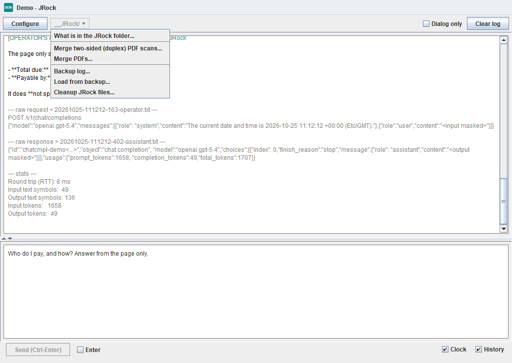

*The label beside Configure names the folder, and every item in its menu acts on that folder.*

### Backup and restore

The whole working folder in one file, from the **window's menu** (click the **`__JRock/`** label
beside *Configure*):

- **Backup log...** asks for a `.zip` name - offering `jrock-backup-yymmddhhmm.zip`, in the same
  folder *Save log as* opens in - and packs the entire `__JRock/` directory into it: the log, the
  prompt, every message file, the includes and everything the conversions wrote. The Send button
  is held while it runs, and the log says how many files and bytes went in.
- **Load from backup...** takes two paths: the archive (with a *Locate...* button) and the
  working directory to unpack it into (with a *Choose...* button). If that directory isn't
  empty it asks **Overwrite everything?** first. Then `__JRock/` is deleted, the archive is
  unpacked in its place, and JRock **switches to that directory** - re-reading its log and its
  prompt exactly as it does when the working directory is changed in Configure.

An archive has to hold a `__JRock/` folder — or a `JRock/` one, as every backup written before
5.3.0 does, whose contents then land in `__JRock/` — or it is refused, which is what keeps *Load
from backup* from unpacking some unrelated zip over a working folder; nothing in it can be
written outside the chosen directory whatever the entry names say. A backup can't be saved
inside `__JRock/` either - that is the folder being packed. A target directory that still has a
`JRock/` folder of its own is refused as well: a restore ends by switching JRock into that
directory, and [a folder may hold only one of the two
names](#persistence-crash-recovery--full-local-history).

**Autobackup log** (Configure dialog, on by default) does the same thing by itself: five minutes
after the cursor last moved in the prompt, it takes a backup with the dated default name and no
dialog at all. Once per idle spell, not every five minutes - a window left open overnight has one
backup, and the next keystroke arms it again.

A backup is taken of a folder JRock is still writing to, and it is written to survive that. The
prompt is autosaved by writing a `jrock<digits>.tmp` beside it and moving it into place, so those
names appear and vanish in milliseconds; they are **not** packed — what one of them is about to
become is in the zip either as it was before the write or as it is after it. Any other file that
turns out to be gone or unreadable when its turn comes is skipped and counted, and the log says
so (`... file(s) were being written while the backup ran`) rather than the whole backup failing on
it. No lock is taken on the folder: JRock's own writes happen on the UI thread, so a lock held for
the length of a zip would stall typing rather than the write, an OS file lock means nothing to the
editor or sync client that may be in that folder too, and the browser build's filesystem has no
such lock to take.

### Cleaning up (the window menu)

**Click the `__JRock/` label beside Configure → Cleanup JRock files...** — beside Backup log... and
Load from backup..., because the backups are among the things it deletes.

What grows in a JRock folder is everything JRock has written **for itself**, and it grows per
action rather than per conversation — so those are the four places this sweeps:

| | what is in it |
|---|---|
| `__JRock/includes/` | every page of every PDF as a PNG, a CSV per spreadsheet sheet, the Markdown of every DOCX and the pictures out of it, the folder an [xpdf reading](#pdf-as-html-or-text-xpdf) §15 of a PDF becomes, a copy of every file ever attached |
| `__JRock/urls/` | one file per address [Fetch URL](#fetching-a-url) §14 has ever been given |
| `__JRock/wav/` | one file per [narration](#narrate-windows-and-the-browser) §31 and per [recording](#recording-from-the-microphone-ctrlspace) §31 |
| the working directory | the `jrock-backup-*.zip` files, each one the whole folder zipped again |

A year of filing letters is a gigabyte of page images nobody will open, and a year of talking to
JRock is a folder of `.wav` nobody will play.

1. **A dialog asks for a number of days**, **10** by default. Everything older than that, in
   those four places, goes.
2. **It says what it found before it deletes anything**: how many items, how many bytes, how many
   in each place — and only the places that had something, since a line naming a folder nothing
   was deleted from reads as though something was — and that they do **not** go to the Recycle Bin.
3. The log names the total and the places it came from, and **names anything that would not
   delete** — a file held open by something is worth knowing about by name rather than by count.

**A folder under `includes/` goes whole.** One xpdf reading of a PDF is a folder of page HTML and
page images, written there by the conversion as a single unit, and it is of no use with half its
pages deleted — so it is counted and deleted as the one thing it is. That is the only place a
folder is touched at all.

**`__JRock/messages/` is never touched**, and that is the point of doing this by hand rather than on
a timer: the messages are the transcript's own evidence — every request and every reply, in full,
as text — and text is nothing. A thousand exchanges is a few megabytes, and what was actually
said is the one thing anybody asks for a year later. The log, the prompt, the settings and the key
are left alone too.

Judged by the **file system's own modification time**, and nothing else: a converted copy carries
no date of its own (its name is its source's), and "how long has this been sitting here" is
exactly what a modification time answers — the same date Explorer shows. Only what is **directly
in** those folders is considered, one level and no walk: the working directory holds your own
documents and your own folders, which a cleanup has no business going into — so a folder of yours
there is never even listed, let alone deleted.

**What is deleted is an attachment's file**, which is the thing to understand before saying yes: a
converted copy, a fetched page and a recording are all includes, and an include whose file has
gone **cannot be sent again** — the log says so if one is asked for. The file you attached in the
first place is of course untouched, and the transcript still holds everything that was said about
it. That is the bargain: the words kept for ever, the bytes behind them for ten days.

## Merging PDFs: plainly, and two-sided scans

### Merging PDFs (Ghostscript)

**Click the `__JRock/` label beside Configure → Merge PDFs...** — under *Merge two-sided (duplex)
PDF scans...*, which is the clever version of this one.

*a* + *b* + *c* = *d*: every page of every file you pick, in the order you pick them, each
document's own pages in its own order. A letter and its appendices into one document; a scan that
came out of the feeder in three goes; the pages somebody sent you one at a time.

1. A **multi-select file chooser**, filtered to PDFs — **pick them in the order they are to go**.
   Typing the names into the File Name box in quotes is what settles that order (and on a touch
   device it is how more than one file is picked at all).
2. **The order is listed back, numbered, and confirmed** before anything runs. This is the one
   thing the dialog has to get right: a chooser's multiple selection comes back in no dependable
   order, and here there is nothing to sort by — *a* + *c* + *b* is a perfectly good answer if
   that is what you meant, and no rule about names could know. Twenty pages merged the wrong way
   round are cheap to make and tedious to undo, so the list is where you check it.
3. **Save the merged PDF as** — offered as `<first file>-merged.pdf`, deliberately not the
   duplex merge's `.Merged.pdf`: they are two different documents made of the same scans. A name
   that is one of the files going in is refused, since the merge reads as it writes.
4. **One Ghostscript run**, and the order is the argument order: `pdfwrite` writes pages in the
   order they are interpreted and Ghostscript interprets its files left to right. No page
   arithmetic, nothing counted, so a document's pages keep their own order because nothing asks
   for them one by one. The log names every file in the order used, then the result with its page
   count and size — and says that the files that went in are untouched.

In the **browser** build there is no Ghostscript and PDF.js does not write PDFs, so the item says
so instead of doing nothing.

### Merging duplex scans (Ghostscript)

**Click the `__JRock/` label beside Configure → Merge two-sided (duplex) PDF scans...** — alone
above its separator, under *What is in the JRock folder...*.

A sheet feeder with no duplex unit takes a two-sided batch in two goes: the first pass gives the
fronts, in order, and then the stack goes back into the feeder exactly as it came out of it — so
the second pass gives the **backs in reverse**, the back of the last sheet first. Two PDFs, neither
of them readable on its own, and interleaving them by hand is a job nobody does twice. This is the
`pdftk A=front B=back shuffle A1 BN A2 B(N-1) ...` one-liner, done with the **Ghostscript** a PDF
include already needs — no pdftk, no Python, nothing else to install:

1. A **multi-select file chooser**, filtered to PDFs. Pick exactly **two** — both passes of the
   same batch, in any order. **Their names decide which is the front pass: the earlier name is
   the fronts**, so `scan0166.pdf` is the front of `scan0166.pdf` + `scan0167.pdf`, whichever was
   clicked first. On a touch device, both names in the File Name box in quotes selects two files
   without a Shift key ([context menus](#context-menus-right-click--long-tap) §32).

   The chooser's own order is not used, because it is not an order: `getSelectedFiles()` comes
   back in the order the selection happened or the File Name box was parsed, which varies by
   look-and-feel and by how the files were picked — `"doc.pdf" "doc-2.pdf"` typed in that box
   could arrive back to front, and the merge would then pair every front with the wrong back.
   Names are compared **without the extension** (a plain compare puts `doc-2.pdf` *before*
   `doc.pdf`, `-` being 0x2D and `.` 0x2E) and with **digit runs as numbers**, so `scan9.pdf`
   comes before `scan10.pdf` on a scanner that does not pad its counter. The log says which file
   it took as which before anything runs:

   ```
   Duplex merge, front pass (the earlier name): C:\scans\scan0166.pdf
   Duplex merge, back pass (in reverse): C:\scans\scan0167.pdf
   ```

   So a pair named `front.pdf` and `back.pdf` merges with **`back.pdf` as the front pass**:
   the names are read, not understood. Rename them if that is not what you meant.

   | Two passes of a 3-sheet batch | Pages, in the file |
   |---|---|
   | `scan0166.pdf` — the fronts, in order | 1F, 2F, 3F |
   | `scan0167.pdf` — the backs, reversed by the feeder | 3B, 2B, 1B |
   | **merged**: front 1, back N, front 2, back N−1 … | 1F, **1B**, 2F, **2B**, 3F, **3B** |

2. A **save dialog** for the merged file, offering `<front-name>.Merged.pdf` in the folder you
   were just in — the front pass names it, its page 1 being the merged document's page 1.
3. Both passes are counted, and the merge runs: **front 1, back N, front 2, back N−1, …** — which
   is sheet 1 front, sheet 1 back, sheet 2 front, … because the second pass came out backwards.
   Ghostscript reads its arguments in order, so a `-dFirstPage`/`-dLastPage` pair in front of each
   named file picks one page out of it, and `pdfwrite` writes them in the order they are
   interpreted:

```
gswin64 -dNOPAUSE -dBATCH -dSAFER -sDEVICE=pdfwrite -o C:\scans\scan0166.Merged.pdf
        -dFirstPage=1 -dLastPage=1 scan0166.pdf  -dFirstPage=12 -dLastPage=12 scan0167.pdf
        -dFirstPage=2 -dLastPage=2 scan0166.pdf  -dFirstPage=11 -dLastPage=11 scan0167.pdf  ...
```

- **The page count comes first, and from the other Ghostscript.** The windowed build shows its
  progress in a window but writes nothing to a pipe, so the count is asked of the **console**
  build (`gswin64c`) instead: `runpdfbegin pdfpagecount`, a PostScript one-liner that reads the
  page tree and looks at no page at all. Ghostscript 10 and later interpret PDF differently, and
  there it fails — so the fallback is to interpret the file with no output device and read the number out
  of `Processing pages 1 through N.`, a line every version has printed for decades. That costs one
  pass over the document; the quick answer costs nothing.
- **The merge itself runs the windowed build** (`gswin64`, not `gswin64c`), which reports its
  progress in its own window and closes when it finishes — the log says so, since it has nothing
  to echo. The log line summarises the command rather than printing it: a full feeder names both
  files a few hundred times over.
- **A mismatch is refused, not merged.** Both passes feed the same sheets, so different page
  counts mean one of the two files is not the pass it was taken for — merging them would put the
  wrong back on every front. Picking one file, or the same file twice, or a merged name that is
  one of the scans, is refused the same way. Ghostscript is run from the folder the scans share,
  with bare file names, because every sheet names both files again and Windows stops accepting a
  command line at 32767 characters — past that the tool says so and suggests a shorter path or
  half the batch.
- **Nothing is deleted.** The merge ends in a line saying the two scans are untouched and to look
  through the merged file before deleting them, so a pass that went into the feeder the wrong way
  costs a second try, not a rescan.
- Not in the [browser](#jrock-web-in-the-browser) §05: the browser's PDF engine, PDF.js, reads PDFs
  and does not write them, so there the item says so and points to the desktop build.

## Multimodal includes (Ctrl+I)

Attach **text, image or audio** files to a prompt (and convert **PDFs**, **RTFs**, **DOCX** or
**XLSX** documents into text or pictures):

1. **Ctrl+I** opens a file picker. It's **multi-select**, so you can attach several files at
   once. It opens on **All supported files**, and the dropdown narrows that to one type at a
   time — no type is in two filters, so the filter only decides what you see, never how a file
   is read:
   - **Image files** (png, jpg, jpeg, gif, webp)
   - **Text files as is** (txt, md, csv, json, xml, html, svg, java) — sent exactly as they are on disk
   - **Audio files** (wav, mp3) — the recording itself, sent as an
     [`input_audio` part](#what-an-audio-include-is-sent-as) for a model that listens
   - **PDF files** — as page images (one PNG per page), as an **HTML folder** (xpdf's
     `pdftohtml -nofonts` into a folder under `__JRock/includes/`, then included as **Include
     directory...** would) or as **text** (`pdftotext -enc UTF-8` into a `.txt` there) — whichever
     **Include PDF as** in [Configure](#configure-dialog-top-left-button) §28 says, and the filter
     names it ([details](#pdf-as-html-or-text-xpdf) §15). The browser has no xpdf and always reads
     page images.
   - **RTF files** — converted to Markdown, or sent as is, markup and all, for a model that
     reads (and writes) the format itself: **Include RTF as** in Configure
   - **DOCX files, as Markdown text** — tables and **pictures** included: each picture is
     written beside the Markdown and referred to from it where the document draws it, so a
     document exported as DOCX and included back is the same document
     ([details](#rtf-and-docx-conversion-no-external-tool) §15)
   - **XLSX files, as CSV text, one file per sheet** —
     ([details](#xlsx-conversion-no-external-tool) §15)

   **Include from processed copies in __JRock/includes/** (Configure, **on** by default): each picked file
   is copied under `__JRock/includes/` first and included from the copy
   ([why](#includes-that-outlive-the-session)) — and an image bigger than the page it will be
   read on is **downscaled as it is copied**, to the **Images DPI** Configure is set to, so the
   copy is not always byte for byte. The conversions keep their results in its subfolders too.
   Turned **off**, files are included where they lie, and a PDF as page images, an RTF as
   Markdown, a DOCX or an XLSX — each of which has to write its result under `__JRock/includes/` — is
   refused, with a line in the log and a dialog naming the setting to turn back on.

   **Include directory...** (prompt context menu) picks a folder instead and includes every
   file in it the same way, by its type: first the folder's own files in name order, then each
   folder inside it in name order, the same way down — so the order is the same every time and
   a folder's files sit together in the prompt. `__JRock/` itself is never gone into, nor a link
   to a folder. A file of any other type is skipped, and the log says so for each. The log
   then gives the count of files included and skipped.
2. Each file is hashed (SHA-256, shortened to 12 hex digits). The hash → path mapping is kept **in memory only**
   (not persisted); every start reads the paths back out of the log
   ([below](#includes-that-outlive-the-session)).
3. A token `@img <hash>`, `@txt <hash>` or `@audio <hash>` is inserted at the cursor (one per
   file / per PDF page). Duplicate tokens for the same file are not added again (also checked
   across prior turns in Extend mode).
4. The log records each include with stats (locale-formatted numbers):
   - **Images**: dimensions, the size on paper at **Images DPI**, total pixel count, and file
     size in bytes — `Image: 514 x 529, 4.4 cm x 4.5 cm @ 300 DPI, 271,906 pixels, 58,280 bytes`.
   - **Text**: symbol count (Unicode code points) and file size in bytes.
   - **Audio**: what the header says — format, sample rate, channels, bitrate, playing time —
     and file size in bytes.

**Markdown reference above each include** (Configure, off by default) puts one line more above
every token, naming the file and saying what it is — that same stats line as its text:

```

@img 1f3a9c0b7e42
[Text: 1,204 symbols, 1,210 bytes](<meeting notes.txt>)
@txt 8b52e0ad91cc
```

A picture's reference is an image (`![...]`), anything else's a link (`[...]`); a name with a
space in it goes in angle brackets. The name is the file's name — the one picked, even when a
processed copy is what is sent — and for **Include directory...** its path from the working
directory, or its absolute path when the folder is outside it, since a folder's files can share
names. The model reads the line as the file's place in the text, and writes a picture's
reference back into its answer where the picture belongs — which
[**Export selected Markdown with images as DOCX...**](#markdown-export-rtf-and-docx) §30 then
places, by that name.

Image dimensions are read **straight out of the file header** — the PNG, GIF, WEBP and JPEG
headers all state the size in a documented place — rather than by decoding the image (an
`ImageHeader` class of its own, since byte-level format parsing has nothing to do with the
rest of JRock and is worth being able to read, and measure, on its own). That is
the same arithmetic on every platform, so the browser build reports the same numbers as the
desktop one; `ImageIO` could not, because in CheerpJ it reaches for the JDK's *native* colour
management (`UnsatisfiedLinkError: no lcms in java.library.path`), which a browser JVM does not
have. It is also less work: a 40 MB photo is not decoded in full just to say how big it is. If a header can't be read, the include still happens and the
log says the dimensions were unavailable — the bytes sent to the model are the file itself
either way, so none of this touches what the model receives.

### What an audio include is sent as

An audio include is **not** an image: nothing is downscaled, nothing is converted, and there is
no Markdown-reference variant, because there is no picture to place in an answer. The bytes on
disk are base64-encoded and sent as an `input_audio` content part beside the text:

```json
{"type":"input_audio","input_audio":{"data":"UklGRiQ...","format":"wav"}}
```

**The parts go in the order your prompt wrote them**, part for part, recording included:

```json
{"role":"user","content":[
  {"type":"text","text":"transcribe me the audio"},
  {"type":"input_audio","input_audio":{"data":"UklGRiQ...","format":"wav"}}]}
```

Nothing is sorted for you — not images before text, not a recording before the question it
belongs to. A prompt's segments and the files between them only mean anything in the order they
were written, and where the token sits is the one place that order is visible, so it is the one
place it is decided.

That is worth knowing, because a model can care. Voxtral treats a recording as the prompt rather
than as something the prompt is about: say *"hello operator"* into it and it says hello back, and
a question typed in *front* of the audio gets answered as a question about nothing — *"I'd be
happy to help! Please provide the audio you'd like me to transcribe"*, with the recording sitting
right there in the same message, counted in `prompt_tokens` and all. Its
[own examples](https://huggingface.co/mistralai/Voxtral-Mini-3B-2507) put the audio chunk first in
every one. The fix is a prompt, not a feature: put the `@audio` token first, or send the
recording with no text at all. Another model may want the opposite, which is exactly why JRock
does not choose.

The `format` is the file's own extension, lower-cased, and **wav and mp3 are the only two there
are**: [the API's schema](https://github.com/openai/openai-openapi) makes that field an enum of
exactly those. `m4a`, which is what a phone's voice memo hands back, is refused by the endpoint,
so the filter offers only files the request can carry. (`m4a`
*is* documented for the separate *transcription* endpoint, which JRock does not call; and
Voxtral's `input_audio` has no format field at all, decoding with libsndfile, which has no AAC.)

A path handed straight to `automationInclude` can still be anything, so one that is neither wav
nor mp3 is called out where it was picked rather than left to come back as an HTTP 400:

```
This would go out as input_audio with format "m4a", which the API does not take: the field is an enum of "wav" and "mp3", and an m4a comes back refused. Convert the file to one of those two first.
```

What the log reports is read **straight out of the header**, by an `AudioHeader` class that is
`ImageHeader`'s counterpart and exists for the same reasons: arithmetic on the first few
kilobytes, no decoder, no native library, nothing that behaves differently in the browser build
(the byte-order helpers are literally `ImageHeader`'s — a nested class can reach a sibling's
private statics). Both formats say enough to be worth reading:

| Format | Read from | Example log line |
|---|---|---|
| **WAV** | the RIFF chunks, walked for `fmt ` and `data` — so the playing time is exact | `Audio: WAV, 44.1 kHz, stereo, 16-bit, 1,411 kbps, 0:32, 5,644,844 bytes` |
| **MP3** | the first frame header after any ID3v2 tag; the playing time follows from the file size at that bitrate, which is why it says *at that bitrate* | `Audio: MP3 (MPEG 1 Layer III), 44.1 kHz, stereo, 128 kbps, 1:15 at that bitrate, 1,207,296 bytes` |

Anything else — including an MPEG-4 file that reached the include some other way — reports
*(nothing readable in the header)* and its byte count, which is the honest answer and is what
the file is charged by anyway. That is the deal the class is kept to: **a hundred lines** of
arithmetic and not one more, so when a format wants more than that (a VBR header for an exact
MP3 length, an MP4 box walk for a duration) the answer is the byte count, not a decoder inside
JRock. An `ftyp` box is recognised for one reason only — to stop the MP3 frame scan mistaking a
box for a frame sync and inventing a line about a file it cannot read.

Everything else is the machinery the other kinds already use: the same hash, the same
deduplication, the same re-check of every file on send, the same reload from the log at startup. One
place differs: the [masked request dump](#conversation-log) §08 prints `<audio masked <hash>>` where
the base64 would be, for the same reason images are masked — a minute of audio is about a
megabyte of it.

One thing to know before sending, though: the [**Clock**](#clock) §09 is a `system` message, and a
model that listens may refuse one beside a recording. A send with both warns and then goes as it
is; unticking **Clock** is the fix, and it is yours to make — once per folder, since the folder
remembers it.

**Fetch URL** does not download audio; audio comes from Ctrl+I.

### A picture or a recording in the reply

An include works the other way round too. A model that answers with an **image** or with
**speech** cannot put it in the text: what comes back is base64 in the message's one binary
field, with a media type beside it saying what it really is. JRock saves that payload into
`__JRock/includes/`, named after the moment it arrived, and **makes it an include of the
session** — so the picture is a file you own, in the folder the log names, with a hash of its
own:

```
Saved the png the reply carried (175,969 bytes): C:\work\JRock\includes\20261010-202058-403.png
Included @img 078adf22bb5d from C:\work\JRock\includes\20261010-202058-403.png
With a Markdown reference above it: 
Image: 1004 x 669, 17.0 cm x 11.3 cm @ 150 DPI, 671,676 pixels, 175,969 bytes
```

and the **answer itself carries the same two lines an include puts in the prompt**:

```

@img 078adf22bb5d
```

That is the point of doing it this way: **select the reply and export it** (Markdown, or
[DOCX](#images-in-the-docx) §30) and the picture is *in* the document, because the reference is
exactly what the export resolves. It is one include in every other respect as well — the same
hash, the same line in the log, the same reload of that line at the next start, so the answer
is still exportable after a restart.

- The **extension comes from the media type** the reply gave the payload — a `png`, a `jpg`,
  a `wav`, an `mp3` — which is also what decides the kind of token: an image is `@img`, a
  recording is `@audio`. A payload with no type at all (the Chat Completions audio output
  states its format in the *request*, not in the answer) is read from its own first bytes
  instead. Something neither says anything about is still saved, under `.bin`, and gets no
  token — a file nothing can be sent as is not pretended to be one.
- It respects [**Markdown reference above each include**](#configure-dialog-top-left-button) §28,
  the same setting an include from the dialog follows. Off (the default), the answer carries
  the bare `@img <hash>` and no reference line.
- The bytes are written **exactly as they arrived**, unlike an include's processed copy, which
  is downscaled to *Images DPI* on the way in. This one is the model's own output at the size
  it chose.
- A reply that is *only* a picture has no text, and says so rather than inventing some: a
  reply whose `content` is `null` is read as no text at all, and what the log shows is the
  reference and the token.

### Fetching a URL

The same include, for something that isn't on this machine. **Ctrl+U**, or **right-click the
prompt → Fetch URL...**, asks for an address, downloads it into `__JRock/urls/`, and includes the saved
file exactly as if you had picked it with Ctrl+I — a **web page, plain text, JSON or XML
as text**, an **image as a picture**. Two lines go into the prompt, the address above the token:

```
[](https://example.org/a/article)
@txt 1f3a9c0b7e42
```

The link says where the text or the picture came from, in a form the model reads as a
reference belonging to the content below it; the token is what is actually sent.

**What is pasted around the address is dropped**, so it can be copied carelessly out of a list or a
sentence: ` - https://example.com/ ,` is fetched as `https://example.com/`. Anything before the
first letter or digit goes, and so do trailing spaces, dashes, sentence punctuation and a closing
bracket the address never opened — `https://en.wikipedia.org/wiki/Java_(language)` keeps its own.
The log says how the field was read when that is not what was typed.

**The dialog is sized against the screen**, so it fits a phone as well as a desktop window, with
its **OK** button in reach. The explanation wraps to a width taken from the screen, and in the
browser the field asks for fewer columns, since the layout stretches it to the room there is
anyway. In the browser the URL row also carries a **Paste** button of its own, exactly like the [Bedrock API
key](#configure-dialog-top-left-button) row: an address is pasted rather than typed, and a button
is one tap that no browser gesture can take away.

What decides which of the two it is — and the extension the file is saved under — is the
**response's own `Content-Type`**, not the URL. A link ending in `.png` that answers with HTML
is a web page, and saving it as a PNG would only produce an `@img` token no model can read:

| It answers with | Saved as | Inserted as |
|---|---|---|
| `text/html`, `application/xhtml+xml` | `.html` | `@txt` — sent as text, markup and all |
| `text/plain` | `.txt` | `@txt` |
| `application/json` | `.json` | `@txt` |
| `application/xml`, `text/xml` | `.xml` | `@txt` |
| `image/png` | `.png` | `@img` — sent as a picture |
| `image/jpeg` | `.jpg` | `@img` |
| `image/gif` | `.gif` | `@img` |
| `image/webp` | `.webp` | `@img` |
| **anything else** | — | **nothing.** The type is named, in the log and in a dialog, and no file is written |

Details:

- **The file is named after the URL**, by its last path segment, with the extension its media
  type calls for *added* rather than substituted — `/a/article` → `article.html`,
  `/pics/cat.png` → `cat.png`, `/page.php` → `page.php.html`, and an address with no path of
  its own → `<host>.html`. Anything a file system might object to becomes `-`, and a very long
  name is cut. The same URL fetched twice is **one file** (same bytes, same name, nothing
  rewritten); a different page that wants a taken name becomes `article-2.html`, exactly as an
  [include copy](#includes-that-outlive-the-session) does.
- **The URL field has the focus** when the dialog opens, so Ctrl+U, Ctrl+V, Enter is the whole
  of it.
- **A page — or plain text, JSON or XML — is saved as UTF-8**, decoded first with the charset the response declares — an
  included text file is *read back* as UTF-8, so a page served as `windows-1251` would
  otherwise reach the model as mojibake. An image is saved byte for byte: those bytes are what
  gets sent.
- **`https://` is assumed** when the address has no scheme, so a bare `example.org/page` works;
  anything else keeps the scheme it was given, and one that is not `http` or `https` is
  refused by name. Redirects are followed (but not an `https` → `http` downgrade), and the
  address the bytes really came from is logged when it differs.
- **JRock names itself** in the `User-Agent`, as `JRock/<version>
  (+https://github.com/ivan-khvostishkov/jrock)` — a client that says whose it is, which bot
  filters such as Akamai's (in front of `helpx.adobe.com`, among others) let through.
- Because the file lands in `__JRock/urls/`, beside `__JRock/includes/`, it is **already in a folder
  you own**, as a copy is — a URL include survives a restart the same way, reloaded from the log at startup.
- **In the browser it goes through the page**, `window.myBrowserHttp.fetchUrl` — the same
  arrangement as the model calls, one more method on the same object, so both builds run the
  identical code above this line. The reply carries the status, the `Content-Type`, the address
  finally landed on and the bytes themselves, which is everything the rules above need. The one
  difference is the browser's, not JRock's: a page it fetches must allow cross-origin reads
  (**CORS**), and most sites do not. A site that refuses is named as such, and the dialog says so
  before you try.

### Includes that outlive the session

The hash → path map is not persisted, and a restart therefore loses it — while the prompt and
the whole transcript *are* restored from disk. So the tokens come back, and two things make sure
they still stand for their files: the files are kept where JRock can find them again, and the log
that says where they are is read back at every start.

**Include from processed copies in __JRock/includes/** — a checkbox in
[Configure](#configure-dialog-top-left-button) §28, **on** by default. A chosen file is **copied
into `__JRock/includes/` first and included from the copy**, so the log's line points inside the
folder you own:

```
Copied for the include: C:\photos\IMG_4002.jpg -> C:\demo\JRock\includes\IMG_4002.jpg
Included @img 1f3a9c0b7e42 from C:\demo\JRock\includes\IMG_4002.jpg
```

Two different files of the same name both survive, the second as `IMG_4002-2.jpg`; the same
file twice is not copied twice. A file already under `__JRock/includes/` is included where it is,
and so is anything the conversions wrote: they write into that same folder themselves, each
output named after the file it came from — so everything an
include is made from is in one place, and in one flat list. A fetched URL is saved beside it, in `__JRock/urls/`. A copy that
fails is reported and the original included anyway — the setting is there to keep a file within
reach, not to refuse the include. It matters most in the [browser](#jrock-web-in-the-browser) §05,
where an uploaded file lands in CheerpJ's `/uploads` and is gone after a reload, taking the only
path the log recorded with it. Turned off, every file is included where it lies — and a type
whose conversion has to write under `__JRock/includes/` is refused instead (see
[Multimodal includes](#multimodal-includes-ctrli)).

**And a copy is JRock's own file, so an oversized image is downscaled into it** — which is why it is a *processed* copy, not always a byte-for-byte one. The page a
picture is read on is A4 less 2 cm margins — the [DOCX export's](#images-in-the-docx) §30 text
frame — which at the [**Images DPI**](#configure-dialog-top-left-button) §28 in Configure has room
for a definite number of dots each way: 1004 × 1518 at the default 150. A phone photograph or a
600 dpi scan carries several times that, and the extra pixels are paid for twice, once in tokens
and once in the time spent sending them, without anybody ever seeing them. So the copy is scaled
to fit, and says its new size in its name:

```
Downscaled for the include: 4032 x 3024 -> 1004 x 753, which is what A4 at 150 dpi has room for.
Copied for the include: C:\photos\IMG_4002.jpg -> C:\demo\JRock\includes\IMG_4002-1004x753.jpg
```

One factor for both directions, so whichever of width and height binds, the picture keeps its
proportions; the reduction is done by repeated halving, because a single bilinear step reads four
pixels out of the dozens each new pixel covers and turns small print into aliased crumbs. JPEGs
are written back at quality 0.92 rather than ImageIO's default 0.75, legibility being the whole
reason for keeping the pixels that are kept. **PNG and JPEG only**: a GIF may be an animation
(ImageIO would hand back its first frame) and the JDK cannot read WEBP at all, so both are copied
at full size with a line saying why. A picture already within the page is copied byte for byte,
and a plain include is never rewritten — that file is not JRock's. The page here is A4 **portrait**
even though the [export](#markdown-export-rtf-and-docx) §30 can also write landscape: a copy is made
long before anybody picks an orientation in a save dialog, and portrait is the frame that is enough
for either — cut to it, a picture is placed at 300 dpi on a landscape page rather than stretched to
fill it.

**In the browser the page scales it.** CheerpJ's JVM has no image pipeline to do this with:
`ImageIO.read` on a JPEG goes looking for the native colour-management library it cannot load,
and its `Graphics2D` resamples nothing, so a copy scaled there would come out at full size. A
browser, on the other hand, decodes, resamples and encodes PNG and
JPEG in native code as a matter of course, so JRock hands the picture to the page over the
[bridge](#http-transport) §07 and gets it back smaller: `canvas`, the same repeated halving, the
same 0.92 for JPEG. A host page without that function means a full-size copy
and a line saying so, the same as any other scaling that could not be done.

**The includes are reloaded from the log at every start** — at startup, after the Configure
dialog, and after a restore from backup, as part of the session report. The log recorded every
include ever made, which is the same information the map held, so it is read top to bottom as the
history it is:

| In the log | What it means |
|---|---|
| `Included @img <hash> from <path>` (or `@txt`, or `@audio`) | remember `<hash>` → `<path>`, replacing an earlier path for that hash — the file was included again, perhaps from somewhere else |
| a message (yours or the model's) referring to a hash | that hash is wanted, at the path remembered for it **at that point**, so a later include cannot rewrite what an earlier message meant |

Both spellings of a reference count: the `@img`/`@txt`/`@audio` token, and the
`` a [Markdown reference](#multimodal-includes-ctrli) leaves — the log's
`With a Markdown reference above it:` line says which include that name stands for, and is read
back with it — an answer carrying one needs
the file to export as a DOCX with the picture in it. The current prompt is read last, being the
newest thing there is, and after a restart its recovered tokens are usually the whole reason for
doing this. The session report gets one line for it, and none when nothing refers to an include:

```
Includes reloaded from the log: 1 of 3 referred to, 1 with a missing file, 1 not recorded in the log - a send stops until each one is included again (the last 10 requests; "Reload all includes", in the prompt's menu, reads the whole log)
```

**A start reads the last few requests, not the whole log** — the folder's
[**History limit**](#configure-dialog-top-left-button) §28 when it has one, since that is already
your own answer to how much of this conversation still matters, and **ten** when it does not.
The reason is an agent's folder rather than a person's: a
[push-to-talk](#the-first-agent-push-to-talk-jrockpushtotalkjava) §19 JRock records every turn and
attaches it, so a month of talking is **hundreds of audio includes in one log** — and reading
all of them back at every start is work done for files no question will ever mention again. The
line says how far back it looked.

**And *Reload all includes* in the prompt's menu reads the whole log**, for the conversation
that reaches further back than that: every include line, every reference, from the first line of
the log to the prompt as it stands. It is also the repair for a map lost some other way — a
cleared log, a folder changed and changed back.

The cut keeps the **gray lines above** the oldest request it keeps, which is the one thing it
could get wrong: an include is recorded while the prompt is being composed, so the lines saying
where a request's files are sit immediately *before* it, and cutting at the request itself would
keep the token and throw away the path (`JRockReloadWindowTest`).

**Nothing is hashed here**, deliberately. Whether each file is still the file it was is exactly
what the send checks, one hash per token, and the answer can change between the two moments
anyway — so starting is cheap on a folder of large attachments, and a file that has been edited
since is caught at the only moment that matters.

**A file that is still missing stops the send**, with **Stop a send on a missing include** on in
[Configure](#configure-dialog-top-left-button) §28 — the default. A token whose file is gone, cannot be
read, or has no include line in the log is named in the log, one line per file, right after your
message, and nothing goes to Bedrock:

```
Missing include: included file is missing: C:\demo\JRock\includes\quarterly.rtf.md (@txt 8b52e0ad91cc).
Missing include: @img 4d0c1a77e6b3 is not known - no include of it is recorded in the log.
Not sent: 2 included files are missing. Include them again with Ctrl+I, or turn off "Stop a send on a missing include" in Configure to send their tokens as text.
```

Turned **off**, the same files are a `Warning:` each and the send goes on: each token goes to the
model as the text it is — `@img 1f3a9c0b7e42` rather than the picture — while everything else is
sent as usual:

```
Warning: included file is missing: C:\demo\JRock\includes\quarterly.rtf.md (@txt 8b52e0ad91cc); sent as text.
Warning: @img 4d0c1a77e6b3 is not known - no include of it is recorded in the log; sent as text.
```

A file that is there but has **changed** since it was included still stops the send: it is a
different file now, and including it again is the fix.

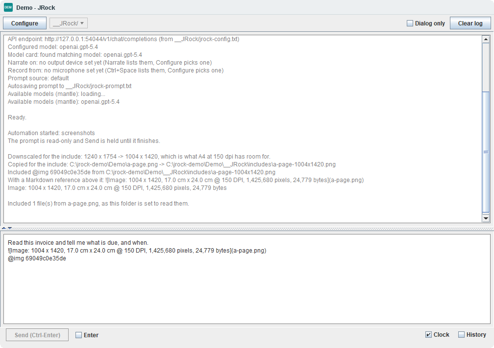

*A question, and the page it is about: one include is a token in the prompt, a Markdown
reference above it, and two lines in the log saying what was copied and what it was
downscaled to.*

## Converting what you include: PDF, RTF, DOCX, XLSX

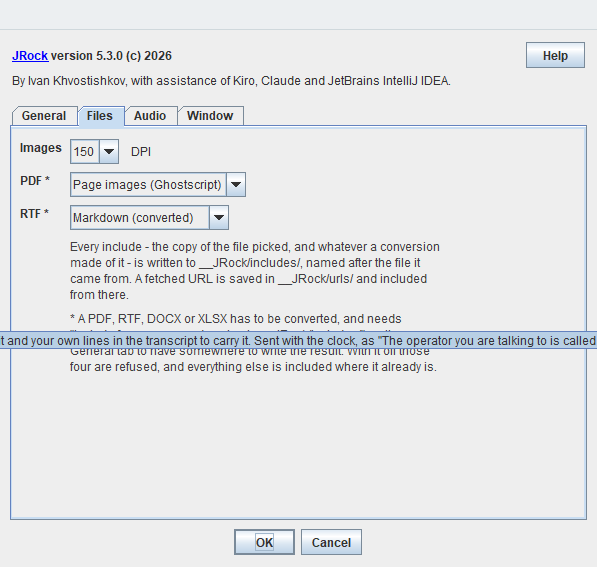

*Which conversion each kind of file gets is a setting, and this is where they are: the DPI a page
is rendered at, the two include modes, and what JRock keeps beside the original.*

### PDF conversion (Ghostscript)

Selecting the PDF filter runs **Ghostscript** to convert the PDF, one page image per page, then
includes each produced page. Ghostscript must be on your PATH: `gswin64` on Windows, `gs` on
macOS and Linux. In the [browser](#working-with-pdfs) §06 the same filter renders with PDF.js
instead, into `__JRock/includes/`.

**Page images, not Ghostscript text.** There is no text filter on Ghostscript's `txtwrite`
device, because `txtwrite` takes the text operators as they come and hands back something a model
has to guess at — no headings, no tables, columns interleaved. A PDF's text goes through
[xpdf](#pdf-as-html-or-text-xpdf) instead. A scan has no text layer to extract in the first
place, and goes as page images.

A long conversion says so while it runs, rather than after. The command line is logged before
Ghostscript is started, and the conversion happens off the UI thread so the window stays
alive. On **Windows** JRock runs the **windowed** build (`gswin64.exe`, preferring it over
`gswin64c.exe`), which reports its progress in its own window and closes when finished.
Everywhere else the console `gs` is run with `-q` omitted, and its progress — `Page 1`,
`Page 2`, … — is echoed into the log as `gs:` lines while it works.

- Output is written under **`__JRock/includes/`**, named `<pdfname>.gs.NNN.png` — page images at
  the **Images DPI** set in Configure (150 by default), the page's physical size being the
  PDF's own business.
- The exact Ghostscript command and its output are echoed to the log.
- If Ghostscript isn't found on your PATH, JRock logs a note, shows a dialog, and opens
  https://ghostscript.com/ so you can install it.


*A page attached with Ctrl+I, before anything is sent. In the prompt: the `!​[Image: ...](a-page.png)`
reference with the pixel size, the centimetres it will print at, the DPI and the byte count, and
the `@img` hash token under it. In the log, what the include did — the copy into
`__JRock/includes/`, the hash it is known by from now on, and the dimensions it was read from the
file's own header.*

### PDF as HTML or text (xpdf)

Two more PDF filters, desktop only, use the **Xpdf command line tools** by Derek Noonburg, from
https://www.xpdfreader.com/ — `pdftohtml` and `pdftotext` must be on your PATH. They hand a model
the PDF's text, in reading order, rather than pictures of it.

- **PDF as HTML folder, with xpdf** runs `pdftohtml -nofonts <pdf> <folder>`, then includes the
  folder as [**Include directory...**](#multimodal-includes-ctrli) §14 does: each `pageN.html` (and
  `index.html`) as `@txt`, each page's background `pageN.png` as `@img`.
- **PDF as text, with xpdf** runs `pdftotext -enc UTF-8 <pdf> <name>.txt` and includes that file
  as `@txt`, as it is.

| Include a PDF as | Runs | Attaches | Keeps |
|---|---|---|---|
| **page images** (the default) | Ghostscript, or PDF.js in the browser | one `@img` per page | the page exactly as it looks |
| **HTML with pictures** | `pdftohtml -nofonts` | each `pageN.html` as `@txt`, each `pageN.png` as `@img` | the reading order, and the pictures |
| **text** | `pdftotext -enc UTF-8` | one `@txt` | the text, in reading order |

A scan has no text layer, so both xpdf modes come back empty on one — which is
[the test](#the-pdf-already-has-a-text-layer-do-i-need-ocr-at-all) §03 for whether a document is
pictures of words.

The output goes **under `__JRock/includes/`, named after the whole of the PDF's name**: `report.pdf`
gives the folder `report.pdf.html` or the file `report.pdf.txt` there — extension and all,
deliberately, because the stem alone would turn `report.pdf` into `report.txt`, and that is a name
a text file of your own can already have. Everything an include is made from shares that one
folder, so a conversion must not be able to land on top of something that was put there.

**Nothing is asked, and the folder your documents are in is not written into.** The pages are
working material for the model — the readable copies are whatever you export — so they go where
the Markdown of every converted document and every processed copy already goes, they are cleaned
up by age with the rest of them (**Cleanup JRock files...**), and a document folder keeps the
document and nothing else. That is also why there is nothing left to answer: the conversion is
JRock's own file, so creating it needs no permission, and an earlier conversion of the same PDF is
replaced rather than reused, so the pages always say what the PDF says now. It needs **Include
from processed copies in `__JRock/includes/`** on, like every other conversion. The command and the
tool's own output are echoed to the log. If a tool isn't found on your PATH, JRock logs a note
and, when a person is there to read it, shows a dialog and opens xpdf's download page.

### RTF and DOCX conversion (no external tool)

Selecting **RTF as Markdown text** or **DOCX as Markdown text** converts the document to
Markdown and includes *that* file as an ordinary `@txt` token — so what the model receives is a
text part, and the prompt shows one token for the document.

Nothing has to be installed, unlike the PDF path. The RTF reader is the JDK's own
`javax.swing.text.rtf.RTFEditorKit`, the same one a `JTextPane` uses; a `.docx` is a ZIP of XML,
so it is read with `java.util.zip` and the JDK's XML parser. Both work on a bare JVM — and in a
browser tab, where no subprocess can run at all. Markdown rather than flat text because the
formatting is what these formats are for: headings, bold, italic and (from a `.docx`) tables
survive as markup a model reads as structure instead of being thrown away.

**From an RTF.**

- Output is written under **`__JRock/includes/`**, named `<rtfname>.md` — `notes.rtf` becomes
  `notes.rtf.md`, so two RTFs with the same stem can't overwrite each other.
- What is mapped, and nothing more:

  | In the RTF | In the Markdown |
  |---|---|
  | paragraph | a block, separated by a blank line |
  | bold, italic | `**bold**`, `*italic*`, `***both***` |
  | a font size larger than the document's body size | a heading — `#`/`##`/`###` by how much larger (6 pt, 3 pt, any), short lines only |
  | a bullet character (Word writes the bullet as text) | a `-` list item; `1.`, `2)` … are kept as they are |
  | a `HYPERLINK` field | `[the text it shows](its address)`, the text keeping its bold and italic; a link to a bookmark in the document (`HYPERLINK \l`) stays plain text |

  Markdown's own characters in the text (`*`, `` ` ``, `\`, a leading `#`) are escaped, so a
  document that talks about asterisks still says so.
- **Not** attempted: tables (RTF table rows reach the reader as ordinary paragraphs, so their
  cells run together), embedded images, colours, alignment. Underline has no Markdown of its
  own and stays plain text rather than being invented into emphasis.
- A file that isn't really RTF (some other document renamed, say) has no text the reader can
  find; JRock logs that and includes nothing, rather than attaching an empty file.

**From a `.docx`.** A Word document says what each paragraph *is* — a style name, a list
reference, a table cell — so the conversion reads that structure rather than guessing at it from
font sizes:

- Output is written under **`__JRock/includes/`**, named `<docxname>.md` — `quarterly.docx` becomes
  `quarterly.docx.md`, the same rule as for RTF — with the document's pictures beside it under
  the same prefix (see below).
- Only `word/document.xml` is read, with its relationships part for link addresses and picture
  parts, and only these parts of it:

  | In the document | In the Markdown |
  |---|---|
  | a `Heading1`…`Heading6` or `heading 1`… style (either spelling), or `Title` | `#` … `######` |
  | a paragraph with `w:numPr` (list markup) | a `-` list item — Word keeps the bullet in the numbering, not in the text |
  | a `Quote`-ish style | a `>` quote line |
  | a `Code`/`Preformatted`/`Listing`/`Source` style | an indented code block |
  | `w:b`, `w:i` on a run (`w:val="false"` switches it back off) | `**bold**`, `*italic*`, `***both***` |
  | `w:tbl` | a pipe table, with a `\| --- \|` separator after the first row; a `\|` inside a cell is escaped |
  | `w:tab`, `w:br`, `w:cr` in a run | a space; a `w:noBreakHyphen` a `-` |
  | runs Word split mid-word | one word — adjacent runs with the same bold/italic are joined back together |
  | a `w:hyperlink`, a `w:fldSimple` or a field spelled out over runs with a `HYPERLINK` instruction | `[its text](its address)` — the address read from `word/_rels/document.xml.rels` for a `w:hyperlink`; a link to a bookmark (`w:anchor`) stays plain text |
  | a `w:drawing` (`a:blip`) or a `w:pict` (`v:imagedata`) | ``, where the document draws it |

  Markdown's own characters in the text are escaped here too, so a document about asterisks
  still says so, and a `[`, `]` in a link's text or a space or parenthesis in its address is
  escaped so the link stays one link.

**And the pictures come out with it.** A `.docx` is the format that carries a document's graphics
without a PDF's page-image reading, so a document included here keeps them:

- Every picture the document draws is written beside the Markdown, **byte for byte**, named for
  the whole of the document's name and the picture's own part: `quarterly.docx.image1.png`,
  `quarterly.docx.photo.png`. A picture the document places twice is written once.
- The Markdown refers to it by that name, on the spot where the document draws it — in a
  paragraph of its own, or inside a sentence, wherever that is. The alt text in the square
  brackets is the **alternative text** the document gives the picture (Word's *Alt Text* box);
  where it gives none, the file's own name stands there.
- Each picture is included as an `@img` token of its own, so the model reading the document is
  given the pictures of it as well as the words, and the [**DOCX
  export**](#markdown-export-rtf-and-docx) can place them again under the names the text refers
  to them by.
- So the round trip holds: **export a document as DOCX with its images, include it back, and it
  is the same document** — text, structure and graphics. That is what the format is for; a
  reading that keeps only the words is what TXT and RTF are there for. It is also what makes a
  DOCX the thing to hand to a word processor or an OCR tool and take back again — Acrobat's or
  ABBYY's *Export to Word* of a scan goes straight back in.
- A picture the document only **links to** on the web has no bytes in the package, so there is
  nothing to write out and no reference is written for it. Nor is one in a format a request
  cannot carry — a pasted chart or an equation is usually an **EMF** or a **WMF**, and a request
  takes PNG, JPEG, GIF and WEBP: a reference to a picture neither the model nor the export could
  read would be a reference to a hole in the document. The log names the formats it passed over,
  so *"where did that chart go"* has an answer; saving the document with those pictures as PNG
  brings them in.
- **Not** read: `numbering.xml` (so every list level is a `-`, and numbered lists are not
  renumbered), headers, footers and footnotes, colours, alignment and
  underline (which has no Markdown of its own, same as on the RTF side). With track changes on,
  an insertion is read as the text it is and a **deletion is not read at all** — `w:delText` is
  text someone took out, not text the document says.
- A file that isn't really a `.docx` — an older `.doc`, a PDF, anything renamed — has no
  `word/document.xml`, and the log says exactly that: *Could not read DOCX renamed.docx: no
  word/document.xml inside it - is it really a Word .docx?* Nothing is included and no
  Markdown is written.

### XLSX conversion (no external tool)

| | **XLSX** | **DOCX / RTF** | **PDF** |
|---|---|---|---|
| Read with | `java.util.zip` + the JDK's XML parser | the same (RTF: Swing's reader) | Ghostscript, xpdf, or PDF.js |
| Needs installing | **nothing** | **nothing** | Ghostscript or xpdf on the desktop |
| Works in the browser | yes | yes | yes, through PDF.js |
| Becomes | one CSV per sheet, `@txt` each | one Markdown file, `@txt`, plus its pictures as `@img` | page images, or xpdf's HTML/text |

Selecting **XLSX as CSV text, one file per sheet** writes every sheet of the workbook, in tab
order, as its own CSV and includes each as an `@txt` token, so a workbook of three sheets is
three tokens. Like a `.docx`, an `.xlsx` is a ZIP of XML, read with `java.util.zip` and the JDK's
XML parser, so this works with nothing installed and in the browser too.

- Output is written under **`__JRock/includes/`**, named `<xlsxname>.<sheet>.csv`, so
  `stock.xlsx` with a sheet *Sales Q1* gives `stock.xlsx.Sales Q1.csv`. A character Windows
  forbids in a file name becomes `_`.
- What a cell becomes:

  | In the sheet | In the CSV |
  |---|---|
  | text, shared or inline | the text; rich-text runs joined, phonetic guides left out |
  | a number | the number as the file stores it, not rounded to the places shown |
  | a number in a date or time format | **ISO**: `2026-10-04`, `2026-10-04 18:00:00`, or `18:00:00` for a time alone, whatever the sheet's own format says (the 1904 date system too) |
  | `TRUE` / `FALSE`, an error | `TRUE` / `FALSE`, the error as shown (`#N/A`, `#DIV/0!`, …) |
  | a formula | its last calculated value, as above |

  Dates are ISO so the CSV reads the same on any machine: Excel's short date follows the
  reader's locale, and the file does not record it.
- Rows and columns keep their places: an empty cell is an empty field and an empty row an empty
  line, so *row 7, column C* is the same cell in both, and every line has the same number of
  fields. A field with a comma, a quote or a line break in it is quoted (RFC 4180).
- **Not** read: number formats other than dates, merged cells (the value stays in the first
  cell, where Excel keeps it), charts, images, comments.
- A file that isn't really an `.xlsx` has no `xl/workbook.xml`, and the log says so; nothing is
  included.

On send, every referenced include is verified (known hash **and** the file still hashes the
same, i.e. unchanged). A file that has changed stops the send, with the reason logged, and so
does one that is missing or unknown — or, with **Stop a send on a missing include** off, that one
is a warning and its token is sent as text ([details](#includes-that-outlive-the-session) §14). Valid includes are expanded into a **multi-part message**: text segments become text parts, `@img`
becomes a base64 image part, `@txt` becomes a text part with the file's contents, `@audio`
becomes a base64 [`input_audio` part](#what-an-audio-include-is-sent-as) §14. In Extend mode,
includes in prior turns are expanded too.

## Automation: prompts, flows and agents (`samples/`)

Bedrock has a managed answer to reusable prompts:
[Prompt management](https://docs.aws.amazon.com/bedrock/latest/userguide/prompt-management.html)
stores prompts as AWS resources with *variables*, *variants* and immutable *versions*, edited in
a console *prompt builder*; [Flows](https://docs.aws.amazon.com/bedrock/latest/userguide/flows.html)
chains them by wiring one node's output into another's input, then publishes a version, points
an *alias* at it, and runs it with `InvokeFlow`. Flows is visual orchestration, though; code that
runs such a chain by itself is closer to
[AgentCore](https://docs.aws.amazon.com/bedrock-agentcore/latest/devguide/what-is-bedrock-agentcore.html),
which hosts agents you write, runs them, and gives them tools to act with.

The prompts in `samples/` are the Prompt management half, and the agents and flows beside them
are the AgentCore half — AgentCore on the local machine, with the JRock window as the runtime
and its automation API as the tools. A **flow** runs the chain once, on a document you point it
at, which is what Bedrock Flows does for a hosted one; an **agent** loops instead, staying up to
be asked.

JRock does the same thing with **plain text files in a folder you own**. A prompt is a `.txt`
file; the library is a directory ([the prompts directory](#the-prompts-directory) §04); a variable
is an [`@txt` / `@img` include token](#multimodal-includes-ctrli) §14; and chaining is you —
**Ctrl+Shift+S** the part of the reply you want, **Ctrl+I** it into the next prompt.

| Bedrock | JRock |
|---|---|
| Prompt, stored as an AWS resource in one region | a `.txt` file in your prompts directory |
| Variable, filled in at invoke time | an `@txt` / `@img` token, filled in by Ctrl+I |
| Version / variant (immutable snapshot) | a file copy — or whatever your version control already does |
| Prompt builder in the console | the prompt pane, and any text editor |
| Flow: prompt nodes wired output → input, version + alias, `InvokeFlow` | Ctrl+Shift+S the output, Ctrl+I it into the next prompt |
| IAM permissions, service quotas, per-node billing | files |

Nothing to deploy, nothing to keep in sync with a region, and the whole workflow is
greppable. By hand it is two keystrokes between the steps — which is also where you get to read
the intermediate result before it becomes the next prompt's input. When you'd rather not be
there for it, a chain can also run itself: see
[Automating the chain](#the-first-flow-doc-inventory-jrockdocinventoryjava) §17.

### The samples

`samples/` is three folders, and the split is the one thing worth knowing before reading them:

```
samples/flows/     the 7 that run ONCE, on a document you point them at,
                   each beside the prompt files it reads
samples/agents/    the 7 that LOOP, started with JRock and staying up,
                   each beside the prompt files it reads
samples/simple-prompts/
                   the prompts that belong to neither and have no program at
                   all: open one with Ctrl+O, fill it in, send it yourself
```

A prompt file sits with whatever reads it, because that is where it is looked for — an agent
resolves its prompt beside its own `.java` and nowhere else, which is why the
[installer](#the-installer-installerinstalljrockjava) §36 copies the two into one folder and never
splits them. The prompts, wherever they sit, double as a template for a prompts directory of
your own:

- **`jrock-prompt-doc-to-ascii.txt`** — turn a document into plain text that keeps its layout:
  ASCII rules for tables, right-aligned text kept right-aligned to a fixed column, centred text
  centred, one separator line per page. Written for a scanned or printed PDF, included as page
  images — and read by [the automation](#the-first-flow-doc-inventory-jrockdocinventoryjava) §17 on the
  DOCX it made, included as Markdown.
- **`jrock-prompt-doc-to-markdown.txt`** — the same document as **Markdown with image
  references**: headings, pipe tables, lists, bold and italic, and each attached picture's
  `` copied to where that picture sits on the page, so
  [**Export selected Markdown with images as DOCX...**](#markdown-export-rtf-and-docx) §30 turns the
  answer into a Word document with the logos, photos and stamps in place.
- **`jrock-prompt-doc-inventory.txt`** — read a document and answer with **nothing but a file
  name**, following one convention:
  `<date>-<counterparty>-<what it is>-<document number>`, e.g.
  `2026-06-14-DHL-FollowUpOnParcelDelivery-1234567890`. Titles are put into English, and
  counterparties shortened to the name people actually use (*Beitragsservice* → `GEZ`,
  *Bayerische Landesbank* → `BayernLB`). The name is in **`A-Z`, `a-z`, digits and hyphens
  only** — no umlauts, accents or spaces, which are written out instead (*München* →
  `Muenchen`, *ß* → `ss`) — so it opens and places everywhere: Adobe InDesign, for one, will
  not place a `.docx` with an umlaut in its name. The title has to **identify the document on
  its own** — not *Letter*, not *Response*, but the terms that document and no other is about —
  and a **10-digit document number already in the file name** (`Document-5341797276.docx`) is
  the number it is filed under.
- **`jrock-prompt-doc-archive-labelling.txt`** — the one in `samples/simple-prompts/`, with no
  program behind it: read a document and answer with **a Markdown table and nothing else**, the
  twelve fields of an archive card — document number, an ISAD(G) title and description, paper
  format and sheets, PDF pages, printing, storage and disposal costs, the document type and the
  year it may be destroyed after. It takes three attachments rather than one: the document, your
  own cost instructions, and your own archive classification table, which is where the type
  numbers and retention years come from. Open it with Ctrl+O, press Ctrl+I on each `@txt` line,
  and send it yourself.
- **`jrock-prompt-translate-to-english.txt`** — translate a document into English and answer
  with **nothing but the translation**, after one `Translated from: <language>` line. All of it,
  not a summary; the original's paragraphs, headings, lists, tables and page separators kept;
  numbers, dates, amounts, reference numbers, addresses and URLs copied rather than
  reformatted; names transliterated with the original in parentheses the first time, and terms
  with no English equivalent given the same treatment (*income tax return
  (Einkommensteuererklaerung)*). What cannot be read becomes `[unreadable]` instead of a guess,
  and what can — a stamp, a signature, a handwritten note — is translated and marked as such.
- **`jrock-prompt-translate-to-arabic.txt`**, **`-chinese`**, **`-french`**, **`-russian`**,
  **`-spanish`** — the same prompt for the other official languages of the United Nations.
  Only the target language changes, along with what goes with it: names written in the target
  script (Arabic, Simplified Chinese, Cyrillic) or kept as they are in Latin script, the
  example term translated into that language, and the `Translated from: <language>` line kept
  in English so an agent can read it back.

All of them end in bare `@img` / `@txt` lines. Those are **placeholders, not tokens** — a real
include token carries a 12-hex-digit hash, so a bare one is only ever sent as the text it is.
They mark where the attachments belong: put the cursor on that line and press Ctrl+I.

### The scenario: a PDF you can find again

The point of chaining these two is an archive whose file names mean something, plus a text copy
of every document for reading and further automation.

1. **Ctrl+O** → `jrock-prompt-doc-to-ascii.txt`.
2. **Ctrl+I** → the PDF, with the **PDF as page images** filter. Ghostscript rasterises it, one
   PNG per page, and each page's `@img` token lands in the prompt. Page images because layout is
   the whole question here, and a scan has no text layer at all.
3. **Ctrl+Enter**. The reply is the document as plain text.
4. **Select that reply in the log and press Ctrl+Shift+S** — with a selection, Ctrl+Shift+S saves *just the
   selection* ("Save selected text as"), so you get the document and not the transcript around
   it. Save it next to the PDF.
5. **Ctrl+O** → `jrock-prompt-doc-inventory.txt`. Ctrl+O always opens back in the prompts
   directory, so step 5 is the same two keystrokes as step 1 even though step 4 just saved a
   file somewhere else entirely.
6. **Ctrl+I** → the `.txt` you just saved, with the **Text files as is** filter. One `@txt` token.
7. **Ctrl+Enter**. The reply is a base file name.
8. **Rename both files to it** — `<name>.pdf` and `<name>.txt`.

The result is a PDF you can identify from the file listing alone, and a text twin of it that
`grep` can read. Repeat per document; the prompts don't change.

### Using them

Point JRock's prompts directory at whichever folder holds the prompt you want —
`--prompts-dir` on the command line, or the **Prompts** row in
[Configure](#configure-dialog-top-left-button) §28 — and it is two keystrokes away from any working
directory. Installed, that folder is the install folder, which the
["JRock here!" entry](#windows-explorer-right-click-integration) §33 carries for you, so the library
follows you into whichever folder you right-click.

| | Where it lives | What it is |
|---|---|---|
| `samples/simple-prompts/` | `SimplePrompts\` once installed | `.txt` prompts to open with Ctrl+O and send yourself |
| `samples/flows/` | `Flows\` | one `.java` each: runs once, on something you point it at |
| `samples/agents/` | `Agents\<name>\` | one `.java` each: loops, listens on a port, has a folder of its own |
| the prompts beside either | the same folder | what that program sends, as editable text |

They are worth reading before they're worth running: the useful part is not the wording but
the shape — one prompt per step, the step's input left as an include token at the bottom, and
an output narrow enough to be the next step's input. Copy the folder and rewrite the contents
for your own documents. The `jrock-prompt-*.txt` names are only a convention, matching the
`jrock-prompt.txt` autosave and the `jrock-prompt-copy.txt` that Ctrl+S offers; JRock loads any
text file.

## The first flow: doc inventory (`JRockDocInventory.java`)

The eight steps above are a loop you run per document, and the first of the **flows** in
`samples/flows/` runs them for you. A flow is one run, on one document, that asks you which —
nothing about it loops, and nothing ever starts it behind you. It is one Java file, started the
way JRock is:

```
java -cp jrock.jar JRockDocInventory.java document.pdf   # no argument: it asks for the file
java -cp jrock.jar JRockDocInventory.java scan.jpg       # an image, a DOCX, an RTF or a TXT too
java -cp jrock.jar JRockDocInventory.java --working-dir D:\HPScan   # that folder's settings
```

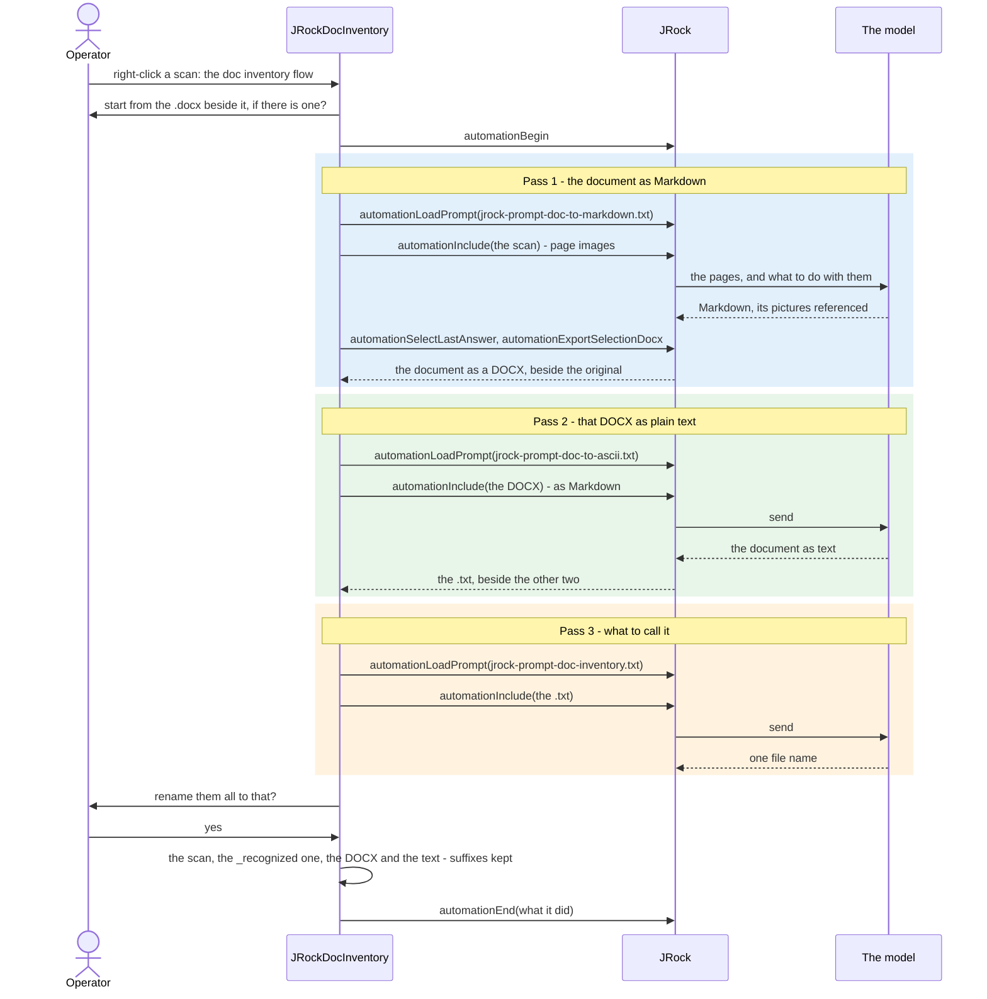


**Cancel the chooser and the JRock window opens anyway** — with nothing run and no automation on
it: an editable prompt, a working Send, the folder's own log. A flow's right-click entry is often
the quickest way to a JRock *in the folder you clicked* — to change a setting there, to read the
log, to clean the folder up — and closing the chooser used to end the process and leave you to go
and find JRock yourself. (Under `--auto` it does not: whoever started the flow is waiting for the
process to end, and a window held open by a flow with nothing to file is a flow that never
answers.) Every flow does this, the six translators included.

It reads three prompts out of its own directory and runs them as a chain, each pass reading what
the one before it wrote beside the document, under the document's own name:

1. **Markdown, then a DOCX.** A PDF is converted to HTML by xpdf's `pdftohtml`, into
   [`__JRock/includes/`](#pdf-as-html-or-text-xpdf) §15 — JRock's own folder, so nothing is written
   beside the document, nothing is asked, and there is nothing to tidy up afterwards — and each
   page image goes in with its `` reference. An image is a one-page document and
   goes in as itself, with its reference; it also gets a **PDF copy to print from**,
   `document.pdf`: one A4 page, the image centred at 300 dpi, or shrunk to fit inside 30 mm
   margins when it is bigger than that, never enlarged. `jrock-prompt-doc-to-markdown.txt` answers
   with Markdown, which is selected in the log and exported as **`document.docx`**, pictures and
   all.
2. **Plain text.** That DOCX goes in [as Markdown](#rtf-and-docx-conversion-no-external-tool) §15
   with `jrock-prompt-doc-to-ascii.txt`, and the answer is saved as **`document.txt`**.
3. **A name.** The text goes in with `jrock-prompt-doc-inventory.txt`, and you are offered to
   rename the files to the name that comes back — **in a field with that name already in it**,
   so Enter files them under it and one word of typing files them under something better.

Then a "Finished" dialog, and the window is yours.

**It starts where the document already is.** A DOCX (or an RTF) starts at pass 2, a TXT at pass
3. The chooser offers these extensions; a path from the right-click menu is *checked* to be one
of them, because that menu hands over whatever was clicked, and a file sent and charged for
before anyone notices is a poor way to find out. And a PDF or an image whose `.txt` or `.docx` is
already beside it — an earlier run's, or Acrobat's *Export to Word* — gets an offer to **start
from the one furthest down the chain** instead: the `.txt` before the `.docx`, since every pass
skipped is a send not paid for (*"All the files are renamed either way"*).

**Files of the same name are one document filed more than once.** So the set is followed in
every direction: pick any and the others are found beside it. The rename at the end moves
**every file of the document** — the PDF or the image, the DOCX, the TXT, any RTF, the `.indd`
the layout was made in, a spreadsheet appendix, a scanner's sidecar: whatever in that folder
carries the document's name, whatever its extension — all to the same name, together or not at
all. Half a document renamed is the mess this automation exists to clear up, not to make.

**A suffix on the name is another file of the same document, not another document.**
`3703093896-en.docx` and `3703093896_SA.txt` beside `3703093896.pdf` are the translations and
the appendices, and are no use filed under a name of their own — a translation left behind is
worse off than a copy, because its own name no longer says which document it is the translation
*of*. So they are renamed with the rest and **keep their suffix**:
`2026-06-14-DHL-FollowUpOnParcelDelivery-3703093896-en.docx`. The suffix is the only thing that
tells one file of the set from another, which is why it stays, and the rename question names the
suffixes it is keeping — `-en, _SA` — rather than the full names, which depend on what you type
into it. A suffix starts with a hyphen or an
underscore and **nothing else** — a dot is not one, or `scan0167.Merged.pdf` would be a file of
`scan0167.pdf`, and that merged document is the one whose own two passes the last step offers to
delete.

**What a suffix means is yours to decide — JRock only keeps it attached.** There is no list of
known suffixes in the code and there should not be: the flow's rule is "a hyphen or an underscore
and then anything", so a convention of your own survives a rename without anybody teaching it to
the program. The one in use here, for the record:

| Name | What it is |
|---|---|
| `file.pdf` | **the document itself** — the scan as it came off the glass, or the PDF as it arrived |
| `file_recognized.pdf` | the same pages with a **text layer**, from [OCR](#recommended-tooling-faq) §03 |
| `file-S.pdf`, `file-SS.pdf` | the **signed** copy, scanned back in after signing (`-SS` where it is the signed *and* stamped one) |
| `file-SA.pdf` | the signed copy **with its appendices** scanned too — one PDF of everything that went in the envelope |
| `file-RFS.pdf` | **reduced file size**, from ABBYY FineReader's *File → Reduce File Size…* — the copy to attach to an e-mail |
| `file-en.docx`, `file-SA.txt` | a **translation**, an appendix as text — anything the set needs that is not another format of the same pages |
| `file.indd` | the **InDesign layout** it was typeset in, which is not a copy of the document at all |

All of them are renamed together with the document and keep their suffix, so a folder filed a
year ago still says which file is the signed one and which is the small one to send.

**The suggested name is editable, in the question itself.** It arrives in a text field with the
model's answer already in it: **Enter** files the set under that name, **Cancel** leaves every
file exactly as it was, and anything typed in between is the name used instead. A model reads one
document and guesses a counterparty, a date and a subject out of it; the person at the keyboard
knows what the page does not say — that this *Stadtsparkasse* is the one the rest of the folder
calls `SSKM`, that the letter is about the flat and not the account it names, that the number
worth finding it by is the one stamped on it. The answer to a name that is nearly right used to
be **No**, and then four files renamed by hand in Explorer with their suffixes copied across by
eye. What you type goes through the same cleaning as the model's own answer — a trailing space,
a slash out of a pasted path, `Rechnung Mai 2026` with the spaces still in it — and a name that
is nothing but punctuation is asked for again rather than guessed at. JRock's log keeps the
suggestion too, whenever it is not what the files ended up being called: the names themselves no
longer hold that, and it is the thing to read a week later when the folder looks nothing like
the answer.

**Nothing of pass one is left to tidy up.** The HTML pages xpdf made of the PDF are working
material for the model — the DOCX and the TXT are the copies people read — and JRock writes them
into its own [`__JRock/includes/`](#pdf-as-html-or-text-xpdf) §15 folder, cleaned up by age with
everything else there. So the document's folder holds the document and the files named after it,
and there is no folder of page images to be asked about, renamed or deleted: one question fewer
in the flow, and nothing left beside a filed letter that a sync client can hold open while
something tries to delete it.

**And the two scans a two-sided letter was merged from are deleted**, last of all and only
once everything before it has gone right. Every page of both is in the merged document — the
merge refuses a pair whose page counts differ, so nothing of either can be missing from it —
and that document is the one that was read, named and renamed. What is left otherwise is two
files holding the same pages under names that mean nothing, in the folder the operator looks at
to see what has **not** been dealt with: two leftovers there are a letter that still looks
unfiled, and *"file it"* on them would file the same letter again from scratch.

The gate is everything-went-right, not nearly. The pair was merged; every file of the document
was renamed; and the renamed document is there and is **bigger than either pass on its own**,
which a truncated merge would not be. Anything else and both scans stay, because whatever is
interfering with one file in that folder is a reason not to delete another beside it. A delete
that fails is a sentence in the report.
Interactively it is **asked** — and the question says that this does not go through the Recycle
Bin, because it does not; `--auto` deletes them, which is what `--auto` is for.

File names in its dialogs each get **a line of their own**, indented, never sharing a line with
prose: `2026-06-14-DHL-FollowUpOnParcelDelivery-1234567890.pdf` is an ordinary name here, and
three of those wrapped into a paragraph is a dialog as wide as the desktop with nothing to
compare down a column.

The name is **found** in that reply rather than assumed to be all of it: the prompt asks for
nothing but the name, and a model that adds a sentence about the document anyway should not have
that sentence turned into a file name. So the reply is searched for the line that looks like one
— name characters and little else, few enough spaces to be a name rather than prose — and failing
that, for a name embedded in a line (`File name: 2020-07-27-FTS-IncomeTaxReturn-2019`). The first
line that answers wins, the top of a reply being where the answer was asked for. If nothing in
the reply looks like a file name, the automation stops and shows you the reply, instead of
renaming your documents to a sentence.

"Name characters" means **letters, not ASCII**. The prompt asks for `A-Za-z0-9` and hyphens,
umlauts written out, and a model that does as asked gives `2026-09-22-MuenchnerBank-…`. The
sanitiser is the safety net for one that does not, and a net held to `A-Za-z0-9` would turn every
letter it did not know into a dash — `2026-09-22-M-nchnerBank-…`, where a dash is exactly the
character that means *the next part of the name starts*; `MünchnerBank` at least still reads
right, and is easy to fix by hand. So the test is
Unicode's own (`\p{L}`), and the reply is normalised to NFC first, so an *ü* is one character and
not a *u* with a combining mark trailing it — the two look identical on screen and only one is
what the file system and the person searching the folder next year will agree on.

JRock's flags are passed straight through, and the document is not — a bare argument is a prompt
file to JRock, so the two are told apart on the way in. That is what the installer's
[right-click entry](#windows-agents-and-flows-one-entry-each) §33 is made of: one command with
`--working-dir` and no document (so the chooser asks, in that folder), one with the clicked file
appended.

**`--auto` files a letter with nobody watching.** One PDF, or **two** — the two passes of a
two-sided batch, which are merged into one document first through JRock's own duplex merge
(`automationMergeDuplex`) because they are one letter and filing them separately would file half
of it twice. Every question answers itself the way the person at the keyboard almost always
answers it — yes, rename them, under the name the model gave, nobody being there to type
another — and the result is **printed in a line a program can read**
(`AUTO-RESULT name=… scanned=… files=…`) instead of shown in a dialog a program cannot dismiss.
It is how the [paper docs agent](#a-seventh-agent-paper-docs-in-and-out-jrockpaperdocsjava) §25 files a scan the
moment it arrives, with the operator three rooms away.

**And `--auto` ends the process when it is done**, window and all. That is not tidiness: a JVM
with a window open does not exit when `main` returns, because Swing's event thread is not a
daemon — so interactively the window stays, holding the log and the conversation, until you close
it, which is right. With nobody there to close it, the agent that started the flow waits for the
**process** and not merely for its answer: it reads the flow's output until the stream ends, and
a stream ends when the process does. A flow that files a letter and then sits there is therefore
indistinguishable from one still working, which is exactly how a filed letter once came back to
the operator as *"the paper docs agent did not answer"*.

**`-cp jrock.jar` has to name a jar that is there.** Nothing downloads it: the
[installer](#the-installer-installerinstalljrockjava) §36 puts one in the folder it installs into
(one level up from `Flows\`, two up from an agent's own folder), or take it from a
[reproducible build](#finally-reproducible-builds) §38 artifact, or build it with
`java .github/build/BuildJar.java`. Running from a clone, point `-cp` at wherever you built it.
The jar is in
`.gitignore` and the build tool skips `.jar` files in that directory, so a local copy changes
nothing about the repository or the reproducible source zip.

`-cp jrock.jar` is not optional, and it does more than you'd think: the
[source-file launcher](https://openjdk.org/jeps/330) compiles the script **in memory against
that class path**, so the script's `JRock.automationSend(...)` calls are ordinary typed static
calls the compiler has checked — and no reflection is involved anywhere. Forget the flag and you
get `cannot find symbol: variable JRock` before anything runs (source-file mode compiles *only*
that one file, so it won't quietly pick up a `JRock.java` sitting next door either); use a jar
too old to have the automation API and the error names the missing method. Both are better
diagnoses than any dialog would be.

What it does *not* do is run headless. It starts the real window and drives it, so:

- the prompt fills with include tokens page by page as Ghostscript rasterises the PDF, and the
  log reports every step, exactly as if you were typing;
- **the prompt is read-only while the automation runs** — a keystroke landing in a prompt that
  is about to be sent is the one failure mode here that would be silent, so the field is locked,
  Send is held, and both are released at the end;
- **History is forced off** for the duration (and restored afterwards), so pass two
  asks about a text file and not about pass one's page images all over again;
- both turns stay in the transcript, and when the dialog closes the prompt is editable and the
  conversation is there to be continued by hand — asking the model *about* the document it just
  read is usually the next thing you want.

It fails by saying why, in the log and in one dialog: no Bedrock key, initialisation that never
finished, no Ghostscript (so nothing was included, which is a stop rather than a request that
asks about a document and attaches none of it), a reply that never came back. Nothing is
overwritten — an existing `document.txt` becomes `document-2.txt`, and the same on rename.

## A second flow: translating (`JRockTranslateToEnglish.java`)

One pass instead of two, and the shorter half of why both samples are here:

```
java -cp jrock.jar JRockTranslateToEnglish.java Rechnung.pdf
java -cp jrock.jar JRockTranslateToEnglish.java --working-dir D:\HPScan   # it asks which file
```

It loads `jrock-prompt-translate-to-english.txt`, includes the document, sends, and writes the
reply beside the original as **`<name>-en.txt`** (`-en-2.txt` if that one exists — nothing is
overwritten, and nothing existing is touched at all, so unlike the inventory it has no question
to ask and runs straight through). The summary names the language the model says it translated
from, read back off that first line.

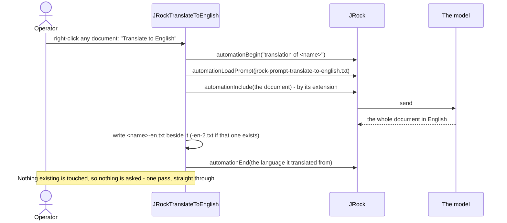


**The document can be any kind JRock can include**, and the include kind comes from the
extension: `.pdf` as page images, `.docx` and `.rtf` converted to Markdown text, `.txt` `.md`
`.csv` `.json` `.html` `.log` `.java` as they are, and `.png` `.jpg` `.jpeg` `.gif` `.webp` as pictures.
Which is what makes this one worth [a right-click entry of its
own](#windows-agents-and-flows-one-entry-each): that entry hands over whatever file you clicked,
of any type, so a scan, a Word document and a photograph of a page all translate from the same
menu item. An extension it has no include for is a stop naming the ones
that work — before the window opens, not after a minute of Ghostscript.

The `.txt` next to the original is an archive copy, not the only place the answer is. The
translation is in the transcript, which is the point of driving the real window: select it there
and **Export selected Markdown with images as DOCX...** turns it into a document, in
[either A4 orientation](#markdown-export-rtf-and-docx) §30 — a translated letter usually wants to
end up as a letter.

**The other official UN languages** each have a flow of their own, built the same way:
`JRockTranslateToArabic.java`, `JRockTranslateToChinese.java`, `JRockTranslateToFrench.java`,
`JRockTranslateToRussian.java` and `JRockTranslateToSpanish.java`. Each loads its own prompt and
writes `<name>-ar.txt`, `-zh.txt`, `-fr.txt`, `-ru.txt` or `-es.txt`. There is one file per
language because a flow is one file, and its right-click entry is named after it
(*Translate To French*, and so on). The files differ in nothing but the language, its code and
the class name, so a change to one belongs in all six.

Its one real limit is that a reply is one reply: a very long document can run into the model's
own output limit, and what comes back then is a translation that stops in the middle rather than
an error. JRock sends no `max_tokens` of its own, on purpose — any number it guessed would
truncate some model's useful output — so the ceiling is whatever the chosen model applies. Split
the document, or choose a model with more room.

The two files are also worth reading side by side. The plumbing — the flags, `ownDirectory()`,
`check()`, `reply()`, the dialogs on the event dispatch thread — is the same twice, because an
automation *is* a prompt, an include and a send; what differs is the chain around them. Copy
whichever is closer to yours.

## The first agent: push-to-talk (`JRockPushToTalk.java`)

A loop rather than a pass, and no prompt file at all:

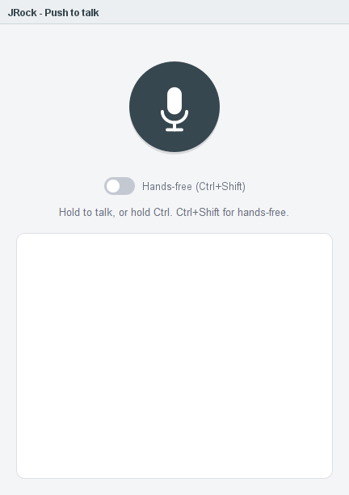

*One button, and what it says under it. Hold it, or hold Ctrl while this window has the focus; the answer appears here and is read aloud on the speaker JRock was told to use.*

```
java -cp jrock.jar JRockPushToTalk.java
java -cp jrock.jar JRockPushToTalk.java --working-dir D:\Voice   # that folder's model and mic
```

It starts JRock, clears the prompt, and opens a small window of its own beside JRock's with one
round button. **Hold the button, or hold Ctrl** while that window has the focus, and JRock
records from its **Record from** microphone. Let go and the recording goes into the prompt the
way Configure says: an `@audio` token, or with **Transcribe recordings into the prompt** ticked,
the text Windows heard. The agent waits until it is there (the recording thread has finished,
transcription included) and presses Send. Sending empties the answer area in the agent's window.
When the reply comes it is shown there, so the area only ever holds the last answer. The
conversation so far is in JRock's window already. Then JRock **reads the whole answer aloud** on its **Narrate on** device, the same way
Narrate selected text does. The button is ready again while it speaks, and pressing it stops
the voice, so the microphone doesn't record the last answer as the next question.

- **Hands-free**, a spoken conversation with both hands free. The **Hands-free** lever under
  the button, or **Ctrl+Shift** (in either order), hands the listening to JRock's own
  [Mic always on](#mic-always-on) §31, which has to be ticked for it. JRock mutes that while an
  automation runs, and the lever lifts the mute: just talk. Once you stop, what you said is in
  the prompt, the agent sends it, shows and reads out the answer, and listens again — turn after
  turn. Turning the lever off, clicking the button or pressing **Ctrl on its own** ends it: the
  microphone is muted again, what was being said is not sent, and an answer being read out
  stops (one still on its way is shown, not read). Nothing else ends it: a turn that fails —
  a recording a Bluetooth headset dropped out of, a request that went wrong — is shown on the
  button, and two seconds later JRock listens again, so you just say it again. The microphone is muted while a
  question is on its way, and listens again while the answer is read aloud: **start talking
  and the reading stops**, and what you say is the next question. On speakers JRock would hear
  its own voice and stop itself, so use headphones — or the mute button below.
- **Unplugging the microphone is the mute button**, and a headset usually has no other one.
  Pull it out and hands-free **stays on and goes quiet**: nothing is heard, nothing is sent,
  nothing is read out, no error is announced and the lever is left where you put it. The
  agent's window says *"No microphone — waiting for it…"*, JRock's log says which microphone
  went, and that is all. Plug it back in and it listens again by itself, within a second or
  two — no lever, no button, no dialog. Which is what makes it usable as a mute: keep the
  narrated answer out of the next recording, or say something to somebody in the room without
  saying it to a model. **Say it, then unplug** is the usual order, so a recording that already
  reached the prompt is still sent — the microphone is not needed to send it, and an answer you
  waited for while the question sat unsent would be the worst of both. Only a recording the
  unplugging cut short, with nothing in the prompt to show for it, is dropped — silently, because
  that is the same gesture arriving as a failure. (The agent asks
  `automationMicReady()` for this: a quiet room and an unplugged microphone are
  indistinguishable to the listening call itself, and they mean opposite things.)
- **History is JRock's.** The prompt is cleared before every recording; whether the model also
  hears the conversation so far is the [**History**](#conversation-log) §08 checkbox, and how much
  of it the [**History limit**](#configure-dialog-top-left-button) §28 in Configure. With History
  on, a question the model asked can be answered in the next recording. The whole conversation
  is in JRock's transcript either way.
- **The recording comes first in the prompt.** That is what Voxtral wants (see
  [what an audio include is sent as](#what-an-audio-include-is-sent-as) §14): it takes a recording as the question and answers it.
  After it come **the three parts of the appendix** — `jrock-prompt-ptt-answering.txt`
  (how to answer), `-asking.txt` (what it may ask for) and `-doing.txt` (the sentences that make
  something happen), beside the agent — and then the time, on the last line: `Friday, 25
  September 2026, 10:01:34 Europe/Berlin (Central European Summer Time, CEST, UTC+02:00)`, the
  date, the day of the week and the time zone in full, in English. Voxtral does not work with
  JRock's own **Clock**, which goes as a system prompt, so the agent tells it the time this way.
  The files are read again every turn: edit one, and the next question goes with the new one.
  Without them the agent does not start.

  **They are included, not pasted**, and that is the difference between a readable transcript
  and an unreadable one. It was one file pasted into the prompt, which put twenty thousand
  characters of instructions into the window and into the log **on every turn**: the question
  and the answer — the only two things anybody opens a transcript for — sat buried between two
  walls of the same text, and debugging a wrong answer meant scrolling past the appendix to find
  it. An [include](#multimodal-includes-ctrli) §14 is one line: JRock copies the file, hashes it, and
  the prompt carries `@txt <12 hex digits>` where the text would have been. The model gets every
  word; the window gets a line; and **the hash is the same every turn**, because the file is —
  which is also why the time is the last line of the prompt rather than a placeholder inside a
  part. Three parts rather than one because they are read for different reasons, and the one
  somebody is debugging is usually `-doing.txt`.
- **The microphone and the speaker are JRock's to choose.** If either is not set, the agent's
  window says so. Open **Configure** in JRock's own window, open the **Narrate on** or
  **Record from** dropdown to see what this machine has, pick one, and carry on. An answer that
  could not be read aloud still counts as answered: it is on the screen.
- **A turn that brings no answer says so out loud**, in one fixed phrase: **"Error. Should I
  try again?"** — for a send that failed, a reply that never came, and a reply that arrived
  empty, which is a failed turn to anyone listening however well the request itself went.
  Hands-free, nobody is looking at the window, and a silence where an answer should be says
  nothing about whether one is still coming; the phrase is nothing like an answer, so it cannot
  be mistaken for one. Trying again is yours: hands-free listens again by itself after two
  seconds, and a held turn is the button pressed once more. The reason is still shown in the
  window, goes into **JRock's log** to be read afterwards (an agent started by `javaw` has no
  console to print it to), and when the phrase itself cannot be read aloud — no speaker set —
  that is shown too. A missing microphone is **not** one of these: see the mute button above.
- **Before every tool call it says *"One moment, please."***  A turn is often not one send but
  a chain: the calendar agent reading Thunderbird's index, the Thunderbird agent searching a
  mailbox, the paper docs agent looking in the scanner's folder — or **filing** a letter, which
  is minutes — the browser agent photographing a page and having a model of its own read it.
  Until the answer comes back there is nothing to hear, and the status line that says *"Reading
  the web…"* is no use to somebody three steps from the screen, which is the whole reason this
  agent talks. It is said **before each call**, because a turn is often several of them — a list
  of mail and then one message off that list, a front page and then a page it pointed at — and
  not twice within six seconds, since a second phrase would cut the first one off mid-word and
  *"One mom– One moment, please"* sounds like a fault rather than a courtesy. The phrase is said
  by the agent, so it is in the transcript with everything else it ever said out loud.
- **A filed letter is announced as soon as it is filed**, in the agent's own voice: *"Filed as
  DHL, Follow Up On Parcel Delivery, 14 June 2026, document number 5 2 8 1 8 8 3 2 1 7."* Filing
  drives the whole [doc inventory flow](#the-first-flow-doc-inventory-jrockdocinventoryjava) §17 and takes
  minutes, and it ends in the one thing the operator by the scanner wants to hear: what the
  letter is called now. Waiting for the model to phrase that — which is what the next send does —
  means waiting again, and if that send or the socket goes wrong they are told nothing at all
  about a letter that **is** filed. The name is said **as words**: the date out of the front (an
  ISO date read aloud is *"two thousand and twenty-six dash zero six"*), the ten-digit number off
  the end and spoken digit by digit (a reference read as a number is one nobody can write down),
  the counterparty as it stands, and the title split at its capitals.
- **While the model thinks, the line is not quite silent.** From the moment the recording stops
  to the moment something is said, the speaker JRock narrates on carries **the odd crackle** —
  the way an analogue line crackles: a scratch of a millisecond or twenty, every couple of
  seconds, sometimes two or three in a run, and **nothing at all in between**. Those seconds are
  otherwise ambiguous in the one way that matters: hands-free you are not looking at the window,
  and silence says nothing about whether the microphone heard the end of your sentence, whether
  anything was sent, or whether this is the pause before *"Something went wrong. Should I try again?"*.

  **Sparse rather than continuous, and that is the design.** A held sound — a fan, a hum, a hiss
  — is something you end up listening *through*, and after a few turns it is tiring and in the
  way of the voice. A few scratches say the same thing, *the line is open and something is
  happening*, while leaving the room quiet: the loudest crackle peaks at a fortieth of the scale
  and most are far quieter, so what you hear is a transient gone before it registers as a level
  at all. Deliberately **not a beep** either — a notification sound is a program announcing
  itself in the middle of a conversation, while a line that crackles is just a line. Made as it
  plays, so there are no sound files to ship and no licence to check, and gone before the first
  word rather than under it. If no speaker is set, or the one set is not there, there is simply
  no sound: one line in JRock's log and the turn carries on.

  **And the gaps are silent because nothing is open in them.** A speaker hisses while its output
  stream is *active*, whatever the stream holds — writing exact zeros still hisses, and that
  noise floor cannot be turned down from in here. So the line is not held open: the thread
  sleeps through the gap with the device **closed**, opens it for the
  twenty-odd milliseconds a burst lasts, and closes it again. Opening this machine's monitor
  speakers costs about 95 ms, which is invisible in a gap that is random to begin with — and the
  room now goes quiet **26 ms** after the answer arrives, against 383 ms when a line was being
  drained, because there is nothing left to drain.
- **Nothing that can be changed has the focus when a window opens.** Swing hands the focus to
  the first component that will take it, which in these windows is a text field, a checkbox or a
  button — a setting one stray keypress away from being something else, with a caret blinking in
  it as an invitation. Every agent gives it to the window's **root pane** instead: no key
  bindings, so a keypress does nothing at all, and Tab still steps into the window as usual.
- **Closing the agent's window** ends the automation and gives JRock back to you, the
  conversation included.
- **Alarms.** An answer that says *"Now is hh:mm:ss, I'm setting an alarm for hh:mm:ss"* — the
  appendix asks the model for this sentence, in English whatever the language — sets an alarm in the [timer agent](#a-second-agent-timer-and-alarm-jrocktimerjava) §20.
  The first time is checked against the computer's clock first, and a model more than two
  minutes off sets nothing. The status line says what became of the alarm: set, refused, or
  not set because the timer agent isn't running.
- **Renaming one, or marking it busy or free.** *"I'm renaming event a3f91c to: Dentist, with
  the X-ray"* and *"I'm marking event a3f91c as busy"* (or *as free*) send `#rename`, `#busy` and
  `#free` to the Thunderbird agent, which composes the update for you to send — same event, same
  time, new name or a different *shows as*. Said out loud before anything happens, as the move
  is, so no appointment is touched that you did not hear named. Everything the agent **creates**
  shows as free; *"…, showing as busy"* on the end of the new-event sentence is how an event that
  is meant to block the time gets created that way.
- **A new event in the calendar.** An answer that says *"I'm putting it in the calendar on
  YYYY-MM-DD at HH:MM, named …"* — the appendix asks the model for this sentence too, in English
  whatever the language — sends `#new` to the [calendar
  agent](#a-fifth-agent-thunderbird-your-calendar-and-your-mail-jrockthunderbirdjava), which posts the invitation to you
  from yourself for you to send with **Ctrl+Enter**. Leave the time out and it is an event for
  the whole day. Two things make this safe to drive by voice: the sentence is **read aloud
  before anything happens**, so nothing reaches a calendar that the operator did not also hear,
  and the address is the one picked in the agent's window at both ends, so it **cannot reach
  anybody else**. The status line says what became of it, and JRock's log has the whole of what
  the agent said back, including where the `.ics` file is.
- **What a message says, and answering it.** *"I need your mail: message Sam"* brings one
  message back as a document — it goes into `PTTFiles/mail/` and is **included** in the prompt, the
  same way a scanned letter is, so the model reads a document rather than a quotation of one.
  Asked to answer it, the model **reads the draft aloud first** and says nothing a program
  recognises; only once the operator agrees does it say *"I'm preparing the draft reply to
  0a6a15: …"*, and only then does a compose window open. Two steps, because a window that
  appears while somebody is still thinking about the wording is a window they did not ask for.
- **Everything it writes goes in one folder, `PTTFiles/`**, under the agent's own working
  folder: the answers saved as DOCX, and — in a subfolder each, for the two kinds that arrive in
  numbers (`mail/`, `papers/`) — the messages and the post the other agents hand over.
  One folder, so **one folder can be synchronised** — point a cloud client at it and *"save that
  answer"* said across a room becomes a document on a phone a minute later. Deliberately not the
  working folder itself and not `__JRock/` inside it: those hold the API key, the conversation and
  the log, and a folder destined for somebody's cloud should hold what was asked for and nothing
  else. It is made the first time something is written into it.
- **Putting something in a file, which is three different things.** The sentence the model says
  decides which, and the [paper docs agent](#a-seventh-agent-paper-docs-in-and-out-jrockpaperdocsjava) §25
  does the keeping in every case — it owns the folder, and it has the flow that names documents:
  - *"I'm saving the last answer to a file"* — **the answer before that sentence**, the thing the
    operator just heard and liked. The previous answer and never the sentence asking for it: the
    request is not the thing they liked.
  - *"I'm saving the message to a file"* (or *the letter*, *the page*, *the attachment*) — **the
    document an agent handed over**, as it was handed over. This is the half that was missing. A
    message out of the mailbox, the invoice attached to it, the text of a scanned letter, a page
    off the web: all of them arrive **formatted**, none of them is ever read aloud — what the
    operator hears is the model's few sentences *about* them — so *"save that e-mail"* had
    nothing to act on but those few sentences. The operator wanted the invoice, not a summary of
    the invoice.
  - *"I'm writing a document: …"* — **a document that does not exist yet**. "Draft a reply to that
    e-mail and save it", "write a letter to the landlord about the heating". The model is sent
    **back to work with a different prompt** — `jrock-prompt-ptt-document.txt` beside the agent,
    which asks for the document itself and nothing else, where the appendix asks for short spoken
    sentences — with what the operator asked for in `#what` and the last handed-over document in
    `#material`. **Nothing of what comes back is read aloud**: reading a letter to somebody who
    asked for it in writing is a minute of listening to something they are going to read anyway.

  All three end the same way: the document goes into **`Incoming/`** as a Word document named by
  the doc inventory flow, and the agent **says where it went** — *"Saved into Incoming as DHL,
  Follow Up On Parcel Delivery, 14 June 2026, document number 5 2 8 1 8 8 3 2 1 7."* That
  sentence replaces the model's own: a save asked for across a room used to be answered on a
  screen nobody was looking at, and two narrations at once would have cut each other off. A save
  that could not be spoken, or that failed, ends in the usual *"Something went wrong."*
- **A new time for an appointment of your own.** An answer that says *"I'm proposing to move
  event a3f91c to 2026-10-20 at 14:30"* — the id being the one the calendar answer printed —
  sends `#move` to the Thunderbird agent, which composes the update to you for you to send. You
  hear the sentence before anything is prepared, so no appointment is touched that you did not
  hear named, and anything with another participant on it comes back refused with who they
  are.
- **One question, as many fetches as it takes.** The model only finds out what it needs by
  reading what it has just been given: *"I need your mail: 7 days"*, and then one message off
  that list **by the id on its line** — an id it could not have known before the list arrived;
  a site's front page, and then *follow* the section that was actually asked about. So a turn
  goes round as often as it has to — fetch, send, read the reply — until the reply is an answer
  instead of another request, **five fetches at the most**. The calendar, the mail, the post and
  the web all work this way; the location and the weather stay once a turn, because neither
  changes between two sends.

  Two things end a turn early, and both end it the same way. **The same request twice** is a
  model going in circles: the second fetch hands back exactly what the first one did, so it
  cannot be the thing that unsticks it. And the **sixth** fetch is where a question asked across
  a room has to be answered with what there is. Either way the operator hears the usual
  **"Something went wrong. Should I try again?"** and the window shows what the model kept asking for — because
  *"I need your mail: message 0d613e"*, read out to somebody who asked what their post says, is
  the machine talking to itself while they are still waiting.

  **And a turn that ends on a request is never read out**, however it got there. The one that
  found this: a letter was filed, the paper docs agent took longer than its socket allowed to say
  so, the loop broke with the model's *"I need the post: file it"* still in hand — and that was
  what the room heard, about a letter that had in fact been filed. A reply that still matches one
  of these request shapes is now treated as the failure it is: shown in the window, named in the
  log, and the fixed phrase is what gets spoken.
- **The web.** When the whole answer is *"I need the web: …"* — `site zdnet.com`,
  `search <words>`, `docs <question with the product in it>`,
  `follow <what to open> on <address>`, `links on <address>`,
  `parcel <tracking number>` — the agent asks
  the [browser agent](#a-sixth-agent-the-web-by-looking-at-it-jrockbrowserjava) §24 on
  `127.0.0.1:47474` and puts the Markdown it gets back into the next prompt. The slowest of
  them: a browser, a render, six photographs and a model. **Two layers, carrying
  different things** — addresses and Markdown between the two agents, and between the operator
  and the model only a site's name and plain words. If what comes back is a consent dialogue or
  a sign-in rather than the page, the appendix tells the model to say so and to mention that
  the browser's own window is open on it.
- **Location.** When the whole answer is *"I need to know your location"*, the agent does not
  show it or read it aloud. It sends `#here` to the
  [geo location agent](#a-third-agent-geo-location-jrockgeolocationjava) §21 and gives the model the line that
  comes back, unchanged, as the next prompt, e.g. `Munich, Bavaria, Lat: 48.13, Lon: 11.59`.
  The reply to that is the turn's answer. Once a turn: a place does not change between two
  sends, so a model that asks twice has its turn ended rather than answered. The model knows
  which question the location answers only with History on.
- **Calendar.** When the whole answer is *"I need your calendar for today"* — or *"… for this
  week"*, or *"… for 2026-12-24 to 2026-12-26"* — the agent asks the [calendar
  agent](#a-fifth-agent-thunderbird-your-calendar-and-your-mail-jrockthunderbirdjava) on `127.0.0.1:47473`, puts the
  briefing into the next prompt and sends it. Each line carries the calendar it came from, so the model can say which calendar something is in. *"… for tentative"* asks for the
  maybes, which the other answers leave out on purpose.
- **Mail.** When the whole answer is *"I need your mail: …"* — `today`, `3 days`, `unanswered`,
  `senders 5 days`, `with <somebody>`, `mailboxes` — the agent asks the [Thunderbird
  agent](#a-fifth-agent-thunderbird-your-calendar-and-your-mail-jrockthunderbirdjava) on
  `127.0.0.1:47473` and puts what comes back into the next prompt. So *"have I had
  anything today?"*, *"who wrote this week?"*, *"when did I last hear from them?"* and *"what
  have I not answered?"* are questions with answers, read off Thunderbird's own index without a
  server being asked or a message being touched. The words the model may use are mapped to the
  agent's own request in one place, and anything else is passed through for the agent to refuse
  with a reason rather than guessed at.
- **Weather.** When the whole answer is *"I need weather for this location: …"*, the agent
  does not show it or read it aloud either. If the location has no coordinates, the location
  agent is asked for them first. If the model already has them from `#here`, they are used as
  given. The [weather agent](#a-fourth-agent-weather-jrockweatherjava) §22 returns a checked
  open-meteo.com address. The agent fetches that address into
  `jrock-prompt-ptt-weather.txt`, the way Fetch URL does, and the model's report is read
  aloud. Without the other agents, the request is shown and read aloud after all, and the
  status line says why. See [Multi-agent collaboration](#multi-agent-collaboration) §26.

## A second agent: timer and alarm (`JRockTimer.java`)

The one to show first: **no Bedrock API key needed, and no JRock either**. Nothing in it calls
a model, and nothing in it calls into JRock — an alarm clock that made a text-generation program
start up in order to ring would be a strange alarm clock.

```
java -cp jrock.jar JRockTimer.java --working-dir D:\Timer
```

The speaker is chosen **in this window** and remembered beside the agent in
`jrock-timer.txt` — a setting belongs to the program whose setting it is. The jar on the class
path is habit rather than need, and
JRock's flags are accepted and ignored so that one right-click entry and one start script can
treat every agent alike.

It opens a small window: a time and **Set**, the speaker, and the alarms set since it opened
listed underneath, each counting down. Nothing is kept across runs but the speaker.

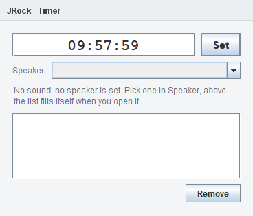

*The whole agent. The time field is filled in with the clock when it opens, so setting an alarm
is editing two digits; the speaker list fills itself the moment it is opened, because what is
plugged into a machine changes between one opening and the next; and the line under it says what
it would do with no speaker chosen rather than waiting to say it at the moment the alarm fails to
ring. The window title is how the picture tells you which agent this is.*

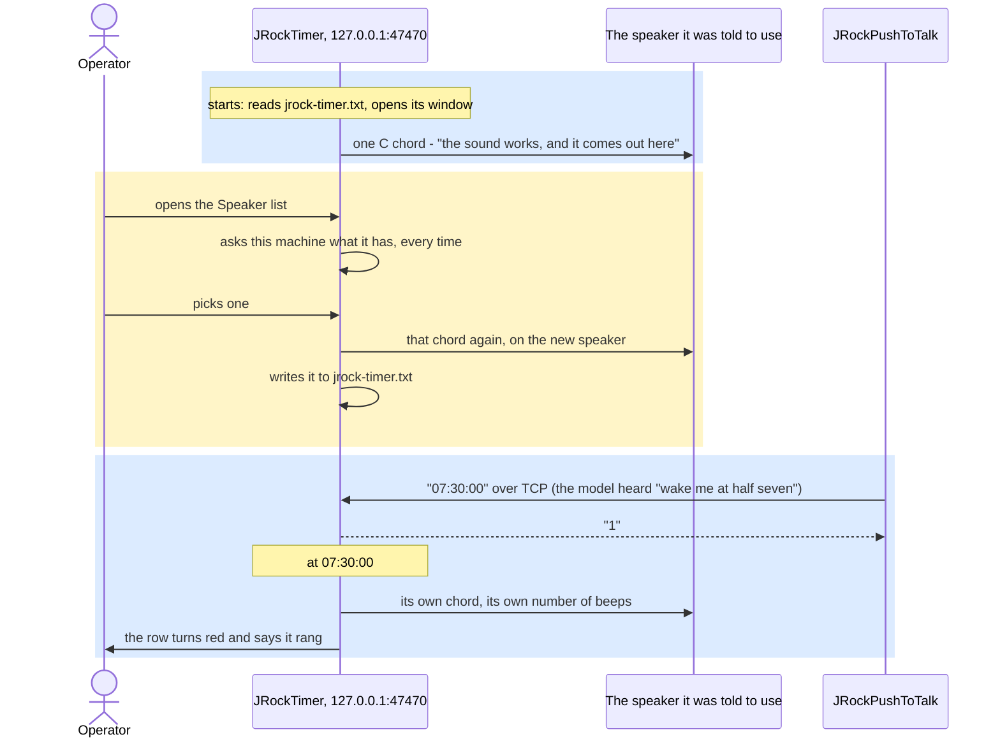

- **The speaker is this agent's own, and the list is made every time it is opened.** JRock's
  Configure dialog lists the devices once per dialog, which is fair for a dialog somebody opens
  and closes; this window is open for days, so a headset plugged in this afternoon has to be in
  the list this afternoon. Measured: 581 ms on the first open of a session and 48 ms, then
  32 ms, on the ones after it — Java Sound caches the enumeration, so only the first open pays.
  Picking one plays its chord at once, because *which speaker is this?* is a question only the
  ears can answer. And the one chosen before **stays in the list when the machine has not got
  it at the moment** — a headset switched off for the night is still the choice, and a dropdown
  that quietly forgot it would re-point the alarms at nothing.

- **The time is when the alarm rings**, 24-hour `hh:mm:ss`: `07:30:00` is today if that is
  still to come, and otherwise tomorrow. `+hh:mm:ss` is a timer instead: `+00:05:00` rings in
  five minutes.
- **It beeps once when it starts**, a C chord at half an alarm's volume, before any alarm
  exists. Partly because an agent started by a right-click or by the installer may have its
  window behind another one — but mostly because **it proves the sound works**. Everything else
  here is silent until an alarm comes due, so a speaker that is not set, or set to something no
  longer plugged in, is otherwise discovered when an alarm fails to wake you. If it cannot play,
  the window says why *now*: *"No sound: the speaker … is not connected"*.
- **Every alarm rings its own sound**, because more than one can be set and from across the
  room the sound is the only thing that says *which* has gone off. The chord and the number of
  beeps both move with the alarm: the **first** rings a **C** chord **three** times, the
  **second** a **G** four times, the **third** an **E** five times, and the **fourth** starts
  the chords again on C with **six** — the three chords cycle, while the count keeps rising, so
  two alarms that share a chord are still a beep apart. The window names the sound when the
  alarm is set and again when it rings (*"Alarm set for 07:30:00, C chord, 3 beeps"*), and every
  row in the list carries it as `C x3`. Numbering counts the alarms *set*, not the rows, so
  removing one from the middle never hands its sound to the next one.
- **Sounds**: that chord **once** when the alarm is set — so setting a third alarm with two
  still waiting is heard as a third sound, not the same chirp a third time — and the same chord
  its own number of times when it rings. One beep against three or more, a little quieter, is
  what tells *set* from *ringing* at the same chord. **Remove** (or Delete or Escape on it in
  the list) takes an alarm off
  the list, and stops it if it is still beeping. The agent makes the sounds itself, with no files,
  and plays them with Java Sound on JRock's [**Narrate on**](#narrate-windows-and-the-browser) §31 speaker, never
  on the Windows default. That device name is the only thing it takes from JRock's settings
  (its own `jrock-timer.txt`). If no speaker is set, or it isn't connected, the window
  says so, and the alarm still shows.
- **The alarms survive a restart.** An alarm is for a moment in the future, and the machine
  between now and then is promised to nobody: Windows restarts for an update, the laptop is
  shut, the window is closed by mistake. One set for eight tomorrow morning that a reboot at
  midnight quietly cancels is worse than no alarm at all, because it was relied on. So every
  waiting alarm is written into `jrock-timer.txt` **as it is set** — not only when the window
  closes, which a killed process never reaches — and read back at startup into the list,
  counting down again from where it was. What is written is the **absolute moment**, not the
  time of day: `+00:05:00` set at 23:58 is due at 00:03, and a timer read back as five minutes
  from whenever the agent next starts would be an alarm for a different moment.

  **One that came due while nothing was running is dropped without a word.** Ringing it late is
  the one thing it must not do — *"it is 07:30"* at nine in the morning is a machine talking
  about yesterday — and there is nothing to be done about a moment that has passed, so nothing
  is said about it either: a window that opens complaining about three of them is a window that
  teaches you to close it. The numbering carries on from the restored alarms, so the next one
  set does not take a chord and a beep count that one still waiting already has.
- **Closing the window says so out loud**: two notes falling, where starting up is a chord
  rising. This window has one button, a list and a close box, and closing it ends every alarm
  that was waiting — so the time it is the wrong thing to click, it is audible. (Played on the
  event thread: the sound thread is a daemon, and this is the last thing the process does.)
- **Other agents set alarms** over TCP, on `127.0.0.1:47470` only. Connect, send the time as
  above and a newline, and read one line back: `1` means the alarm is set, `0` means it isn't.
  Then close the connection. [Push-to-talk](#the-first-agent-push-to-talk-jrockpushtotalkjava) §19
  does this.
- **JRock's agents' ports** are **47470–47479**. The timer has the first, the geo location agent
  47471, the weather agent 47472, and the Thunderbird agent 47473. The range is
  below Windows' dynamic range (49152 and up, where the system hands out ports and Hyper-V
  reserves blocks of them), and no well-known service uses it. Another timer already running
  on the port is reported in the window. Alarms can still be set there by hand.
- **Run it in a folder of its own.** JRock keeps one log per folder and writes it whole, so two
  JRocks in one folder, such as this one and push-to-talk's, overwrite each other's log. A
  folder with no key is fine. Set its **Narrate on** once, in its own JRock's Configure: the
  dropdown lists the speakers when you open it.

## A third agent: geo location (`JRockGeoLocation.java`)

It knows where the operator is and tells other agents.

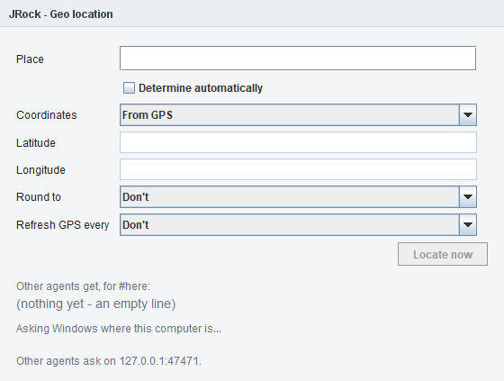

*Nothing is kept across runs, so the place is entered or found at every start - and Round to decides how much of it other agents are told.*

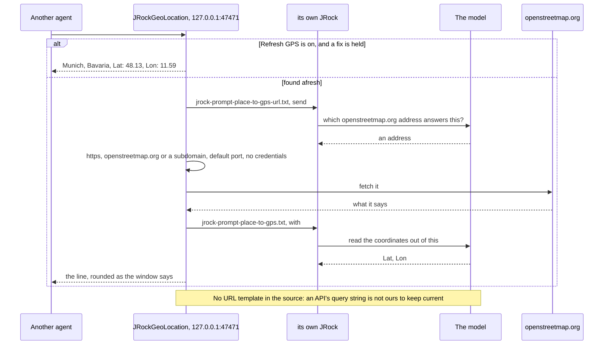


```
java -cp jrock.jar JRockGeoLocation.java --working-dir D:\Location
```

It starts JRock and takes it as an automation, like the timer, and opens a small window.
**Nothing is kept across runs**, so the location is entered and refreshed at every start.

- **Place**: typed, or **Determine automatically** (then the field is greyed out and shows
  what was found).
- **Coordinates**: *Enter manually*, *From GPS* (Windows location, through PowerShell's
  `GeoCoordinateWatcher`), or *From the place (openstreetmap.org)*. In the two automatic modes
  Lat and Lon are greyed out. The agent locates once at startup.
- **Round to**: *Don't*, or 2–6 digits. Only the line sent to other agents is rounded; the
  fields keep every digit.
- **Refresh GPS every**: *Don't*, 5 or 30 min.
- **Looking things up on openstreetmap.org goes through the agent's own JRock.** For example,
  to name the place at some coordinates:
  1. `jrock-prompt-gps-to-place-url.txt` asks the model for a web address on openstreetmap.org.
  2. The first `http(s)://` address in the reply is **checked**: it must parse as a Java URL,
     use `https`, have no user name, use port 443 or none, and be `openstreetmap.org` itself or
     one of its subdomains.
  3. JRock's [Fetch URL](#fetching-a-url) §14 fetches it into `jrock-prompt-gps-to-place-name.txt`.
  4. The model reads the place from what came back, or says `NOT FOUND`.

  A place goes to coordinates the same way, with `jrock-prompt-place-to-gps-url.txt` and
  `jrock-prompt-place-to-gps.txt`.

- **The prompt names the site; the model writes the address.** There is no URL template in the
  source for openstreetmap.org or anywhere else. A query string hard-coded here would be a copy
  of somebody's API that can change without warning, and checking it means finding the current
  documentation for a service nobody here controls. A model has read those sites, so it is asked
  for the address instead — which is the kind of work it is good at: put these coordinates in
  the right parameters of a form you have seen a thousand times. **The address is then checked
  before anything is fetched**, which is what makes it safe to let a model write one: scheme,
  host, port and the absence of a user name are all verified against the one site the prompt
  named. The same trick runs the [weather agent](#a-fourth-agent-weather-jrockweatherjava) §22.
- **Other agents ask** on `127.0.0.1:47471`. They send one line and read one line back, and the
  agent closes the connection after it. A line is a place, coordinates, or both, comma-separated
  and latitude first: `Munich, Bavaria`, `Lat: 48.13, Lon: 11.59`, or
  `Munich, Bavaria, Lat: 48.13, Lon: 11.59`. The half that is missing is found. **`#here`**
  means where the operator is now, as the window has it set. An empty line back means not known,
  and the window says why.
- **Caching.** Answers for places and coordinates are kept for the run. `#here` is kept only
  while Refresh GPS is on. Then the GPS is read again every 5 or 30 min, and the place is looked
  up again if it is automatic, so `#here` is answered at once.
- **Run it in a folder of its own**, with History off there. A key is needed only for the
  openstreetmap.org lookups; GPS and typed values work without one.

- **Two choices are remembered**, in `jrock-location.txt` beside the agent: **Determine
  automatically** and **Round to**. Not the place, not the coordinates and not the refresh
  interval — a place is where somebody is *now*, and an agent that started up insisting it was
  still in last month's city would be worse than one that asks. Those two are preferences about
  how to work rather than facts about the world, and typing them in again every morning is the
  kind of small insult software should not offer.
## A fourth agent: weather (`JRockWeather.java`)

It turns a location into a checked address for the weather on open-meteo.com. It does not fetch
the weather itself: the agent that asked does that.

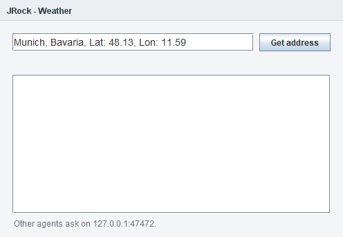

*It answers with an address and fetches nothing: the agent that asked does that.*

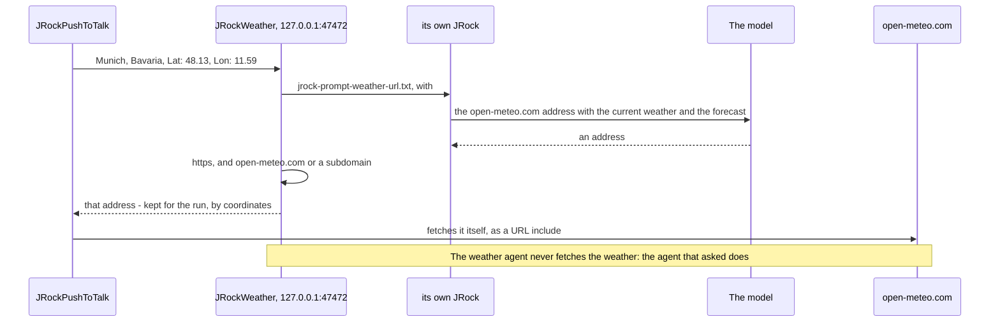


```
java -cp jrock.jar JRockWeather.java --working-dir D:\Weather
```

| | The weather agent | The geo location agent |
|---|---|---|
| Port | `127.0.0.1:47472` | `127.0.0.1:47471` |
| Is asked | a place **with coordinates** | `#here` |
| Answers | one checked `https://api.open-meteo.com/...` address | `<place>, Lat: …, Lon: …` |
| Fetches it | **no** — the agent that asked does | — |
| Where the address comes from | a model, from `jrock-prompt-weather-url.txt` | a model, for the place name |
| What is checked | `https`, and `open-meteo.com` or a subdomain | `https`, and `openstreetmap.org` |

- **Other agents ask** on `127.0.0.1:47472`. They send a location in the geo location agent's line
  format, **with coordinates**, e.g. `Munich, Bavaria, Lat: 48.13, Lon: 11.59`. They get back
  one line: the address, or an empty line and the reason in the window.
- `jrock-prompt-weather-url.txt` asks the model for the open-meteo.com address with the current
  weather and the forecast, in Celsius and in the local time zone — **no URL template in the
  source**, for the reason the [geo location agent](#a-third-agent-geo-location-jrockgeolocationjava) §21
  gives: an API's query string is not ours to keep up to date, and a model that has read the
  site can write one from the coordinates. The address is then checked the same way, against
  `open-meteo.com` and its subdomains, and kept for the run by coordinates.
- The window lists the lines asked for and the addresses given, and has a field and **Get
  address** to try one by hand.
- It needs a key. **Run it in a folder of its own**, with History off there.

## A fifth agent: Thunderbird, your calendar and your mail (`JRockThunderbird.java`)

What **Thunderbird already knows**, read out of its own files — your **calendar** and your
**mail** — for the push-to-talk agent to ask about and for you to read. And two things it puts
back: a calendar event, posted to you by yourself, and a drafted reply in a compose window.

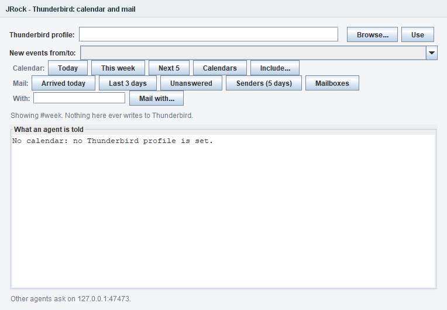

*Thunderbird is the authority and this says so: every answer carries the age of the cache it was read from.*

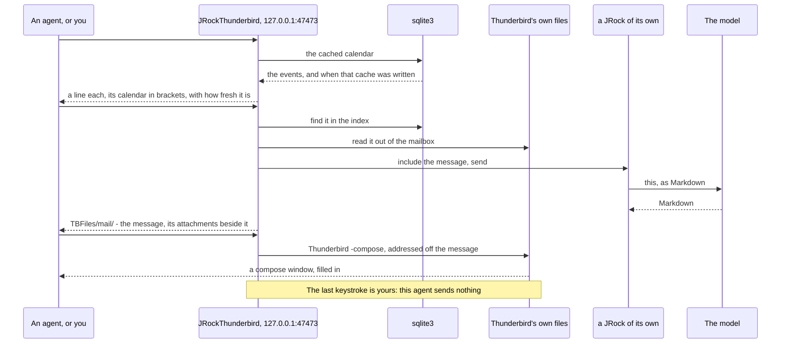


The calendar and the mail listings need **no model and no key**: they are files, read and
reported. Reading **one message** is the exception, and it has a JRock of its own for it — see
below, because the reason is the interesting part.

Neither half is ever the authority on anything — Thunderbird is. What is here is what
Thunderbird has already written down, which is why **every answer says how fresh that is**.

| Asked on `127.0.0.1:47473` | Answers with | Needs a model? |
|---|---|---|
| `#today` `#week` `#next` `#range <from> <to>` | the events, with how fresh the cache is | no |
| `#calendars` `#tentative` `#optional` `#busy` `#free` | which calendars, and what is accepted or free | no |
| `#new <date> <time> <name>` | writes `jrock-event-nnn.ics` and opens a compose window | no |
| `#move` `#propose` `#rename` | the same, for an event that exists | no |
| `#mail` `#unanswered` `#with` `#senders` `#mailboxes` | the listings, out of Thunderbird's index | no |
| `#message <who>` `#read` | one message as Markdown in `TBFiles/mail/`, its attachments in `TBFiles/attachments/` | **yes** — its own JRock reads it first |
| `#reply <id> <text>` | a compose window, addressed off the message and never from speech | no |
| `#note` | what it last said, for the asker to read aloud | no |

**Events, and that is the name.** Thunderbird keeps tasks (VTODO) in a table of their own, and a
calendar served over CalDAV by Google has none — the cached table is empty. If your "tasks for
today" are the things in your calendar, this is them.

```sh
java -cp jrock.jar JRockThunderbird.java --profile K:\Thunderbird\Profiles\xxxx.default-release
java -cp jrock.jar JRockThunderbird.java --print week      # one briefing, no window
```

- **Where it reads.** `<profile>/calendar-data/cache.sqlite` is Thunderbird's cache of every
  calendar on a server; `local.sqlite` is the one it keeps itself. Both are read, **read-only,
  never written and never moved**, and the names come from `<profile>/prefs.js`, where
  Thunderbird keeps them as `calendar.registry.<uuid>.name`.
- **One profile, named in full.** The window has the folder as a field with a *Browse…* button,
  and remembers it in `jrock-thunderbird.txt` beside the agent. No wildcards and no guessing:
  which profile is read is not a thing to be inferred when a machine has several.
- **It needs `sqlite3`** — the command-line tool from [sqlite.org](https://sqlite.org/download.html),
  the one outside thing it wants, as Ghostscript and xpdf are for PDFs. Looked for **on `PATH`,
  then beside the agent, then in the working directory**, and when it is nowhere the window says
  exactly that and where to get it. Every query runs with `-readonly`, and nothing a client sends
  reaches a query: a range is parsed into two dates and rendered back as numbers.
- **What it answers**, over TCP on `127.0.0.1:47473`, loopback only — one line in, the briefing
  out, read until the connection closes:

  | | |
  |---|---|
  | `#today` | what is on today |
  | `#week` | today and the six days after it |
  | `#next [n]` | the next *n* events from now (default 5) |
  | `#range 2026-12-24 2026-12-26` | any span of days |
  | `#move a3f91c 2026-10-20 14:30` | move an appointment of **your own**, by the id on its line |
  | `#tentative [days]` | the maybes, which every other answer leaves out — `#tentative 2026-12-01 2026-12-31` for a span |
  | `#calendars` | the calendars, and how many events each holds |
  | `#new 2026-10-15 14:00 Dentist` | a new event, by post (below) — an hour long unless the calendar says otherwise |
  | `#new 2026-12-24 Christmas Eve` | the same with no time given, which makes it an event for the whole day |
  | `#new 2026-10-15 14:00 +busy Dentist` | the same, blocking the time — everything is created **free** without `+busy` |
  | `#rename a3f91c Dentist, with the X-ray` | a new **name** for an appointment of your own, by the id on its line |
  | `#busy a3f91c` / `#free a3f91c` | whether it blocks your time, changed afterwards |

  ```
  This week, Sun 11 Oct to Sat 17 Oct 2026 (Europe/Berlin):
  Mon 12 Oct:
    14:10-15:10  Dentist  [Family]
    16:00-17:30  Physiotherapy  [Calendar]  (repeats weekly)
  ```

- **A maybe is not a plan, and is kept out of every briefing.** Four things mean "not
  necessarily happening", and none of them belongs in an answer to *"what is on today?"*:
  `STATUS:TENTATIVE` on the event itself (244 of 1,569 events in the profile this was written
  against), and an `ATTENDEE` line for one of **your own** addresses saying
  `PARTSTAT=TENTATIVE` (you answered *maybe*), `PARTSTAT=NEEDS-ACTION` (**nobody has answered
  it** — so it is not arranged with you, however arranged it looks in somebody else's
  calendar) or `ROLE=OPT-PARTICIPANT` (you were invited optionally). Reading any of them out
  as settled is how somebody turns up to something that was never arranged.

  Nothing is hidden, though: a briefing that left any out **says how many**, and `#tentative`
  lists them with the reason on each line — *tentative*, *you said maybe*, *you have not
  answered it*, *optional for you*. Cancelled events were already dropped and still are.

  ```
  Sat 4 Apr:
    10:00-11:00  Legal review (confidential)  [me@…]  (you have not answered it)
  ```
- **Every event line ends with a short id**, like `id a3f91c`, which is how a particular
  meeting is named in the next request. It is six hex characters of a hash of the calendar and
  the event's UID — not the UID itself, which reads
  `20311231_q4m7x2vk9hs3nd8pt5wzr1bjyc@google.com`: forty-five characters of somebody else's
  bookkeeping, on every line of a briefing that has to be read aloud and repeated back through
  a model without a character going astray. Six tell 1,569 events apart, are short enough to
  say, and are **derived rather than stored**, so the same event has the same id in every answer
  and after a restart. The whole UID works anywhere the short one does, for anybody who has it.
- **`#move` moves an appointment that is entirely yours, and nothing else.** Organised by
  you, or by nobody, and with **no participant but you**. Everything else is refused with the
  reason: a meeting somebody else arranged is theirs to move, and a meeting with other people
  on it cannot be moved without telling them — which is not a thing to do from across a room
  by voice. In this calendar that leaves **311 of the 312** upcoming events movable and one
  refused, which is about the right shape for a rule nobody has to think about.

  ```
  Stopped: "Legal review (confidential)" has 2 other participants (A. Partner
  <partner@…>, other@…), so moving it is something they have to be told
  about. Do that one in Thunderbird.
  ```

  So **no mail here can reach anybody but you** — it goes from your address to your address,
  exactly as `#new` does, and the whole agent keeps the property that no address said out loud
  can get into it. The mechanism follows from who is asking: the organizer of an event is the
  one allowed to change it, so this writes `METHOD:REQUEST` with the same UID and the
  `SEQUENCE` **one higher** than the event carries — an update, in the standard's own terms
  (RFC 5546), which is what Thunderbird reads as *this event has moved* rather than as a new
  one. Accept the update when it arrives and the calendar follows. The new time keeps the
  appointment's **original length**, and nothing is sent until you press Ctrl+Enter.
- **Everything it creates shows as FREE, unless you say otherwise.** `TRANSP` in the calendar
  standard, *shows as* in every calendar application, and the one property of an appointment that
  **other people's software reads rather than people**: an event marked busy is what makes a
  scheduling tool tell somebody you are unavailable. Nearly everything an agent puts in a
  calendar should not do that — a reminder to post a letter, a note that a parcel is due, a
  dentist's appointment you are not asking anybody's permission for — so free is the default and
  `+busy` is the exception, said deliberately (*"…, showing as busy"* through push-to-talk). It is
  written out explicitly rather than left to the standard, whose own default is the opposite.
- **`#rename` and `#busy`/`#free` are the same mechanism as `#move`**, under the same rule: your
  own appointment, nobody else on it. A new title, or a different *shows as*, goes out as an
  update — same UID, `SEQUENCE` one higher — and nothing else about the event changes: a rename
  is not a move, and neither is "show me as free". An appointment that already reads the way you
  are asking for comes back saying so, and nothing is prepared.

  This also fixed a quiet bug in `#move`: the update it wrote carried no `TRANSP` at all, and an
  update without one is **`OPAQUE` by the standard's own default** — so moving an event that
  showed as free used to make it show as busy. Every update carries the event's own value now.
- **A new event goes by post, to you from yourself.** `#new` is the one thing here that is not
  read-only, and it still writes nothing to a calendar: it writes a temporary `.ics` file and has
  **Thunderbird** compose a mail with that invitation attached, **from** the address picked in the
  window **to that same address**. Accept the invitation when it arrives and Thunderbird puts it in
  the calendar — through its own account, its own server and its own rules, which is the only way
  an event can be there and still be there after the next sync. A row written into `cache.sqlite`
  would be an event no server had heard of, and the sync would wipe it.
- **The address is picked from a list, never said out loud.** The window's **New events from/to**
  dropdown is filled with the addresses that Thunderbird profile is set up to send from
  (`mail.identity.*.useremail` in `prefs.js`), and the chosen one is remembered in
  `jrock-thunderbird.txt`. The same address is used at **both** ends, and nothing in a request
  line can name an address — so an agent taking its instructions from a model, which took them
  from whatever was said in a noisy room, **cannot mail anybody but you**. The worst a mistake can
  do is send you a mail you did not want.
- **The last keystroke is yours.** Thunderbird's command line can compose a message but has no
  switch that sends one — there is no `-send` — so the compose window comes up with the address,
  the subject, the body and the attachment all filled in, and **Ctrl+Enter** is the operator's.
  Which is where the one irreversible step belongs anyway.
### The mail half

The same idea, on `global-messages-db.sqlite` — **Thunderbird's own global search index**, the
one *Search Messages* and the quick filter are built on. Three things in it make real questions
answerable without opening a single mailbox file: a row per message with its date and folder, a
JSON blob of Gloda's own attributes (the sender, **read**, **replied to**, **from me**), and the
subject, author and recipients as the text they were written as.

So *"have I answered that?"* is a **fact out of the index** rather than a guess from the text.

| | |
|---|---|
| `#mail` | what arrived today — time, who, subject, which account and folder, and which are unread |
| `#mail 3` | the same over three days, grouped by day |
| `#unanswered` | received in the last fortnight with no reply sent, newest first (`#unanswered 30` for longer) |
| `#with acme` | the last mail each way with somebody, and how much there has been — matched on the address **and** on the name in the address book |
| `#senders 5` | who wrote in the last five days, with how many each and when they last did |
| `#message <id or words>` | **one message's own text**, as Markdown: who, when, what was attached, and what they wrote |
| `#reply <id> <text>` | a draft reply in Thunderbird's compose window, addressed and titled — never sent |
| `#note <what to remember>` | a **note to self**: a mail from your own address to the same address, plain text, opened and not sent |
| `#mailboxes` | the accounts in the index, how much of each, and **how fresh the index is** |

```
Mail that arrived today, Sunday 11 October 2026 (8, newest first):
Sun 11 Oct:
  11:16  budgets@costalerts.amazonaws.com
      AWS Budgets: Account ... has a budget exceeding your alert threshold  [me@gmail.com / INBOX]  (unread)
```

- **Folders are read, not guessed at.** An account's name comes from its IMAP URI, and a
  folder's kind from the last part of that URI — so the bins, the drafts and Gmail's virtual
  folders are left out of "what arrived", and **All Mail** especially, since it holds a copy of
  every message there is and would count everything twice. Sent folders are what "the last you
  wrote" is read from.
- **The index is Thunderbird's, and only as new as the last time it ran.** A message that
  arrived while Thunderbird was closed is not in there yet. Every mail answer therefore ends
  with the date of the newest message in the index, and the appendix tells the model to say so
  rather than answer as if the index were complete.
- **Nothing is opened, moved, marked or sent by asking.** Read-only, with `-readonly` on every
  query, exactly as the calendar half is. The one thing this agent writes is still the single
  `.ics` for `#new`.
- **Replied-to is Thunderbird's own flag**, which it sets when a reply is sent *from
  Thunderbird*. A reply you sent from a phone or a web mailbox is not in this index, so a
  message can show as waiting when it is not — `#unanswered` says that under its list rather
  than leaving you to find it out.
- **A query is a lookup, not a scan.** 192,899 messages and 75,441 conversations here, on a
  network drive, answered in about four seconds: the date and folder indexes cut the set down
  before any JSON is parsed, and `#with` goes through Gloda's indexed *involves* attribute
  rather than reading every message.

### Reading a message, and answering one

- **The body comes out of the index, as text.** Gloda keeps it in `messagesText_content`,
  because that is what it searches — so no MIME is parsed, no HTML is rendered, and **no raw
  message leaves the agent**. A model asked what somebody wrote gets what they wrote, laid out
  as Markdown with the sender, the date, the folder and the message's own short id.
- **Attachments are read, and that needs the message itself.** The index knows what an
  attachment is *called*; only the message carries it. So the agent finds the message file and
  walks its MIME: a folder's URI gives the store through `mail.server.*` in `prefs.js`, and the
  file inside it is found by scanning the maildir **newest first** and comparing each
  `Message-ID` with the one the index gave. There is a map from message key to file name — in
  the folder's `.msf`, in Mork, a format nobody should have to read twice — so this scans
  instead, which finds this morning's post in about a second and has an honest limit for an old
  message in a folder of thousands.

  ```
  folder store for imap://me%40gmail.com@imap.gmail.com/INBOX:
    …\ImapMail\imap.gmail.com-maildir\INBOX\cur
  message 194837261.51842…@mta-7.sender.example…:
    …\cur\1760212800.M247000P3456Q12.MACHINE.eml  (found in 1122 ms)
  attachments: 2
    Rechnung_R0000000X.pdf  [application/pdf]  77134 bytes   starts: %PDF-1.4
    AGB_Online_Shop.pdf     [application/pdf]  363849 bytes  starts: %PDF-1.7
  ```
- **What it hands over goes in `TBFiles/`,** beside the working folder's `__JRock/` and never
  inside it: the message written out as Markdown in `TBFiles/mail/`, what came attached in
  `TBFiles/attachments/`. One folder per agent, named after the agent, exactly as push-to-talk
  keeps `PTTFiles/` — so mail can be found, synchronised, emptied or left out of a backup whole,
  and never sits among the API key, the settings and the transcript (see
  [Persistence](#persistence-crash-recovery--full-local-history) §10).
- **Nothing raw ever leaves.** Whatever is asked about one message — its text out of the index,
  and whatever came attached — goes through **this agent's own JRock** first, and the model's
  version of it is the answer. Worth the wait for three reasons: a mail body as it arrives is
  soft line breaks, tracking footers, unsubscribe boilerplate and `=?UTF-8?B?` wreckage; a
  scanned invoice is a *picture* and says nothing at all until something reads it; and what the
  operator asked for is the letter, not the plumbing it arrived in. One pass turns all three
  into a page of Markdown that can be read aloud, by
  `jrock-prompt-mail-to-markdown.txt` beside the agent.
- **One piece of the furniture is kept: the unsubscribe link.** The rest of it goes — tracking
  pixels, legal footers, "view this in your browser", the unsubscribe paragraph itself — but the
  address behind the word *unsubscribe* is written out on a line of its own, `Unsubscribe: …`,
  just before the summary. **Always that line, `Unsubscribe: none` included**, because a missing
  line reads as "it was not looked for" rather than as an answer. That is what lets push-to-talk
  answer *"can I get off this list?"* about a message it has in front of it, and it answers with
  whether there is a way out rather than with the address — an address spoken aloud is a
  sentence nobody can check.
- **Three attachments at the most, the biggest left out first.** That order
  confirmation carries the invoice (75 kB) and the shop's terms and conditions (355 kB): one of
  those is what was asked about, the other is twenty pages of boilerplate that would be
  rasterised, sent and paid for. The ones left out are **named in the answer**, not dropped
  silently.
- **Short ids, like the calendar's.** Every line of every mail answer ends with `id 0a6a15`:
  six hex characters of the message's own `Message-ID`, which reads
  `<CAHk-=wi8rPqY4nF2xvQ…@mail.gmail.com>` and is unsayable, unrepeatable and forty characters
  of somebody else's bookkeeping. Derived, so the same message has the same id in every answer.
- **The quoted thread is cut.** A reply's own words are what was asked for; the `On … wrote:`
  tail underneath is already in the conversation.

**Answering is two steps, and the window is the second one.** The draft is written, **read
aloud, and agreed to** before anything opens — because a compose window that appears while the
operator is still thinking about the wording is a window they did not ask for.

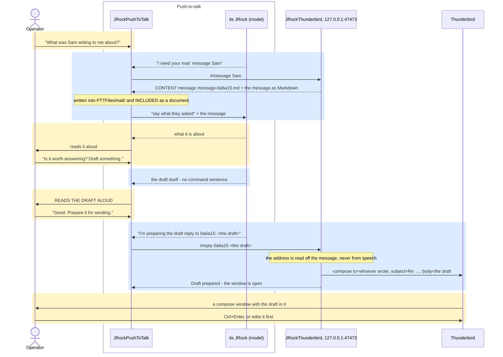

- **The address is read off the message**, never from anything said out loud: the sender of the
  message being answered, and the identity it was addressed to as the sender of the reply. So
  this writes to people who have written to the operator and to nobody else — the same rule
  [`#move`](#a-fifth-agent-thunderbird-your-calendar-and-your-mail-jrockthunderbirdjava)
  follows. A message from one of the operator's own addresses is refused: there is nobody else
  to reply to.
- **Not threaded, and that is a real limitation.** Thunderbird's command line has no
  `In-Reply-To`, so the draft is a new message with `Re:` on it rather than a reply inside the
  thread. It goes to the right person with the right subject; the thread it belongs to is the
  one thing it cannot say.
- **Nothing is sent.** As everywhere else here, the compose window is where it stops and
  Ctrl+Enter is the operator's.

### Both halves, in one window

- **Every line names its calendar**, in square brackets, and `#calendars` lists them with their
  sizes — so "which calendar is that in?" is a question the model can actually answer, and a
  noisy feed can be recognised for what it is. Each calendar also has a **checkbox**, behind the
  **Include…** button: *Holidays in Germany* is 546 entries and would drown a week. They are in
  a window of their own rather than a column beside every answer — a setting touched once when
  a calendar is added does not need 240 pixels of the briefing — and it is **modeless**: a tick
  re-asks the last question behind it, and seeing that happen is the point.
- **Repeats are expanded**: `FREQ=DAILY`, `WEEKLY`, `MONTHLY` and `YEARLY`, with `INTERVAL`,
  `COUNT`, `UNTIL`, `BYDAY` (weekly), `BYMONTH`, `BYMONTHDAY`, plus `EXDATE`, `RDATE` and the
  modified instances Thunderbird stores as rows of their own (a moved one says so, a cancelled
  one disappears). A rule it cannot work out is **still listed**, with a note saying so, because
  an appointment quietly dropped is an appointment missed.
- **All-day events keep their day.** A time with no zone of its own is stored as the wall clock it
  shows, counted as if it were UTC; read in any other zone it slides by hours and lands on the
  wrong date, which is the one thing a date must not do.
- **The schema is Thunderbird's own** (version 23 as this was written, read from
  `cal_calendar_schema_version`). A different one is **reported, not refused** — the tables this
  reads have been stable for years, and a bare refusal would be worse than a warning on a version
  that still works.
- **Hands-free**, the [push-to-talk agent](#the-first-agent-push-to-talk-jrockpushtotalkjava) §19 asks it
  when the model's whole answer is *"I need your calendar for today"*, *"… for this week"* or
  *"… for 2026-12-24 to 2026-12-26"*, exactly as it asks for a location or the weather: the
  briefing goes into the next prompt and the model answers out loud from it. Your event titles do
  go to Bedrock that way — that is the point of asking — and the per-calendar checkboxes are how
  you decide which ones.

## A sixth agent: the web, by looking at it (`JRockBrowser.java`)

A page off the web, read the way a person reads one: by **looking at it**. The agent drives a
browser of its own through the **Chrome DevTools Protocol**, photographs the whole page, and
asks **its own JRock** to turn that photograph into Markdown — which is what the push-to-talk
agent gets back.

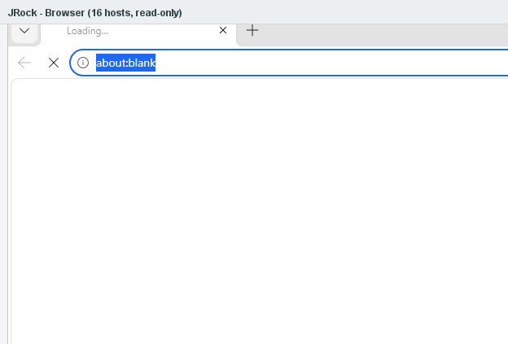

*The host list and the rules are behind the button rather than in front of every answer, which is what keeps this window small enough to sit beside JRock's.*

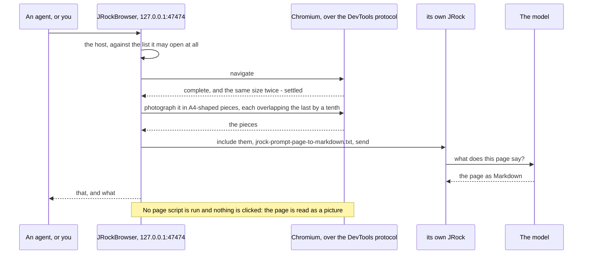


```sh
java -cp jrock.jar JRockBrowser.java                     # the agent, with its window
java -cp jrock.jar JRockBrowser.java --shot zdnet.com    # the photographs, and nothing else
java -cp jrock.jar JRockBrowser.java --links zdnet --wanted "the innovation section"
```

- **Fifteen hosts, five parts of hosts and one page, and nothing else, ever.** The hosts:
  `duckduckgo.com`, `businessinsider.com`, `zdnet.com`, `techcrunch.com`, `scmp.com`,
  `arstechnica.com`, `theverge.com`, `artificialintelligence-news.com`,
  `analyticsindiamag.com`, `venturebeat.com`, `marktechpost.com`, `testingcatalog.com`,
  `news9live.com`, `officechai.com`, `latestly.com` — a list
  in the agent's own source, not a setting, not a line in a request, and not something a model
  can add to. The web is the one thing an agent reaches that nobody in the room controls, so
  what it may reach is written down where it can be read.
- **And five PARTS of hosts** — a path and everything under it, which is the only honest
  way to allow some things. `medium.com` is a million blogs and one of them is wanted, so
  `/data-science-in-your-pocket` is in and the rest of Medium is no more on the list than the
  rest of the web; `mezha.ua` writes in Ukrainian everywhere except `/en`; and documentation
  lives in a product's own corner of an enormous help site, so `helpx.adobe.com` is allowed at
  `/indesign/desktop` and `/lightroom/mobile`, and `docs.aws.amazon.com` at
  `/bedrock/latest/userguide`. Matched on the host — exactly, or with `www.`, and **never a
  subdomain**, because `somebodyelse.medium.com` is somebody else — and on the start of the
  path, as that page (`…/desktop.html`), that folder (`…/desktop/anything`), and nothing that
  merely begins with the same letters (`…/desktop-beta`). Each is asked for by the product's
  name: *"indesign"*, *"lightroom"*, *"bedrock"*, *"data science in your pocket"*, *"mezha"*.
- **And one page whose host is not allowed at all**: Wikipedia's
  [Current events portal](https://en.wikipedia.org/wiki/Portal:Current_events), a summary of the
  day written by people, asked for as *"current events"*. Allowed as a **page** — matched on
  scheme, host and path, with a query refused, since `?action=edit` is a different page wearing
  the same path. Which has a pleasing consequence rather than a cost: **every** link on it goes
  either out to a newspaper (off the list) or further into Wikipedia (not on the list either),
  so it is a page that can be read and not travelled from. `#links` on it answers **0**, which
  is the honest number.
- **Links back to the page you are on are dropped** — "Skip to content", "Expand all", the logo
  that points at itself. Following one would reload what is already there, and on a page whose
  other links all lead off the list they would otherwise be the only candidates left.
- **Checked twice, and the second time is the one that matters.** Once on the address as given,
  and again on **the address the browser actually ended on** — which is not the same thing,
  because a redirect is something a site may do at any moment. Off the list, the page is
  abandoned unphotographed and the answer says where it went. That is a browser's own thought
  about origins: trust what you ended up with, not what you asked for.
- **A screenshot for reading, the DOM for navigating.** Two jobs, two mechanisms. The model
  reads the page off a picture, which is what a person does — and a news page's HTML is mostly
  not the news, so a picture is both smaller and more honest. But a picture cannot be clicked:
  when the next request is *"the AI news section"*, the agent reads the **anchors out of the
  live DOM**, matches the words against their text, and navigates to the one that matches. The
  model never needs an address to follow a link.
- **A4 pieces, overlapping.** A page is as long as it likes, and one enormous image is both
  unreadable and beyond what a browser will render (about 16,000 pixels). So the page is cut
  into pieces the proportions of a sheet of paper (1:1.414), each a clip of its own, overlapping
  by a tenth so a headline cut in half by one piece is whole in the next. zdnet.com's front page
  comes out as **6 pieces of 1531×2165** and arstechnica.com's as 5.
- **Ten seconds, and settled.** `readyState` complete **and** the same measurements twice — a
  page still filling itself in keeps changing size, and that is the difference between loaded
  and finished. Ten seconds at the most, whatever state it is in by then.
- **It clicks nothing.** Not a consent wall, not a cookie banner, not a sign-in — those are the
  operator's to answer, and an agent answering them is an agent agreeing to things in their
  name. So the first read of a site may come back as a picture of a consent wall, **and the
  browser's window is still sitting on it**: answer it once, by hand, and ask again. The
  profile is kept between runs, so the second attempt is the page itself. A paywall or a login
  works the same way — whatever the operator can reach in that window, the agent can then read.
- **The window's own status line wraps to the window.** Every agent's status line is a
  wrapping text area rather than an HTML label, because a label wraps only where its HTML names
  a width in **CSS** pixels — which Swing scales by the display, so `width:680px` asks for 886
  device pixels and a narrower window simply cuts the line off. Measured on a 130% screen: the
  paper docs agent wanted 939 px in a window with 818, and showed two lines of three. A text area
  wraps to the width it actually has, and breaks **inside** a word when the word is wider than
  that — which a file name or an address, being one long token with no space in it, always is.
- **One tab per site**, kept. A second page on a site reuses its tab, and since the only sites
  there are are the ones on the list, there can never be a tab for anything else. Per site rather than one in total
  because a consent answered on one and a sign-in on another are both worth keeping.

  **The browser's own tabs count**, which is what holds that promise over a day. The tab map is
  one run's memory and the browser outlives the run — its profile is kept, the window survives
  an agent that was killed rather than closed, and the operator opens tabs in it themselves. So
  before opening anything the agent asks the browser what it has (`Target.getTargets`) and takes
  the tab already on that site; failing that, a blank one, including the `about:blank` the
  browser starts with. A search after a restart lands in the DuckDuckGo tab that was already
  open, and the startup page is **not** re-navigated when it is already there — whatever is on
  it, results or a half-answered consent dialogue, stays. A lost session repairs itself the same
  way: the tab is still there, so it is attached to again rather than replaced.

  **The empty tabs are closed, and nothing else ever is.** The browser collects them — the
  command line that starts one ends in `about:blank`, and a Chromium whose profile is already
  open answers that by opening a blank tab in the window it already has — and a blank tab is a
  blank page in a window somebody is watching hands-free. Closing an empty one takes nothing
  away: no page, nothing signed in, nothing half read. Never the last tab, though, because
  Chromium closes the window with it. A tab with anything at all on it is left alone.

  **And the browser itself is adopted, not started twice.** A Chromium asked to open a profile
  that is already open doesn't start a browser: the one holding that profile takes the request
  and the process just started exits, so an agent that "starts" it per request was adding a tab
  per request to a window nobody was counting. The agent now notes its browser's debugging
  socket in the profile folder, finds it again on the next run, and connects without launching
  anything. A browser it did not start is also not one it kills on the way out. The note's
  address carries one running browser's own id, so a note left behind by a browser that has
  since been killed matches nothing — and **your** browser, open on the same debugging port for
  your own devtools, is never adopted.

  **The tab being read is brought to the front** (`Target.activateTarget`). Not cosmetic: a tab
  Chromium is not drawing has nothing to photograph, and `Page.captureScreenshot` on a
  background tab never answers at all. It was invisible while every page got a tab of its own —
  a new tab is in front already — and it is what you should see anyway: the window shows the
  page being read.
- **It opens maximized, and the page is the size of the window.** Every tab used to be pinned
  to 1240x1000 whatever the window was doing, so a maximized browser showed the page laid out
  for 1240 pixels with a band of white beside it — the window you are watching, lying about the
  page in it. The metrics override is now **cleared** rather than left unset, because an
  override belongs to the tab and one adopted from a browser a previous run left behind can
  still be carrying the last one. The pictures never needed it: each A4 piece is captured with
  `captureBeyondViewport` and a clip out of the page's own layout metrics, so what is
  photographed is the page at whatever width it is laid out at — measured, duckduckgo.com now
  reads at **1504** pixels wide in 7 pieces on this screen where it read 1240 before. And
  `--start-maximized`, because hands-free the page in that window is your only view of what the
  agent is reading.
- **Its browser is not yours, and the window says where it lives.** The agent starts a Chromium
  of its own — Edge, Chrome, Brave or Vivaldi, whichever it finds — with
  `--user-data-dir=jrock-browser-profile` beside its working folder, e.g.
  `…\JRockAssistant\Agents\Browser\jrock-browser-profile`. That folder is the whole of what
  that browser knows: its cookies, its cache, its history, its local storage. A different
  `--user-data-dir` is a different browser as far as Chromium is concerned, so **nothing of your
  own browsing is visible to it** and what is signed in there is what was signed in there, in
  that window, deliberately.

  The agent's **Help** window shows the **full path and how big it has got** — measured on a
  thread of its own, because a browser cache is tens of thousands of files (327 MB after a few
  days here) and a window should not wait for a disk walk. Both numbers are there for the two
  questions worth asking about a profile: where is it, and how do I make it forget everything?
  The answer to the second is to delete that folder — the next page then starts from a browser
  that has never been anywhere, consent walls and all. Nothing deletes it by itself, because the
  whole point of keeping it is that a consent answered once stays answered.

  **Behind Help, with everything else the window used to say all the time**: the hosts (built
  from the list the check itself uses, so it cannot describe a rule that is not enforced), the
  two-stage address check, that nothing is clicked for you, how a page is read, and the requests
  an agent may send. All of it is behind the button rather than on the page, so what is on
  screen is the field and the controls - a window small enough to sit beside the JRock it
  belongs to, instead of four lines of host names and two paragraphs of prose in front of
  every answer.

| | |
|---|---|
| `#page zdnet.com` | a site's front page — by domain, or by name: `#page South China Morning Post` |
| `#search quantum computing` | a DuckDuckGo search |
| `#docs how do I set a baseline grid in indesign` | a question looked up in a product's own documentation, by walking its labels |
| `#follow the AI link on https://www.zdnet.com/news/` | the matching link on that page, found in its DOM |
| `#links on https://www.zdnet.com/` | what else can be opened there, in words |
| `#parcel 5500148972` | where a parcel is: the tracking page on parcelsapp.com, waited for and read |
| `#hosts` | the list |

### Where is my parcel (`#parcel`)

The one host here that is **asked a question** rather than read: `parcelsapp.com` takes a
tracking number, asks the carriers, and puts what they say on one page — so the page *is* the
answer, and a photograph of it read by a model is the whole of the work.

**The address is the model's, not this code's.** Nothing in the agent knows what a
parcelsapp.com tracking URL looks like, which is the same rule the [weather
agent](#a-fourth-agent-weather-jrockweatherjava) follows for open-meteo: a URL built by
concatenation in an agent is a URL somebody has to come back and edit in that file when the site
moves its paths. `jrock-prompt-parcel-url.txt` beside the agent asks the model for the address
that tracks this number, and what comes back is checked like any other — **https, and on the host
list** — so a model that answers with somewhere else gets nowhere. The tracking number itself is
checked to be letters, digits and dashes before it goes into a prompt.

| | An ordinary page (`#page`) | A parcel (`#parcel`) |
|---|---|---|
| Settled when | the page is **the same size twice** | the **number is on it**, and the size holds for **eight polls** (~3 s) |
| Waits up to | the ordinary timeout | **90 seconds** |
| Why | the page is there when it loads | it arrives `complete` and **empty**, then fills in as each carrier answers |
| Reported as | settled | settled, still changing when time ran out, or the number never appeared |

**And it waits for the tracking**, which is the part a news page never needs. The page arrives
`complete` and **empty** and then fills in as each carrier answers, so the ordinary settle — *the
same size twice* — is satisfied long before there is anything to read. For a parcel the agent
waits up to **90 seconds**, until the **number is on the page** and the page has been the same
size for **eight polls** (about three seconds) rather than two, because every carrier that
answers changes it again. The log says which of those it got: settled, still changing when the
time ran out, or the number never appearing at all.

Push-to-talk reaches it with *"I need the web: parcel 5500148972"* — the number is the only thing
passed on, the carrier is not named and no address is built anywhere but in the model.

### Looking something up in documentation (`#docs`)

Three of the allowed path prefixes are documentation — **InDesign (desktop)**, **Lightroom
(mobile)** and the **Bedrock user guide** — and a question is answered from them by *walking*,
not by searching:

```
#docs how do I set a baseline grid in indesign
  Looking in Adobe InDesign (desktop): page 1 of at most 5…
  Following "Use a baseline grid" (21).
  Looking in Adobe InDesign (desktop): page 2 of at most 5…
  -> helpx.adobe.com/indesign/desktop/layout-and-grid-tools/grids/use-a-baseline-grid.html
     (2 of 5 page fetches)
```

| Asked on `127.0.0.1:47474` | Does |
|---|---|
| `#hosts` | lists the addresses it is allowed to open at all |
| `#page <url>` | opens it, waits for it to settle, reads it as a picture |
| `#site <name>` | the same, for one of the hosts by name |
| `#search <words>` | a search on an allowed engine, then the page |
| `#follow <n>` | follows the nth link it just listed |
| `#links` | what it can follow from where it is |
| `#docs <question>` | **walks** a documentation tree by its labels, at most 5 pages |
| `#parcel` / `#track <number>` | [the parcel page](#where-is-my-parcel-parcel), waited for differently |

- **Why a walk and not a search.** A documentation search box is JavaScript asking a service
  that answers in JSON — no use to an agent that reads pages from pictures and runs no page's
  script. But documentation is a tree whose branches are **labelled** (*"Grids and guides"* →
  *"Create baseline grids"*), so the labels are the index and following them is what a person
  does with the same page.
- **The product is named in the question**, not in a separate argument: *"…in indesign"*,
  *"bedrock: what is a guardrail"*. It is taken out of the question before the labels are
  matched, since it appears on every link in its own documentation.
- **Five page fetches at most**, and the cap ends the walk with whatever it has rather than
  failing. A step is only taken when it matches the question **better** than the one before, so
  the walk goes deeper and never sideways between pages that match equally well — and a site
  that lists its whole tree on the front page (the AWS user guide shows **377** followable links
  there) is answered in one step. All three sets answer in **two fetches**:
  `use-a-baseline-grid.html`, `thread-text-frames.html`, `create-masks.html`, `guardrails.html`.
- **It cannot leave that documentation.** Every step is re-checked after it loads, and only
  links under the same path prefix are considered: Photoshop's help is on the list and is not an
  answer about InDesign.
- **Only the page it stops on is photographed** and read by a model. The pages on the way are
  read for their links alone, which is what keeps the cost of a walk to one page's pictures.
- **The trail comes back with the answer** (`Walked: Use a baseline grid`). The words of the
  question chose the page, so if it stopped somewhere unhelpful, asking again in the
  documentation's own words is what fixes it.

`--docs "<question>"` runs the walk alone — no pictures, no model, no JRock and no window — and
prints every step, which is how the examples above were measured.

**Addresses are for programs, not for saying out loud.** The answer carries the address the
browser ended on — the agent asking is a program, and it needs it to say *"the AI link on
https://www.zdnet.com/news/"* next time. What it must not do is **read one to the operator**:
between the operator and the model there are only site names and plain words, because a URL
spoken aloud is a sentence nobody can check, remember or correct. The appendix says so in as
many words, and the whole address otherwise stays between the two programs, the agent's window,
and its own JRock log.

**What it needs:** a Chromium — Edge, Chrome, Brave or Vivaldi — and nothing else. The DevTools
Protocol is JSON over a WebSocket, and a WebSocket client has been in the JDK since 11
(`java.net.http.WebSocket`), so this is one file with no dependencies like everything else here.

## A seventh agent: paper docs, in and out (`JRockPaperDocs.java`)

The post that comes through the door, and the documents that arrive by every other route — what
the scanner has put in its folder, what arrived when, what a filed letter says, and what was
kept as a document of its own.

**Paper docs, not mail.** The [Thunderbird
agent](#a-fifth-agent-thunderbird-your-calendar-and-your-mail-jrockthunderbirdjava) reads
e-mail; this one reads what is on paper. A scan is a **letter**, a file in the incoming folder
is a **document**, and the answer says which it is, by the folder it came from.

```sh
java -cp jrock.jar JRockPaperDocs.java --folder D:\HPNetworkScan
java -cp jrock.jar JRockPaperDocs.java --folder D:\HPNetworkScan --print recent
```

**No JRock of its own.** It lists folders and reads text files, which needs no model and no
key. Anything that needs one — filing a scan, converting a document, making a document out of a
kept answer — it hands to the **doc inventory flow**, started with `--auto` as a process of its
own. The flow opens a JRock, does the work, prints one line saying what it did, and exits with
its window. So the part that runs all day holds no key, and the part that uses a model lives for
one document.

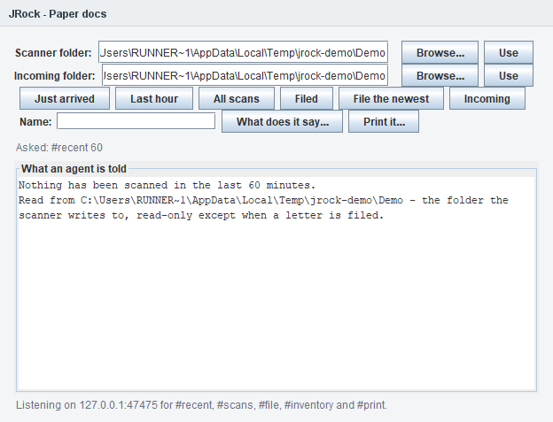

*Both folders on top, each with **Browse...** and **Use**, then the questions as buttons — the
same ones the push-to-talk agent asks it over the socket, so anything an agent can ask, a person
can press. The box is headed **What an agent is told**: the answer it would hand a model, word
for word, including which folder it read and that the folder is read-only except when a letter is
filed. The line at the bottom is the socket it is listening on. Here it has answered `#recent 60`
with "nothing has been scanned in the last 60 minutes", which is what an empty demo folder
honestly says.*

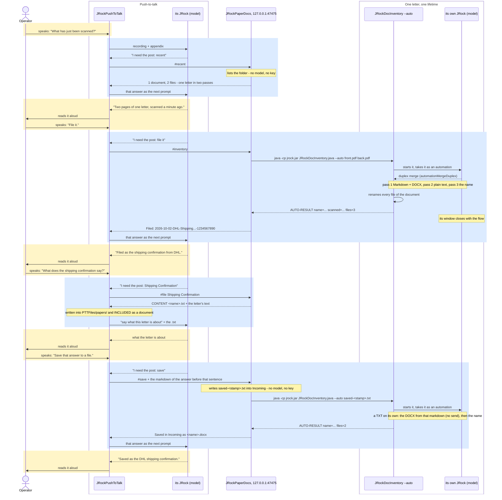

- **Which files make up one letter is said by the operator**, never guessed. A scanner folder
  gives nothing to guess from:

  ```
  scan0164.pdf  21:55:24   2 pages   1.4 MB
  scan0165.pdf  21:58:38   2 pages   1.9 MB
  scan0166.pdf  21:58:59   2 pages   1.9 MB
  scan0167.pdf  21:59:22   2 pages   0.9 MB
  scan0168.pdf  21:59:42   2 pages   0.6 MB
  ```

  Five letters put through a flatbed look exactly like two-and-a-half two-sided ones. Twenty
  seconds apart is both the time to turn a stack over and the time to put the next letter in,
  the page counts match either way, and the names are always adjacent because a scanner counts.
  A wrong guess merges two unrelated letters into one PDF under one name.

  So every scan is reported as itself, with its time and size. `#inventory` files the newest by
  itself, `#inventory scan0166` files that one, and `#inventory scan0166 scan0167` (or
  `#inventory duplex` for the newest two) merges a named pair as two passes of one letter. One
  by itself is the default: a two-sided letter filed as two is two files to tidy up, two letters
  merged is a document that is half somebody else's.
- **A note to self is a mail.** *"I'm making a note: the boiler service is due in March"* opens
  a compose window addressed **from your own address to the same address**, with the note as the
  whole body and `Note: ` and its first line as the subject. Why mail rather than a file
  somewhere: your mailbox is the thing you already search, on every device you own, so a note
  that lands there is a note you will find again — and nothing else here has that property. No
  date and no `.ics`: `#new` is for a thing that happens at a time, this is for a thing to keep.
  **The Markdown is taken off** before it becomes a body: a mail is not a document, so the words
  stay and the asterisks and heading hashes go. The address is the one picked in the window, at
  both ends, so a note cannot reach anybody else, and the last keystroke is yours.
- **Mail can be asked for over any span up to a year**: *"anything from the spring"*, *"did I
  ever hear back from them"*. `#mail 183` is
  183 days and the cap is 366. Weeks, months, half a year and a year are turned into the days
  the agent counts in, and the model is told to reach for a long span whenever the question is
  not about something recent. Forty lines come back at the most, newest first, and the answer
  says when there were more.
- **Two folders, read the same way: the scanner's, and `Documents\Incoming`.** The scanner's
  is where paper arrives; the incoming one is where documents arrive by **every other route** —
  something downloaded, something copied off a phone, and anything this agent was asked to keep.
  `#incoming` lists it newest first, whatever is in it, and anything in it can be asked for by
  name like a filed letter. The rule in each folder differs, and the difference is the point: a
  scan is readable once it has been **filed** (the `.txt` beside it is the flow's receipt, and
  reading an unfiled scan would be reading a picture), while in the incoming folder everything
  readable is readable **now** — nothing there arrived as paper, so there is nothing to convert
  first. That is what makes that folder *always filed by design*.

  **Both are rows in the window**, each with its own *Browse…* and *Use*, and both are
  remembered in `jrock-papers.txt` (`folder=`, `incoming=`). `#folder` answers with both.
- **A file that is not already text is read through the flow.** Asked about a `.docx`, a PDF or
  a photograph in the incoming folder, the agent runs the **doc inventory flow** on it — the
  same run that files a scanned letter — and reads the `.txt` it leaves beside it. So a document
  is converted once however often it is asked about, the text stays on the disk where you can
  see what was read, and the agent itself needs no key, model or window.

  What the flow takes — a PDF, a DOCX, an RTF, a TXT or an image — is exactly what this agent
  reads out. A `.xlsx` is listed and said to be a kind that cannot be read out, rather than
  promised and then refused.
- **On paper: the file's own print action, not a page the agent draws.** `#print <name>` hands
  the document to the shell with the **print** verb — the same thing as right-clicking it in
  Explorer and choosing *Print* — so a PDF goes to the PDF reader, a DOCX to Word, and the pages
  come out of whichever printer is the default one. Either folder, a scanned letter or a
  document that arrived some other way, and `#print` with nothing after it prints the newest
  scan.

  **The best kind there is of that document is the one that prints.** One document is usually
  several files — a filed letter is a PDF with a `.txt` beside it, a kept answer is a DOCX with
  the Markdown it was made from — so the files are grouped by their name without its extension
  and the first kind of `PRINTABLE` that is there wins: the PDF, then the word-processor file,
  then the text, then a picture. A PDF is the document *as it will print*; its `.txt` is the
  right document in the wrong form. Several documents matching the name is a question back, as
  reading one out is — more firmly so here, where a guess costs paper. In the window the button
  needs a name typed into the field: a row of buttons is one stray click away from a sheet of
  paper.
- **Keeping an answer, a handed-over document, or one written to order** — *"I'm saving the last
  answer to a file"*, *"I'm saving the message to a file"*, *"I'm writing a document: …"* — all
  three send the Markdown here.
  The agent writes it to `saved-<stamp>.txt` in the incoming folder and runs the flow on that. A
  `.txt` standing on its own is a document in its own right, so the flow exports it as a **DOCX
  with its pictures placed** (JRock's own Markdown writer, no send — the text is already the
  text) and names both files. One kept answer, end to end: `Heading1` for the `#` line, a bold
  run for `**1,240.00 EUR**`, the bullets as paragraphs, both files named
  `2026-11-30-Unknown-Invoice-2026-0042`, one model call in the run — the name.

  A `.txt` rather than a `.md`: the exporter lays out markdown or plain text, whichever it
  finds, so one text extension is enough. If the naming fails the text is still on the disk, and
  the answer says so.
- **Filing takes minutes, and nothing waits for ever.** The flow behind it is Ghostscript,
  xpdf and three model passes over a scanned page, so a minute or two is an ordinary letter.
  Push-to-talk waits **twelve minutes** for this one request, telling the operator what is
  happening; every other question the paper docs agent answers at once. The flow gets **twenty
  minutes**, kept by a thread of its own that ends the process — the agent reads the flow's
  output until the stream ends, and a stream ends when the process does, so a limit checked
  after the reading could never be reached. A flow that will not exit is killed, the agent
  says so, and the next request is answered.
- **Only `.txt` for content.** Asked what a letter says, it reads the `.txt` beside it and
  nothing else. It converts nothing: turning a PDF into text is the inventory flow's job — with
  Ghostscript, xpdf and a model — and doing it a second way here would be a second answer to
  the same question. A letter that has not been filed has no `.txt`, and the answer says so.
- **Names as they are spoken.** *"Shipping Confirmation"* finds
  `2026-10-02-DHL-ShippingConfirmation-1234567890.txt`: punctuation and case are
  ignored on both sides, and every word of the question has to be somewhere in the name, in any
  order. Several matches is a question back, not a guess.
- **The letter goes into the prompt as a file.** Push-to-talk writes what comes back into
  `PTTFiles/papers/` and **includes** it, exactly as a person would with Ctrl+I — so the
  transcript holds a token and a file beside it rather than ten thousand characters of letter,
  and the model is reading a document rather than a quotation of one.

| | |
|---|---|
| `#recent [minutes]` | what the scanner has put there lately, counted as documents (10 minutes by default) |
| `#scans [n]` | the last *n* scans, newest first, with their times and whether they are filed |
| `#filed [n]` | the letters that have been filed and named |
| `#file <name>` | the text of a filed letter, by any part of its name |
| `#inventory` | file the newest scan, by itself |
| `#inventory <name>` | file that one, by itself |
| `#inventory duplex` | file the newest **two** as one two-sided letter, merged |
| `#inventory <a> <b>` | file those two as one two-sided letter, merged |
| `#print` | print the newest scan on the default printer |
| `#print <name>` | print that document, in the best kind there is of it |
| `#folder` | where it is looking, and whether that folder is there |

## Multi-agent collaboration

Everything at once, and who may say what to whom. The arrows are the real ones — every line in
this diagram is a socket, a spawned process or an API call that exists in the source:

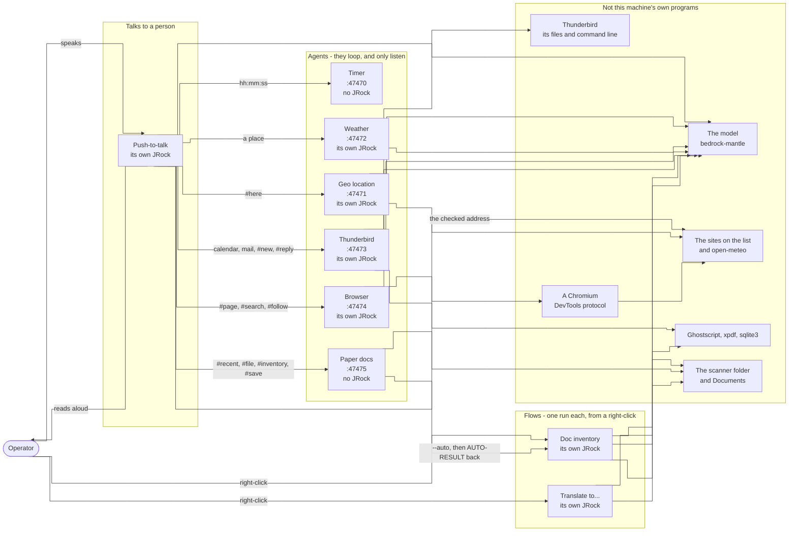

Three things that diagram is for. **Only push-to-talk connects to anything** — every other agent
opens a socket on the loopback interface and waits, so the question "which agent could have
started this?" has one answer. **Two agents have no JRock at all**: the timer, which makes its
own sounds, and the paper docs agent, which drives a flow and otherwise reads a folder. And **every
agent that needs a model has its own** — one JRock per program, one folder per JRock, so two of
them never write the same log or the same prompt file.

The agents are separate programs and they talk over loopback TCP in plain lines of text. Only
push-to-talk talks to a person: it hears the operator through the microphone and answers through
the speaker. Everything else is **robot to robot**:
- the sentences the model says for a program to recognise (it is told to say them in English,
  word for word),
- the lines between the agents,
- the web addresses each agent's model gives and the agent checks before anything is fetched.

Push-to-talk never reads those aloud.

In the diagrams, the **yellow** parts are spoken between the operator and push-to-talk. The
**blue** parts are robot-to-robot: between the agents, their models, and the websites.

**The weather where the operator is.** Two model requests, three agents and two websites, and
the operator hears only the question and the report:

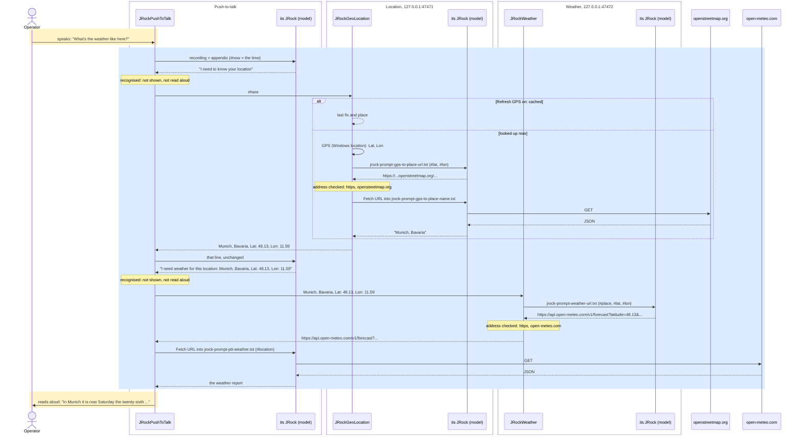

If the operator names a place instead, as in "What's the weather in Berlin?", the model asks
straight away: *"I need weather for this location: Berlin"*. That line has no coordinates, so
push-to-talk first sends `Berlin` to the geo location agent. That agent looks the coordinates up
through openstreetmap.org, the same way it looks up a place above. The rest is the same.

**Setting an alarm.** Here the sentence the program recognises is also what the operator
hears:

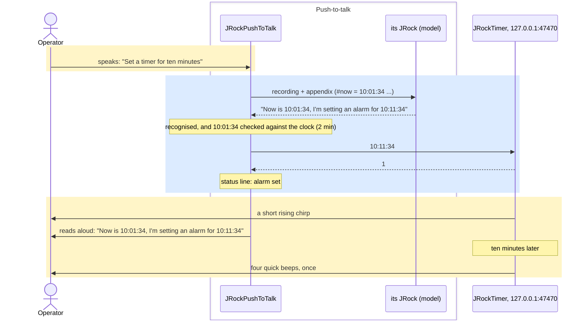

**Putting something in the calendar.** The same shape as the alarm — a sentence the operator
hears, recognised by a program — and then the one step no agent takes by itself:

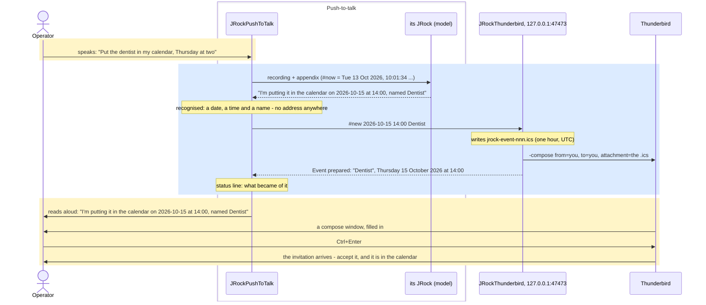

The address is not in any of those lines. It is chosen once in the Thunderbird agent's window,
from the addresses that Thunderbird profile sends from, and used at both ends — so the whole
chain, from a noisy room through a model to a mail, **cannot reach anybody but the operator**.

The agents find each other only by port, with nothing to configure. One that isn't running is
a *connection refused*: push-to-talk says so on its status line, and reads the model's own
answer aloud instead.

## The automation API

`JRock.java` exposes the handful of `public static` methods the script uses. They take and
return nothing but `String`, `String[]`, `long` and `int`, and a `null` return means *fine* —
anything else is a sentence saying what went wrong, in the language the log is written in, so a
script can put it straight into its own dialog without a table of error codes in between.

Static because there is nothing to instantiate: the window, the log, the `__JRock/` directory and
the Bedrock session are one per process, so there is no object that could hold a second set of
them. `JRock.main(new String[0])` shows the window and returns; the methods below drive the one
that is there, and every one of them **blocks and must not be called on the event dispatch
thread** — they say so rather than deadlocking if you do. They are also listed, all of them
together, as [`JRock.Automation`](#the-cheat-sheet-jrockautomation).

**Nothing is said aloud that is not written down.** `automationNarrate()` takes no text: it
reads whatever is selected in the log, exactly as the menu item does. An agent that wants to say
something therefore has it in the log, selects it (`automationSelectLastNote` for its own words,
`automationSelectLastAnswer` for the model's), narrates, and lets the selection go
(`automationClearLogSelection`) — and the reason is the transcript. A spoken answer
with no record of it is the one kind of output this machine cannot account for afterwards; now the
log holds everything JRock has ever said out loud, in order, with the conversation around it, and
the window shows the very words while they are being spoken.

**And the answer is not written down twice.** The model's answer is *already* in the log, as the
answer, so that is what gets selected and read. It used to be copied into a gray line first and
the copy was what was narrated, which put every answer in the window twice — once as the answer,
once as a grey repetition of it underneath. Gray lines are now for what is **not** in the log: an
agent's own sentences, *"Something went wrong. Should I try again?"*, written with
`automationNote(agent, line)` — the agent's name in front so the transcript says who spoke, and
only the words after the name are selected and read out. Reading the answer where it stands also
made narration work in *Dialog only*, where the window shows no gray lines at all and what is not
shown cannot be selected.

### One breaking change in 5.1.0

| Was | Is now | Pick it when you were selecting |
|---|---|---|
| `automationSelectInLog(String text)` | `automationSelectLastAnswer()` | the model's last answer |
| | `automationSelectLastNote()` | the agent's own last note |

`automationSelectInLog(String text)` is **gone**, replaced by `automationSelectLastNote()`
beside `automationSelectLastAnswer()` (both below). An agent or flow of your own that calls
the old one will not compile against this jar; the fix is one line, and which of the two
replaces it depends on what was being selected — the model's last answer, or the agent's own
last note. Everything else added since 5.0.0 is additive: the samples in this release are
written against the new pair.

### The cheat sheet: `JRock.Automation`

**The whole surface in one declaration**, for reading rather than for calling: `public interface
Automation` in `JRock.java` lists every call with its arguments and what it gives back. Grep for
`interface Automation` and the API is on one screen; `JRock.automation()` returns an
implementation that forwards to the statics, for a caller that would rather hold the API than
name it (a test with a stub of its own, say). The method names in the interface are the static
ones — `automationBegin`, not `begin` — because one vocabulary across an agent, this table, the
interface and the log is the point of having it, and `JRockAutomationApiTest` fails the build if
a call is added to one and not the other.

```java
// Starting and finishing
void     main(String[] args)                                 // not in the interface: starts JRock
JFrame   automationWindow()
String   automationBegin(String what)
String   automationAwaitReady(long timeoutMillis)
void     automationEnd(String note)

// The prompt
String   automationLoadPrompt(Path file)                      // absolute, or a bare name here
String   automationPromptText()                               // the text, or null
String   automationSetPrompt(String text)
String   automationClearPrompt()
String   automationInclude(Path file)                         // absolute; the folder decides how
String   automationFetchUrl(String url)

// Sending, and what came back
Sent     automationSend(long timeoutMillis)                   // ok() / failure() / two moments
Path     automationMessageFile(String role, LocalDateTime stamp)   // absolute, or null

// Documents
String   automationExportSelectionDocx(String file)           // the log's selection, left selected
String   automationExportPromptDocx(String file)              // the prompt, or its selection
String   automationMergeDuplex(String front, String back, String out)

// Saying things, and being read afterwards
String   automationNote(String line)                          // named by automationBegin
String   automationSelectLastAnswer()
String   automationSelectLastNote()
String   automationClearLogSelection()
String   automationNarrate()
boolean  automationStopNarration()

// Listening
String   automationStartRecording()
String   automationStopRecording(long timeoutMillis)
String   automationListen(boolean on)
String   automationMicReady()
Heard    automationAwaitHeard(long timeoutMillis)             // heard() / quiet() / failure()
```

**What comes back.** A `String` return is `null` for *done*, and otherwise **the sentence saying
why not** — in the language the log is written in, ready to put straight into a dialog or a status
line. No error codes, and nothing thrown: a flow is a single `.java` file, and an exception
halfway through leaves the document half made. Three calls answer a question instead of doing a
thing (`automationPromptText`, `automationMessageFile`, `automationStopNarration`), and the two
that come back with more than one fact have a type each:

```java
Sent  { boolean ok();  String failure();  LocalDateTime operator();  LocalDateTime assistant(); }
Heard { boolean heard(); boolean quiet(); String failure(); }
```

`Sent.quiet()`'s absence is the point of `Heard` having one: listening has three outcomes —
something was said, the room was silent for this timeout (go round again), or it cannot listen at
all — and as a `String[]` the difference between the last two was `[1] == null`.

**Paths, not path-shaped strings.** `automationLoadPrompt` and `automationInclude` take a `Path`,
and `automationMessageFile` hands one back; `Path.get` is where a character no file name can hold
fails, in the caller's own hands, so nothing in the middle parses anything. An include is
**absolute** — what is included comes from wherever the caller found it — and a prompt file is
absolute **or a bare file name of this folder**, which is `file.equals(file.getFileName())` and
nothing more subtle than that. What each one does, in full:

| Method | What it does |
|---|---|
| `automationAwaitReady(long millis)` | Blocks until the window is up and the model list is in. Returns why not — including the missing API key. |
| `automationBegin(String what)` | Takes the window: prompt read-only, Send held, and a log line saying so. History is left as the checkbox has it. Mutes [Mic always on](#mic-always-on) §31 as well: nobody types into the prompt now, so nobody speaks into it either. The includes the log refers to are already known: every start [reloads them](#includes-that-outlive-the-session) §14. Refuses if an automation is already running. |
| `automationLoadPrompt(Path file)` | Ctrl+O, from a path — **absolute**, or **a bare file name** of the folder this is running in, which is where an agent's own prompts are installed. Anything else is refused rather than resolved: what a relative path would be resolved against is the process's working directory, which an agent started from a right-click entry did not choose. |
| `automationPromptText()` | The prompt's text as it stands, or `null` when there is no automation. What a loaded prompt's bare `@img` / `@txt` placeholders mean is the automation's to decide: read the text, change it, and put it back. |
| `automationSetPrompt(String text)` | Replaces the prompt's text, the cursor at the end. |
| `automationInclude(Path file)` | **Ctrl+I, from a path** — and the kind is the file's own business: its extension and this folder's include settings decide, exactly as the include dialog would. What an agent wants nearly always: a PDF as images, as xpdf HTML or as xpdf text according to *Include a PDF as*, an RTF as Markdown or as its markup, a picture with or without its reference line, each from a copy under `__JRock/includes/` or where it lies — all of which are settings of the folder, and nothing an agent should repeat in its own source. |
| `automationFetchUrl(String url)` | [Fetch URL](#fetching-a-url) §14 (Ctrl+U), for a URL given: the page goes in at the cursor, as a link and an include. A refused URL is a returned reason, not a dialog. Fails when nothing was inserted. |
| `automationClearPrompt()` | Empties the prompt. A send leaves it as sent, so a new question every turn clears it first. |
| `automationStartRecording()` | Start recording (Ctrl+Space): records from Configure's **Record from** microphone, and returns once it is listening. No microphone set is a refusal, not a dialog. |
| `automationStopRecording(long millis)` | Stop recording (Ctrl+Space again), and waits until the recording is in the prompt — an `@audio` token, or the transcribed text with **Transcribe** on. Fails when nothing reached the prompt. |
| `automationListen(boolean on)` | Lifts the mute `automationBegin` put on Mic always on (`true`), or puts it back (`false`). **Turns Mic always on on** if it is off — an agent asking to listen was told to by the operator, and a checkbox in another window is not a second opinion worth having about that; `automationEnd` puts the tick back as they left it, and nothing is written to the config. Refuses only when no microphone is set. |
| `automationAwaitHeard(long millis)` | Waits for a recording [**Mic always on**](#mic-always-on) §31 made. Returns a **`Heard`**: `heard()` when something was said and has reached the prompt, `quiet()` when the room was silent for this timeout — go round again — and `failure()` when it cannot listen at all. Three outcomes, which is why it is a type and not a boolean. |
| `automationMicReady()` | Whether there is a microphone to listen on **right now** — `null` when there is, and otherwise why not, including the one answer a listening loop cannot work out for itself: the microphone set is **not connected**. A quiet room and an unplugged microphone look identical to `automationAwaitHeard`, and they mean opposite things. |
| `automationNarrate()` | Reads **the log's selection** aloud: Markdown stripped, played on **Narrate on**. Returns once it has started, and plays on in the background. Refuses when nothing is selected, when no device is set, or when it isn't connected. **Takes no text** — see below. (Windows) |
| `automationSelectLastAnswer()` | Selects **the whole of the last answer** — the body of the most recent assistant message, without the role header above it or the gray lines under it. `Ctrl+Shift+A` by hand. The one to reach for: the answer is found by **where it is** rather than by its text, so nothing is passed in, nothing has to match, and a flow cannot miss it by a trailing newline or by the ``` fence the model put round it. Refuses when nothing has been answered yet. |
| `automationSelectLastNote()` | Selects **the last line `automationNote` wrote** — its words alone, without the agent's name that goes in front of them in the log. The other half of the pair: there are exactly two things worth saying aloud, the model's last answer and the agent's own last note, and **neither call takes any text**. It replaced `automationSelectInLog(String)`, which took any string and looked for the last place it appeared: an agent had to hand back a copy of what it had just written, and a copy differing by a newline, a space or a ``` fence selected nothing and was then narrated as nothing. Refuses when nothing has been noted (and *Dialog only* hides gray lines). |
| `automationClearLogSelection()` | Lets the selection go and follows the end of the conversation again — the log scrolls nowhere while a selection exists. |
| `automationStopNarration()` | Stops whatever narration is playing. Returns whether one was. |
| `automationSend(long millis)` | Ctrl+Enter, and waits for the answer. Returns a **`Sent`**: `ok()`, `failure()`, and the two moments it wrote as `LocalDateTime`s — which is what `automationMessageFile` takes, so nothing has to be parsed on the way. |
| `automationMessageFile(String role, LocalDateTime stamp)` | The **absolute `Path`** of one `__JRock/messages/` file, or `null` when there is none. `role` is `"operator"` or `"assistant"`; the stamp is one of the two `Sent` hands back, so there is no text to parse in either direction. |
| `automationExportSelectionDocx(String file)` | **The log's own selection** as a DOCX — `Ctrl+Shift+D` through the API, and the third of the trio narration already uses: `automationSelectLastAnswer`, this, `automationClearLogSelection`. The selection is **left as it was found**, an automation being the one that knows when it has finished with it. Refuses when nothing is selected. |
| `automationExportPromptDocx(String file)` | **What the prompt holds** — or its selection, when it has one. Where an automation's own text goes: there is no call that takes Markdown as an argument, because an export is of something the window is **showing**, and a document nobody can see on screen is one nobody can check before it is written. No model, no send, nothing cleared: the prompt is a sheet of paper here. It is what `Ctrl+Shift+D` does by hand when the selection is the prompt's, offered to an automation that has written something and wants it as a file. |
| `automationWindow()` | The `JFrame`, so an automation's own dialogs belong to it. |
| `automationMergeDuplex(front, back, out)` | **Merge two-sided scans**: the same interleave as the window menu — front 1, back N, front 2, back N−1 — with the two dialogs replaced by three arguments. Both passes must have the same page count, or one of them is not the file it was taken for; refused rather than guessed at, since the mistake it makes is every back page against the wrong front. No dialog either way: an automation that cannot press OK must not be shown one. The two scans are left exactly as they were. |
| `automationNote(String line)` | One line in JRock's log, **named by `automationBegin`** — which already said what this automation is called, so the name is given once there rather than in every line: `Push-to-talk: something went wrong`. An agent is started by `javaw` and **has no standard output at all**, and its own window has one status line the next turn overwrites — so this is the only place a reason can still be read an hour later. Needs no `automationBegin` to work, but then the line carries no name. |
| `automationEnd(String note)` | Gives the window back: prompt editable, Send released, Mic always on as you set it, and a log line saying so. |

The "reference" a send returns is a pair of timestamps, because a timestamp already *is* the
name of the file the message was written to (see
[Persistence](#persistence-crash-recovery--full-local-history) §10).
So an automation reads the answer out of `__JRock/messages/<stamp>-assistant.txt` — the same file
you would open yourself — after checking that the request's own file is there, which is what
makes the pair trustworthy. No new state, no separate transcript, nothing an automation can see
that you cannot.

## Configure dialog (top-left button)

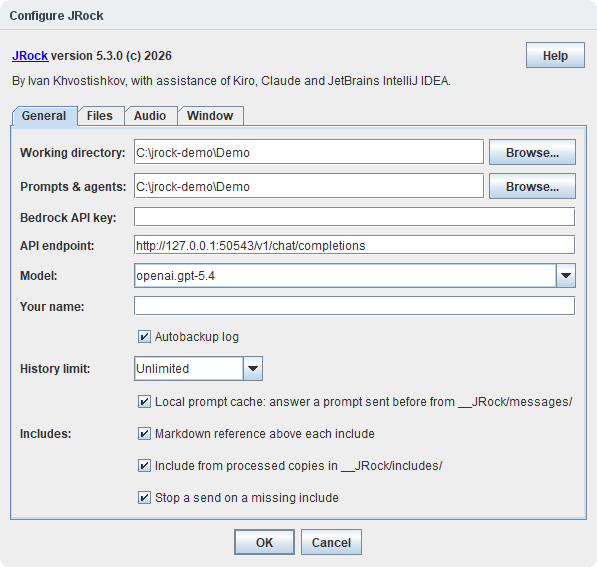

*Every send depends on this tab, and nothing here is guessed at: the key is write-only, the model
is a free line over a dropdown of what the key can reach, and each row says which file keeps it.*

Four tabs, so no one of them is a wall of rows: **General** for what every send depends on,
**Files** for the settings that matter to one kind of file only, **Audio** for the speaker and
the microphone — a tab that is left out where neither can be had, as in the browser — and
**Window** for the window's own size and place.

One word per title, because four of them have to fit side by side across the width of a phone: a
title long enough to be a phrase is a tab strip that scrolls, with the tab nobody can see being
the one they are looking for.

| Tab | Holds | Kept in |
|---|---|---|
| **General** | working directory, prompts directory, API key, endpoint, model, your name, History limit, Clock, History, the prompt cache, the autobackup | `bedrock-key.txt`, and `jrock-config.txt` for the rest |
| **Files** | Images DPI, how a PDF is included, how an RTF is, processed copies, Markdown references, whether a missing include stops a send | `jrock-config.txt` |
| **Audio** | the speaker, the voices, the crackle, the microphone, transcribe, [Mic always on](#mic-always-on) §31 | `jrock-config.txt` — **absent in the browser**, which has neither to choose |
| **Window** | where the window is and how big ([Ctrl+M](#window-size-and-position-configure--window-ctrlm) §29) | `window$` |
| **Help** | [one window of prose](#help-the-button-on-the-first-line): the shortcuts, the folder, the notes | — |

Every row has its own note behind **Help**, and every control answers a right-click with what it
does ([context menus](#context-menus-right-click--long-tap) §32). Pressing **OK** runs the whole
session report again, so what changed is visible in the log rather than taken on trust.

**General**

- **Working directory** (with a Browse button) — reroutes JRock's own files to the chosen
  folder. The OS-level process working directory is unchanged.
- **Prompts** (with a Browse button) — where Ctrl+O and Ctrl+S open,
  always (see [the prompts directory](#the-prompts-directory) §04). It shows the path actually in effect, so
  on a plain launch it shows the working directory; set it back to that to have prompts follow
  the working directory again. Leaving the row untouched changes nothing, so moving the
  working directory alone doesn't pin prompts to the folder you just left. A directory that
  doesn't exist yet is created.
- **Bedrock API key** — write-only: left blank, it keeps the current key; type or paste a value
  to replace it. What you enter is **trimmed** and written to `__JRock/bedrock-key.txt` in the
  working directory, which is where it's read from at startup — trimmed because a pasted key
  arrives with whatever the page copied around it, and no Bedrock key has a space or a newline
  in it. The key is never displayed. The row is there on every platform, since the key is always
  JRock's to hold and no hosting page can hold it instead (see [HTTP transport](#http-transport) §07).
  In the browser the row is a **plain, unmasked field with its own Paste button**. The mask is
  what a phone's CheerpJ build will not raise a keyboard for — the endpoint field beside it, same
  dialog, does come up — and a row you cannot fill in is worse than one whose text can be read
  over your shoulder; the button then works whatever the keyboard does, since a key is pasted
  and never typed from memory. Its menu is **Paste** alone: a key that goes in does not need to
  come back out.
- **API endpoint** — free text: the **Chat Completions URL every request goes to**, in full
  — `https://bedrock-mantle.us-east-1.api.aws/v1/chat/completions`. Another region is another
  host, which is no more typing than a region was. Kept in `__JRock/jrock-config.txt` as
  `endpoint$`, so it survives a restart. The model list is read from `/models` beside it, and a
  [model card](#models) §07 that states its own path — the `/openai/v1` models — keeps that path on
  this host. Prices come from the card for the **region named in the host**, so a host that
  names none simply has no cost line, the same silence a card gives for a region it has no
  row for.
- **Your name** — optional, and the only row here that is about the person rather than the
  machine. Set it and two things follow: the model is told, with the clock, *"The operator
  you are talking to is called Ivan."*, and your own header lines in the transcript end
  with it (`[HUMAN OPERATOR] · Fri, 16 Oct 2026, 14:22 · Ivan`), where the model's end with
  `JRock`. Kept per folder as `operator$`, because a folder is often an agent's rather than a
  person's. Empty is the whole of "not set": nothing is sent, and nothing is shown.
- **Model** — free text with a dropdown of recently fetched models. Kept in
  `__JRock/jrock-config.txt` too — as is the **Images DPI** on the Files tab, which is what makes one
  folder's [agent](#windows-agents-and-flows-one-entry-each) §33 a different agent from the same
  automation installed into another folder.

  **That list is fetched at startup, and afterwards only when there is something new to ask.**
  It depends on exactly two things — the endpoint and the key — and applying this dialog re-runs
  the session report, so changing the narration voice used to cost an HTTP round trip to a models
  endpoint that was going to answer the same thing. Now OK fetches again only when it changed the
  **endpoint**, the **key**, or the **working folder** (which has a key and an endpoint of its
  own); otherwise the report names the list it already has and says it is unchanged. A restart
  always asks.
- **Autobackup log** — on a line of its own, right under the Model, and **on by default**: after five
  minutes without the cursor moving in the prompt, the whole `__JRock/` folder is zipped into
  `jrock-backup-yymmddhhmm.zip` in the working directory, with the Send button held for as
  long as it takes (see [**backup and restore**](#backup-and-restore) §12). Reported at startup
  only when it is **off**, so nobody counts on a backup that isn't being taken.
- **History limit** — how much of the conversation [**History**](#conversation-log) §08 sends with each
  message — which is only ever the messages that were sent with History ticked: the last *N* requests, each with the answer after it, so **4** is at most 8 earlier
  messages before the new prompt. **Unlimited** (the default) sends it all. The cut is always
  at a request, never between one and its answer. Pick from the list or type any number; a
  value that is no number keeps the limit there was. An `#include` already sent in a request
  the limit leaves out is sent again, since the model does not see that request. Kept in
  `__JRock/jrock-config.txt`, per folder, like the model it usually depends on.
- **Local prompt cache** — on by default: a prompt identical to one answered before is
  answered from that answer, and Bedrock is not called (see
  [**Local prompt cache**](#local-prompt-cache) §08).

The three below are the ones about includes, and the dialog keeps them together at the bottom of
the tab under a single **Includes:** label in its left column — the same place **History limit:**
names what its row is about. A run of checkboxes against an empty column reads as one list of
unrelated switches; a label over them says which three belong to each other.

- **Markdown reference above each include** — off by default: every include gets a line above
  its token naming the file, with what the log says of it as its text (see
  [Multimodal includes](#multimodal-includes-ctrli) §14).
- **Include from processed copies in __JRock/includes/** — on by default: each picked file is included
  from a copy under `__JRock/includes/`, an image downscaled to **Images DPI** on the way; off, a
  conversion that has to write under `__JRock/includes/` is refused (see
  [Includes that outlive the session](#includes-that-outlive-the-session) §14).
- **Stop a send on a missing include** — on by default: an included file that is gone, cannot be
  read or is not recorded in the log stops the send, each one named in the log; off, the send goes
  with a warning, and that file's token is sent as text (see
  [Includes that outlive the session](#includes-that-outlive-the-session) §14).

**Files**

- **Images DPI** — how fine a picture JRock keeps, per inch of page: 72 / 96 (screen), **150**
  (documents, the default), 203 (fax/receipt), 300 (print). The image is what the model actually
  sees, so this is a real trade-off — too low and small print is unreadable, too high and you pay
  tokens for detail no model needs. One number for two jobs, because it is the same question asked
  twice: a PDF included as page images is rasterised at it (Ghostscript's `-r`, the page's
  physical size being the PDF's own business), an image's
  [processed copy](#includes-that-outlive-the-session) §14 is downscaled to it, and an image's size
  in cm is reckoned at it in the log and in its Markdown reference — the copy measured
  against A4 less 2 cm margins. Only reported at startup when it isn't the default; every PDF
  conversion logs its full Ghostscript command line regardless, and every downscale says what it
  did.
- **Include PDF as** — *Page images (Ghostscript)* (the default; *Page images (PDF.js)* in the
  browser), *HTML folder (xpdf)* or *Text (xpdf)*: how
  the include dialog, **Include directory...** and `"auto"` automation includes read a PDF (see
  [Multimodal includes](#multimodal-includes-ctrli) §14). The browser offers page images only.
- **Include RTF as** — *Markdown (converted)*, the default, or *Text as is (RTF markup)*.

These two and the four on General above them are kept in `__JRock/jrock-config.txt`, per folder,
as `include-pdf-as$`, `include-rtf-as$`, `include-markdown-references$`,
`include-processed-copies$`, `include-missing-stops-send$` and `local-prompt-cache$`.

The tab is laid out **by file type**, not by setting: the type in bold down the left, how it is
read on the right. Only the three types with something to choose are rows — Images, PDF and RTF —
and where any of it is written is said **once**, at the foot: everything goes to
`__JRock/includes/`, named after the file it came from, and a fetched URL to `__JRock/urls/`. A line
per file type repeating the same path was the repetition, not the information.

An asterisk marks a type that **cannot be included without that folder** — PDF, RTF, DOCX and
XLSX, whose conversions have nowhere else to write — explained once at the foot of the tab
rather than repeated on every row.

**Audio**

- **Crackle while waiting** (Windows / desktop) — a crackle on that same speaker **while a
  model is thinking**, or *(none)*. Seconds pass between a question and its answer; in a window
  being watched that is plain enough, but hands-free, across a room, silence says nothing about
  whether the question was even heard. **Seven tones, and they are notes** — *C, D, E, F, G, A,
  B flat*, one octave from middle C — because the choice is there for a reason worth stating: one
  machine runs several JRocks, one per agent, **sharing a speaker**, so a tone each turns
  *"something is thinking"* into *"the browser is thinking"*. They were five filter settings
  (*deep, low, middle, high, sharp*), which is five shades of one click: a difference you can
  hear with both of them in the same second, and never otherwise — and never otherwise is how
  they are heard. A pitch answers *"which of them is that?"* on its own. Each burst of noise is
  rung through a **resonator at the note's frequency**, a crackle on a string: it still sounds
  like a crackle and it now has a note in it, with the filter's corner riding along so the low
  notes stay duller and the high ones sharper. The loudness is set **after** the ringing, from
  the peak the noise itself reached, because a resonator's gain depends on its frequency. The
  five old names read as the nearest note, so a folder configured before this goes on
  crackling. Tested before it was built: three processes, three tones, one device, 28 opens and
  not one refusal — Java Sound asks for shared streams, so Windows mixes them. The line is
  **closed between crackles**, since a speaker hisses whenever its output stream is active.

  **Preview**, beside it, plays a few seconds of the tone chosen on the speaker chosen — the
  same bursts a wait makes, with the long silences between them taken out, since a faithful
  preview of gaps up to five seconds is a button that appears to do nothing. Picking a tone in
  the dropdown plays one burst too, but one burst is a tick: what has to be judged is the run of
  them, and the only other way to hear that was to send a real request and wait for the answer.
  Both use **what the dialog shows rather than what is saved**, so a tone and a speaker can be
  tried together before OK.
- **Narrate on** and **Record from** (Windows / desktop) — the one speaker
  [Narrate](#narrate-windows-and-the-browser) §31 plays on and the one microphone
  [Ctrl+Space](#recording-from-the-microphone-ctrlspace) §31 records from. Both are free text over a
  dropdown, and neither ever falls back to the default. **The dropdown fills itself the first
  time you open it**, which is the moment you have asked what this machine has — not when JRock
  starts and not when this dialog opens, because asking opens every mixer the system has and
  takes about half a second cold. Once listed, the list stands until the dialog is closed, so
  opening it ten times costs one enumeration; something plugged in while the dialog is open is
  picked up by closing it and opening it again. Whatever is typed in the field survives the
  list being made.
- **Narrate with** (Windows, and the browser) — **the voices** Narrate may read in, by their
  names, on a plain line with an **Add voice** button beside it. **As many as you like, separated by
  commas: the language of the text picks between them.** `Microsoft David Desktop, Microsoft
  Irina Desktop` reads an English answer in David and a Russian one in Irina, which is the point
  of the setting — no one voice reads every language. Empty — the default — means *whichever
  voice here speaks the language*, which is what JRock does when it has not been told
  otherwise. Kept per folder as `narrate-voice$`.

  **Add voice** lists the voices there are and puts the one you pick on the end of the line, so
  the control is never mistaken for the value and the line — which is the value — stays text you
  can type in, reorder or clear. A voice already named is not added twice, and each name appears
  in the list once however many voices report it.

  **The voices are read the first time that button is pressed**, the way the device dropdowns
  fill themselves when they are first opened — about a second of PowerShell, with a wait cursor,
  and only when somebody has asked. Before this they were learned only by *narrating* once, as a
  side effect of the narration script reporting them on its way past, so a dialog opened before
  the first narration offered an empty dropdown: a control that looks broken. A button and a menu
  rather than a dropdown for the same reason — a dropdown is as wide as its widest item, so an
  empty one is a stub the width of its arrow sitting beside a field four times its size, and a
  menu is as wide as the voice names in it. In the browser the page keeps its own voices in
  memory and the list costs nothing.
- **Transcribe recordings into the prompt** (Windows) — under Record from: a recording is typed
  into the prompt by Windows speech recognition instead of being included as `@audio`.
- **Mic always on: record when speech is heard** — under both (see
  [**Mic always on**](#mic-always-on) §31).

In the browser the tab holds the **Narrate with** row alone: the page speaks through whatever
it already plays sound on, so there is no device to pick, and it hands back no audio, so there
is no file to name (see [**narrating in the browser**](#narrating-in-the-browser) §31). The
microphone rows are desktop-only.

Each row names the file its audio goes to, the way the Files tab names its folders:
`__JRock/wav/narration-<date>-<time>.wav`, `__JRock/wav/recording-<date>-<time>.wav`, and
`__JRock/wav/transcribe-<date>-<time>.wav` when a recording was transcribed — one file each, never
overwritten.

Every row above has a **right-click — or, on a touch screen, a long-press — menu** with Copy,
Paste and Select all (the model's is on the combo's editor, which is what a tap lands on). On a
phone there is no Ctrl+V, and *Select all* is in there because a field that already holds a
an endpoint, a model or a path is a field whose contents are in the way of the one being pasted over
it. The API key row is the exception, with Paste alone.

The long press is timed **from the press and checked again on release**, not left to the timer
alone. A `javax.swing.Timer` fires on the event queue, and a modal dialog runs that queue in a
nested loop of its own — in the browser runtime the timer behind it may simply never come up,
and the two dialogs that most need the menu, this one and [Fetch URL](#fetching-a-url) §14, are
modal. Mouse events do arrive there (the field takes the tap and the keyboard appears), so the
clock is read from them instead of trusted to fire, and the long press opens the menu in every
dialog. On the desktop a right-click is simply a right-click.

Applying re-runs the session init (working directory reported first, then models loaded,
ending with `Ready.`). Changing the working directory reloads **both the log and the prompt**
from the new folder, so nothing carries over from the old one. A folder with no prompt of its
own keeps the one on screen and stores it there.

The dialog is titled **Configure JRock** and opens with two lines of its own: the version, with
a **JRock** link to the project on GitHub and a **Help** button at the far end of the same line;
then, below it, who wrote it — Ivan Khvostishkov, with assistance of Kiro, Claude and JetBrains
IntelliJ IDEA. That line wraps on a screen too narrow for it, such as a phone's.

### Help (the button on the first line)

Which JRock this is — the title and version, repeated at the top — what it is, where to write
about it — **jrock@nosocial.net** — and *Source, releases, donate*, which is this repository:
both as links that open the mail program and the browser, each **address on its own line** under
its caption, since on a phone a caption and an address never fit together and one label wrapping
while the other did not looked like two different kinds of line. Then the whole **Shortcuts**
list, **The JRock folder** — every file and subfolder JRock can keep in the working folder, each
with the line that says what it holds (see
[**Persistence**](#persistence-crash-recovery--full-local-history) §10) — and the **Notes** on what
every setting does and which file keeps it. All of it in one scrolling window that opens *on top
of* Configure and centred on it, so anything already typed into the form is still there when it
closes.

| The Help window holds | Which is |
|---|---|
| Title and version | the same line the About box has |
| Write about it | `jrock@nosocial.net`, on a line of its own |
| Source, releases, donate | this repository, likewise |
| **Shortcuts** | all of [the twenty](#keyboard-shortcuts) §34 |
| **The JRock folder** | every file and folder it can hold, each with what it is for ([Persistence](#persistence-crash-recovery--full-local-history) §10) |
| **Notes** | what every Configure row does, and which file keeps it ([Settings files](#settings-files) §11) |

It is a window of its own rather than part of the Configure dialog, so someone who opened
Configure to change the model sees the rows and not three screens of prose around them, and the
prose is one button away when it is wanted. The window is sized against the screen, like the
[Fetch URL](#fetching-a-url) §14 dialog, so on a phone it is a short window that scrolls rather than a tall one with its button
off the bottom.

## The window: its size, place, title and icon

### Window size and position (Configure → Window, Ctrl+M)

The **Window** tab of the Configure dialog sets the window's **width/height** and **on-screen
X/Y** numerically, with the screens in a **table** below them — one row each, their sizes and
top-left corners under each other, the window's own screen in bold — and a line saying where on
that screen the window is. Handy for precise placement, or for moving across monitors without the
mouse. **Ctrl+M** opens Configure straight onto it.

It has a **Set** button of its own, and that is the point of it being a tab: Set applies the four
numbers to the window at once, so the result is there to be looked at — and nudged again, and
again — with the dialog still open. **Enter** in this tab is Set, not OK: every other tab holds
settings OK saves, but here the button that does the work is Set, and Enter reaching OK would
close the dialog without moving anything.

**Where the window is left is where it opens.** Every move and every resize — the title bar, a
corner, a window manager tiling it, the browser page resizing itself around it — is written to
this folder's `__JRock/jrock-config.txt` as `window=x,y,width,height` once the window has stood
still for a moment, and the next start opens it there instead of centred. Nothing has to be
pressed for that: the size you dragged the window to is the size you want it, and a window put on
the second monitor for a reason belongs there tomorrow too. Each folder's JRock keeps its own
corner of the screen.

| What happens to the window | Written to `window$`? |
|---|---|
| dragged by the title bar, or resized by a corner | **yes**, once it has stood still |
| moved by a window manager tiling it | yes |
| the browser page resizing around it | yes |
| **Set** in the Window tab | yes — which is why **Cancel** is the way out |
| **maximized** | no: those bounds are the invisible borders', not a place anybody chose |
| opened where no screen is any more (a docked laptop) | ignored, with a line in the log, and centred instead |

It is **one write per drag, not one per pixel** — the window has to settle first — and a
**maximized** window is not written at all: the bounds a maximized frame reports are the ones its
invisible borders need rather than a place anybody chose, so the size it had before it was
maximized is what comes back. A remembered place that is on **no screen any more** — a laptop
that was docked when it was written — is ignored, with a line in the log saying so, rather than
opening the window where nobody can reach it.

**Set remembers the same way**, so **Cancel** is the way out that leaves the rest of the dialog
alone; this tab is for placing the window exactly, to the pixel, which a mouse cannot do.

In the **browser** it also saves a resize at every start. CheerpJ sizes the window to the page it
is in, and with the page's size already in the configuration the window is that size from the
first paint instead of being built at JRock's default size and laid out a second time.

#### Per-folder window title & icon

The window title and taskbar/Alt-Tab icon reflect the **working directory** so multiple JRock
windows opened in different folders are easy to tell apart:

- The title is `<folder> - JRock` (folder name first, so it stays visible even when Alt-Tab
  truncates the text).
- The app icon is a generated teal tile badged with a short abbreviation of the folder name
  (e.g. `my-cool-project` → `MCP`, `research` → `RES`).

Both follow a change of working directory, so they always name the folder the window is
actually working in.

In the browser the plain title `JRock - Bedrock (mantle)` and the plain `JR` icon are used
while the working directory is CheerpJ's own mount (`/files`) — a folder nobody chose. Open one
of your own and it is named in the title just as on the desktop.

| Working directory | Title | Icon |
|---|---|---|
| `C:\demo\Demo` | `Demo - JRock` | `DEM` |
| `D:\work\my-cool-project` | `my-cool-project - JRock` | `MCP` |
| `D:\scans\research` | `research - JRock` | `RES` |
| `/files` (the browser's own mount) | `JRock - Bedrock (mantle)` | `JR` |

Every screenshot in this README shows it: the caption bar names the folder, which is how one
picture of an agent is told from another.

## Getting the answer out: printing, RTF and DOCX

### Printing / PDF (Ctrl+P)

Opens the native print dialog for the log. On Windows you can pick "Microsoft Print to PDF"
to save the transcript to a PDF, or print to a physical printer. If text is selected in the
log pane, only the selection is printed (with its colors), so a single answer can be printed
without the surrounding transcript.

| | Ctrl+P | Ctrl+Shift+D ([DOCX](#markdown-export-rtf-and-docx)) |
|---|---|---|
| What it is | the window's own transcript, printed | the Markdown, typeset |
| Takes | the log, or just the selection | the selection, or the whole prompt |
| Keeps | the pane's colours and gray lines | headings, tables, pictures, named styles |
| Needs | a printer, or *Print to PDF* | nothing |
| Good for | a record of what was said | a document somebody else lays out |

### Markdown export (RTF and DOCX)

The model answers in Markdown. Select an answer in the log, right-click, and two more items
write that answer out as a document: **Export selected Markdown as RTF...** and **Export
selected Markdown with images as DOCX...**. Both are greyed out without a selection — there is
nothing to export but a selection — and a save dialog gives the file the right extension whatever
you type into it.

**The selection may be the prompt's, not only the log's.** Both export items take whichever
selection there is, and the **prompt's wins** when both have one — which is the whole point of
it. An answer is almost right: a date wrong, a paragraph too many, a heading to add. The log is
a transcript and cannot be edited, so what anybody actually does is copy the answer into the
prompt, fix the line, select it and want a document out of **that** — without sending anything,
without paying for a second answer, and without a word processor in between. The menu items say
which source they are about to use (*"…from the prompt"*, *"…from the log"*), and nothing is
sent or cleared: the prompt is read, not consumed.

**The same two items are in the prompt's own menu**, on the prompt's selection. Each menu acts
on its own side, and neither has to say which: they used to live in the log's menu alone and take
whichever selection existed, the prompt's winning when both did, with the label changing to
*"...(from the prompt)"* to admit it — which is a menu answering a question nobody asked it. The
prompt's selection is the interesting one, and now it is reached from where the editing was done:
the way to make a document out of an answer with a correction in it is to copy the answer into
the prompt, change the line that is wrong, select it and export **that**. The log is a transcript
and cannot be edited at all.

**Ctrl+Shift+D** and **Ctrl+Shift+R** still take either — the prompt's selection when it has one,
the log's otherwise. One pair of keys cannot belong to two menus, and what they act on is
whichever selection there is.

**Ctrl+Shift+A selects the last answer**, which is the step before them and was the only one
that needed the mouse: *draft a letter to the landlord about the heating* → **Ctrl+Shift+A** →
**Ctrl+Shift+D**, and the draft is a DOCX. It takes the **body** of the most recent answer and
nothing else — the role header one line above it is not part of the letter, and dragging a
selection over an answer longer than the window takes the header in about as often as not. The
same item is first in the log's menu, greyed out until something has been answered; pressed in
a log with no answer in it, the key says so in the log rather than doing nothing at all. Not mobile-only, and not desktop-only: it is the same code in a browser tab,
because both converters are built in and neither starts a process.

- **RTF** is written by hand as plain ASCII: every character above it becomes a `\u` control
  word, so no encoding anywhere can change what the file says. Swing's `RTFEditorKit` reads the
  import direction but does *not* write this one — its writer has no notion of a table, and a
  table is half of what a document is for.
- **DOCX** is a six-part OOXML package (`[Content_Types].xml`, two `_rels`, `word/styles.xml`,
  `word/footer1.xml`, `word/document.xml`) zipped with `java.util.zip`, plus one `word/media/`
  part per picture it places. The paragraphs carry **named styles** — Normal, Heading 1–6, Code,
  Quote — and the page is A4 with 2 cm margins, which is why this is the format to export for
  typesetting: a layout application imports a document by mapping style *names* onto its own.
- **A ``` fence round the whole selection comes off** before a word of it is read. A model asked
  for Markdown very often answers with the Markdown *inside* a fence — ` ```markdown ` on the
  first line, ` ``` ` on the last — which is it saying "this is Markdown" rather than Markdown.
  Read as it stands, the whole letter became **one code block**: Consolas, indented, no headings,
  no tables, no pictures placed, with the two fence lines as text at each end. A fence in the
  *middle* of an answer is a code block the model meant and stays one, and so does an answer that
  is two fenced blocks: only a fence around the whole of it is a wrapper. The log says when one
  was taken off.
- **A footer on every page**: `Created by JRock` at the left margin, `jrock.nosocial.net` at the
  right, in 8pt gray. One paragraph, with the two ends held apart by a **right tab stop** on the
  right margin — which moves with the page, so a landscape export puts the address on the
  landscape margin. Deliberately a line of text and not a logo: a picture in the footer would be
  a picture in the media of every export. It is in the footer and not in the text because a
  document gets passed on — printed, scanned, forwarded, pasted into something else — and what
  is printed on every page is the part that survives that. The DOCX *importer* ignores headers
  and footers, so a document exported and included again comes back as the Markdown it was.
- **Which A4** is the DOCX save dialog's file-type dropdown: **DOCX document as A4 portrait** or
  **as A4 landscape**. Same extension either way, so what you type is unaffected; the orientation
  is a property of the document, and the save dialog is the last moment anybody is asked anything.
  Landscape is worth having for a wide table or a landscape photograph, both of which are laid out
  to fit the text frame — and on a portrait page that frame is the narrow way round. The log line
  says which one it wrote.

What the Markdown becomes, in both:

| In the Markdown | In the document |
|---|---|
| `#` … `######` | Heading 1–6, sized 18 pt down to 11 pt |
| `**bold**`, `*italic*`, `` `code` `` | bold, italic, a monospace run |
| `-`/`*`/`+` and `1.`/`1)` items, indented | a list paragraph, bullet or its own number, nested up to five levels |
| `> quoted` | an indented italic paragraph — the *Quote* style in the DOCX, so a bold run inside it stays bold-italic |
| a fenced block (three backticks or tildes) | a Code paragraph, verbatim |
| `---`, `***`, `___` | a horizontal rule |
| `\| a \| table \|` with a `\| --- \|` row | a real table: bordered cells, columns shared across the page width, first row repeated as a header, and `:---:` / `---:` honoured as cell alignment |
| `[text](url)` | in the DOCX, a real hyperlink: the text, underlined and clickable, in Word's *Hyperlink* character style; in the RTF, the text with the URL after it unless the two say the same thing |
| `\*` and the rest of Markdown's escapes | the character itself |

An export **does not fail**. The parser's answer to anything it doesn't recognise is "a
paragraph of text"; if it throws anyway, the document is rebuilt as one paragraph per line and
the log says so — *the text is all there, the formatting is not*. The log line reports what was
written: the file, the block and table counts, and the byte count.

A `.docx` written here reads back through **DOCX as Markdown text** as the same Markdown,
**pictures and all** — each one written out beside the Markdown and referred to from the place in
the text it was placed at ([details](#rtf-and-docx-conversion-no-external-tool) §15) — give or take
the two honest differences a round trip has: a table's header row is written bold, so it comes
back as bold markup, and column alignment is layout the import doesn't read.

#### Images in the DOCX

The DOCX export is the one that carries pictures, which is what *with images* in its name means.
It works on the two things an include leaves in the text, and the model repeats in its answer:

| In the Markdown | In the DOCX |
|---|---|
| `` or `` of an **included** image | the picture itself, zipped into the package as a `word/media/` part and placed as an inline drawing |
| `@img <hash>` of an **included** image | the file's **base name**, `IMG_4002.jpg`, as text — the token named a file, and the document says which |
| either one, for a hash **not included** in this session | the line exactly as it stands, plus a warning in the log |
| an inline `<svg ...>...</svg>`, such as a diagram the model drew | the picture itself, as a `word/media/imageN.svg` part, in the line where it was written, or in a paragraph of its own when a `<div>` wraps it |

**Inline SVG** is placed at the size its markup gives it. Plain numbers and `px` in `width` and
`height` are pixels at **Images DPI** from Configure, the same resolution an included image's size
in cm is measured at, so `width="300"` is 5.08 cm at 150 dpi and 2.54 cm at 300 dpi. `in`, `cm`,
`mm`, `pt` and `pc` keep their physical size at any setting. A missing dimension is worked out from
the `viewBox` proportions, and an SVG with no size at all gets a browser's default of 300 × 150
pixels. It is held to the text frame, never stretched past it. The part is written as a standalone `.svg` file, with the XML declaration and the `xmlns` that
SVG embedded in HTML can leave out, so you can also open it on its own. Word 2016 and later draw it
through their `svgBlip` extension, and the drawing's ordinary `r:embed` points at the same part for
readers that don't know that extension. An SVG inside a code fence is code and stays text. One
that isn't well-formed XML also stays text, and the log warns about it.

**Nothing about an image stops an export.** A hash whose file was never included — a restart
forgets the includes, and the model can invent a hash as easily as a word — is left in the text
as the text it is, and the log says which hash and why once, however many times it occurs. The
same goes for an include that is not an image at all (a `@txt` file the model referenced as a
picture) or a file whose bytes are not a PNG, JPEG, GIF or WEBP: the reference stays, the export
finishes. The log line counts the pictures it did place along with the blocks and tables.

**Sizes are physical, and resolution is the limit.** The page is A4 with 2 cm margins, so the
text frame is 17 × 25.7 cm portrait and 25.7 × 17 cm landscape, and an image is placed as large as
it can be without falling below **300 dpi** in either direction:

- A picture big enough in pixels fills the text frame — the width for a landscape one, the height
  for a portrait one, whichever runs out first. **Both frame dimensions come from the orientation
  the export was asked for**, so a landscape picture on a landscape page is placed against the
  25.7 cm width rather than against the 17 cm of a page it isn't on. A table's columns are shared
  out of the same frame, and the section states the page both ways a reader might read it: the two
  dimensions swapped, and `w:orient="landscape"`.
- A picture too small for that is placed at exactly 300 dpi instead, so it takes up *less* than
  the frame and stays sharp rather than being blown up into a blur. A 300 × 200 px image becomes
  2.54 × 1.69 cm, not a page-wide smudge.
- Width and height are scaled by one and the same factor in every case, so nothing is ever
  distorted. That factor is an integer number of EMU per pixel (the smallest of the three
  limits), which is why the aspect ratio cannot drift as it would with two independent divisions.

The pixel dimensions come from the same header reader the include stats use, and the media part's
extension and content type are decided by **sniffing the file's magic bytes**, not by trusting its
name: a `.png` that is really a JPEG would otherwise produce a package whose content types lie,
and Word answers that with a repair dialog rather than a document.

**The RTF export keeps the simplified logic**: no pictures, and `` and `@img <hash>`
are written out as the text they are. An RTF has no package to put a picture in — the bytes would
have to be hex-dumped into the file itself — and the format is there for anything that opens an
RTF, not for typesetting.

## Narrate (Windows, and the browser)

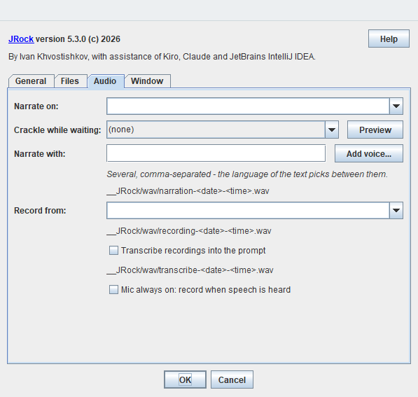

*The speaker and the microphone are yours to pick and nobody else's — there is no fallback to
whatever the system moved its default to — and the file each recording lands in is named here too.*

Select text in the log, right-click, **Narrate selected text**: it is read aloud — by
Windows' own voices on the desktop, and by the browser's own in [JRock
Web](#jrock-web-in-the-browser). While it reads, the same item says **Stop narrating** and
stops it mid-word. The log says what is happening: how many characters, which voice, and
when it finishes.

- **The speaker is yours to set, and nobody else's.** Windows moves its default output to
  whatever was plugged in last, so JRock does not use that default. A first run has no device set.
  Open **Configure → Narrate on:** and the dropdown lists what this machine has; pick one,
  press OK, and it is kept as `narrate-device$` in `__JRock/jrock-config.txt`. (Pressing Narrate with nothing set says so and lists
  them too.) That field is free text over a dropdown, like the model, and emptying it is how a
  device is unset.
- **A device that is not there is a failure, and no fallback.** If the speaker is disconnected
  (a Bluetooth speaker switched off, headphones unplugged), Narrate says so in the log and reads
  nothing. It does not switch to another device. The same happens if the device disappears during
  a reading: it is checked every two seconds.
- **SAPI renders, Java plays.** `System.Speech` can only play on the Windows default, so it
  renders 22.05 kHz 16-bit mono PCM into a pipe instead, and JRock plays that with Java Sound on
  the chosen device.
- **Each narration is saved** as `__JRock/wav/narration-<date>-<time>.wav` — a file of its own,
  never overwritten, for when something sounds wrong: the narration worth hearing again is the
  one that sounded wrong, and an overwrite would have thrown it away by the time anybody went
  looking. A stopped narration is saved as far as it played.
- **Pick the voices, and the language picks between them.** **Configure → Audio → Narrate with**
  is a plain line that takes as many voice names as you like, separated by commas, with an
  **Add** dropdown beside it that puts one on the end of the line and then goes straight back
  to blank — so what the dropdown shows is never mistaken for the setting (the line is), and
  the line stays text you can type in, reorder or clear. Every voice Windows has is in that
  list —
  `Microsoft David Desktop, Microsoft Irina Desktop` reads English in David and Russian in Irina.
  The order is the order of preference, and the rule is:

  1. a voice you named whose own language is the language of the text;
  2. failing that, **any** installed voice whose language it is — because a voice reading a
     language it does not have comes out as gibberish, or as pure silence, which is the one
     outcome worth overriding your choice to avoid (a third-party English voice asked for Russian
     renders nothing at all, with no error);
  3. failing that, the first voice you named, whatever it speaks;
  4. failing that, SAPI's own default.

  Left empty, rule 2 is the whole of it — which is what makes a Russian answer read in Russian
  with nothing configured. The log names the voice that spoke every time, and says so when it had
  to fall back, when none of your names is installed, and when a voice produced no audio at all.
  More voices come from **Settings → Time & language → Speech** — SAPI sees only the classic
  *Desktop* ones, not the newer (OneCore) voices.

- **SAPI, through PowerShell, not JNI.** The voice is SAPI 5, reached through `System.Speech`,
  the .NET wrapper that comes with PowerShell on every Windows. JNI would mean a native DLL built
  for each architecture and shipped beside the jar, where one short script makes the same call.
  The PowerShell process lasts exactly as long as the reading, so stopping it is ending the process.
- **The text goes over as a UTF-8 file**, not as an argument, so a command line and its code
  page (see [**Names Windows cannot put on a command
  line**](#windows-agents-and-flows-one-entry-each)) cannot turn Cyrillic into `?`.
- **The Markdown is read, not the markup.** Headings, `**bold**`, `` `code` ``, list and quote
  markers, table pipes and rules are dropped, links keep their text, and `@txt`/`@img`/`@audio`
  tokens and picture references are left out entirely.
- **The voice follows the text's script.** Most letters in Cyrillic asks for an installed voice
  whose language is `ru`, and the same goes for Greek, Chinese, Japanese, Korean, Arabic, Hebrew
  and Thai. Latin letters get Windows' default voice. When no installed voice speaks that
  language, the log says so and the default voice reads it. A voice comes with the language's
  speech pack (**Settings → Time & language → Language**, or **Speech → Add voices**), but SAPI
  sees only the classic *Desktop* voices, such as Microsoft Irina Desktop (`ru-RU`). A newer
  voice that Settings lists may not be one of them.

### Narrating in the browser

In [JRock Web](#jrock-web-in-the-browser) §05 the same menu item reads the selection out in the
**browser's own voice**, over the same [page bridge](#http-transport) §07 the HTTP client, the
clipboard and the PDF engine use: the page is handed the text, the language JRock worked out
from it, and the **Narrate with** line, and it picks between its own voices by exactly the
rules above. The **Audio** tab appears in Configure for it, with that line and its **Add**
dropdown — filled with the browser's voices the moment the dialog opens, since asking for them
costs nothing there (on the desktop the list is what the last narration reported, because
enumerating them means starting PowerShell).

| Narration | **Desktop (Windows)** | **A browser tab** |
|---|---|---|
| Voices | SAPI's, enumerated by PowerShell when one last read | the browser's, listed the moment Configure opens |
| Output device | **Narrate on**, yours to pick | whatever the page already plays on — no row for it |
| A file to keep | `__JRock/wav/narration-<date>-<time>.wav` | none: the browser renders the speech itself |
| Stop mid-word | yes | yes |

Three things are different in a tab, and the window says so rather than pretending otherwise:

- **No output device**, so there is no *Narrate on* row: the page speaks through whatever it
  already plays sound on, and offers nobody a say in it.
- **No audio file.** The browser renders the speech itself and hands back nothing but the name
  of the voice that read it, so there is no `__JRock/wav/narration-...wav` to keep — and the
  dialog does not name one.
- **A browser speaks only for a page it has been used on**, and the tap that reached the menu
  is long over by the time Java calls back. So the page opens the door on the way past: every
  touch and every key press spends one utterance nobody can hear — a **space**, at volume
  zero — until one of them is seen to *start*. The start event is the only proof a browser
  gives that it accepts speech from the page; **no error is not proof.** A browser that has
  not allowed it takes the text, raises the events and makes no sound at all, so JRock waits
  for the start, and says so when it never comes: *"the browser took the text and said nothing
  … tap the page once and press Narrate again"*, with `speaking`, `pending` and `paused` in
  the line when it timed out instead.

  On **iOS — which is every browser there, Safari, Chrome and Edge alike, all of them WebKit**
  — three things matter. An *empty* utterance is dropped without a sound and without a start
  event, so it opens nothing (hence the space). A `cancel()` immediately followed by a
  `speak()` drops the new utterance silently and can leave the queue **paused**, which looks
  exactly like speaking with no sound — so a cancel is only issued when something is really
  going, and `resume()` follows every `speak()`. And the device's **silent switch and volume**
  apply: a browser's own *Read aloud* and a video playing with sound both prove nothing here,
  since those use the system voice and the media audio path, not the page's speech synthesiser.

What is the same: the Markdown is read and not the markup, the language of the text picks the
voice, *Stop narrating* stops it mid-word, the log names the voice that read it, and
`narrate-voice$` is kept in `__JRock/jrock-config.txt` exactly as on the desktop. The microphone
is **not** in the browser build — recording still wants `wav` or `mp3`, which is not what a
browser hands back.

### Recording from the microphone (Ctrl+Space)

The other direction. **Press Ctrl+Space** in the JRock window — it counts once both keys are up,
in either order — and the log says the recording has started. **Press Ctrl+Space again** and the
log says the recording is done: it is a toggle, so you can talk with your hands off the keyboard.
The prompt's right-click menu has the same toggle, **Start recording** / **Stop recording**, as
the log's has Narrate selected text / Stop narrating. The recording is saved as `__JRock/wav/recording-<date>-<time>.wav` and included as `@audio` at the
prompt cursor, as if you had picked that file with Ctrl+I. It works on any desktop, not just
Windows, and in the browser (see [**recording in the browser**](#recording-in-the-browser)).

| | **Ctrl+Space** | **[Mic always on](#mic-always-on)** |
|---|---|---|
| Starts on | both keys up, in either order | speech — about 0.2 s of voice in the 250–4000 Hz band |
| Ends on | the same keys again | 1.5 s of quiet |
| Keeps the run-up | — | the last **2 s**, from a ring buffer, so you can just start talking |
| Tail kept | 0.3 s after you stop, so the last word is whole | the same |
| Saved as | `__JRock/wav/recording-<date>-<time>.wav` | the same |
| Then | included as `@audio` at the cursor | included, or [transcribed](#recording-from-the-microphone-ctrlspace) into the prompt |
| Format | 16 kHz 16-bit mono where offered, else 44.1/48 kHz | the same |

- **The microphone is set like the speaker.** A first run has none set. Ctrl+Space then records
  nothing, asks you to set up the microphone, and lists the microphones into **Configure → Record
  from:**. The choice is kept as `record-device$`. Empty the field and press Ctrl+Space to list
  the microphones again. A disconnected microphone makes the recording fail with a line in the
  log, and there is never a fallback to the Windows default ("Primary Sound Capture Driver" is
  not offered).
- **The log says when the microphone comes and goes**: "Microphone connected: …" and
  "Microphone disconnected: …". Java Sound has no hot-plug event, so JRock looks every two
  seconds. The Windows driver refreshes its own device list every five, so a change shows up
  within about seven seconds. The startup report says whether the microphone is connected.
- **16 kHz, 16-bit mono** when the microphone offers it, which is plenty for speech. Otherwise
  44.1 or 48 kHz. Leaving the window while recording does not end the recording; come back and
  press Ctrl+Space (or Stop recording) to end it.
- **Recording continues for 0.3 s after you stop it.** The stop usually comes while the
  last word is still being said, and without the extra time that word is cut off. A recognizer
  then hears half a word as a different one.
- **A new file for every recording**, named for the moment it was made. An include is checked
  against its file at every send, including every earlier turn that History sends again. If one
  file were overwritten, every earlier `@audio` token would name a file that has changed since,
  and the conversation could not go on.
- **Transcribe recordings into the prompt** (Windows; the checkbox under **Record from:**, kept
  as `record-transcribe$`). With it ticked, the recording is not included. Windows speech
  recognition (SAPI dictation, the same `System.Speech` Narrate speaks with) turns it into
  text, and the text is typed at the prompt cursor. The audio is kept as
  `__JRock/wav/transcribe-<date>-<time>.wav` — a file per recording like any other, even though no
  token ever names it, because a word the recognizer got wrong is a wav worth playing back. The
  recognizer is always the **en-GB** one, whatever Windows' default is, and the log names it.
  System.Speech sees only the classic *Desktop* recognizers (English and a few others), so
  Russian speech, for one, is not recognized. **Use a proper microphone.** A Bluetooth
  headset's hands-free mic sends 8 kHz telephone audio with nothing above 4 kHz, and the
  recognizer turns that into gibberish. "Today is a good day, do you agree with me" came out
  as "A DMZ a W Greenwood". A good microphone is necessary, but it is not enough. The sample
  rate is not the limit: Windows' own voice is recognized word for word at anything from 8 to
  48 kHz. The limit is dictation that has not been trained on your voice, and it can still
  mishear an accent. When it does, leave the box unticked and let the model hear the recording.
  Voxtral transcribes it if the `@audio` token comes first and the text after it asks for
  exactly that, e.g. *"Transcribe this audio verbatim in its original language. Output only the
  transcript."*

### Recording in the browser

[JRock Web](#jrock-web-in-the-browser) §05 records too, over the same [page
bridge](#http-transport) the HTTP client, the clipboard, the PDF engine and
[narration](#narrating-in-the-browser) use: Ctrl+Space, again to stop, and the recording lands in
`__JRock/wav/` and goes into the prompt as `@audio`, exactly as on the desktop.

| Recording | **Desktop** | **A browser tab** |
|---|---|---|
| Captured by | Java Sound, from your **Record from** device | an `AudioWorklet`, from the browser's microphone |
| Format asked for | 16 kHz 16-bit mono PCM | the same, framed as WAV by the page |
| What the browser gives natively | — | WebM or MP4, which the chat API's `input_audio` enum does not take |
| A rate of its own (Safari) | — | resampled on the way out |
| Permission | the OS's | the browser asks, once |
| Lands in | `__JRock/wav/`, then the prompt as `@audio` | the same |

What the page had to do differently is the audio itself. A browser's `MediaRecorder` hands back
**WebM or MP4**, and the chat API's `input_audio` format is an enum of **`wav` and `mp3`** and
nothing else — so a recording made the easy way could not be sent at all. Instead the page takes
the raw samples through an **`AudioWorklet`** and frames the WAV itself: 16-bit PCM mono at
**16 kHz**, which is the first format the desktop asks its own microphone for, so what arrives in
Java is a file JRock already knows. An `AudioContext` that insists on its own rate — Safari does
— is resampled on the way out by averaging the samples that fall inside each output one, which
does not alias the way picking every Nth sample would.

Three things are different in a tab, and the window says so rather than pretending otherwise:

- **No microphone to pick**, so there is no *Record from* row: the browser chooses it, and its
  own site settings are where that is changed. The startup report says as much.
- **The browser asks the first time.** The permission prompt belongs to the page, and the
  recording thread waits on your answer for as long as you take; a refusal is a line in the log
  (*"the microphone was not allowed for this page…"*), not a dialog. Once allowed for the page,
  it stays allowed.
- **No *Mic always on***, and no transcription. Listening for speech between recordings needs a
  line to watch the level on, and the page hands over a finished recording instead; transcribing
  would mean the browser's own `webkitSpeechRecognition`, which sends your audio to somebody
  else's server — the opposite of what a working folder promises.

The **Mic** indicator still lights while the page holds the microphone, since a recording running
*is* the microphone being open there.

### Mic always on

Tick **Mic always on** (the prompt's right-click menu, or the checkbox under **Record from:** in
Configure, kept per folder as `record-always-on$`) and the microphone listens all the time.
**Speech** starts a recording, as if you had pressed Ctrl+Space. **1.5 s of quiet** ends it, and
it is included or transcribed like any other.

- **The two seconds before it was heard are in the recording.** Speech is recognised *by having
  been spoken* — about 0.2 s of voice, and a syllable or two to be sure it is not a door — so the
  words that did the recognising were already over by the time anything was being kept, and a
  question came out as *"…varisch, what is the weather"*. The microphone's last **2 s** are
  therefore held in a ring buffer all the time it is listening, and that is what the recording
  starts with: you can simply start talking. (It used to be "start with a word to be heard by",
  e.g. *"Hey, Tovarisch, what is …"* — which was a workaround for a buffer.) The log says how
  much of the before went in, and those seconds of room tone trouble no recognizer.
- **What counts as speech:** loud enough over the room's own noise, most of it in the voice band
  (250–4000 Hz), for about 0.2 s, and spread over many frequencies. It doesn't matter who is
  speaking; a voice on the radio is a voice too. A **doorbell or a phone ringing** is one or two
  pure tones, with nearly all its energy in a few frequencies. That is what keeps it out: rings
  are never looked for as such. A click or a key hit is over long before 0.2 s.
- The thresholds are starting values, tested against synthetic sounds in `JRockEarsTest`. A
  given microphone and room may need them tuned (`JRock.Ears`).

- **A red dot and "Mic" blink to the left of Clock** whenever the microphone is open: listening,
  or recording from Ctrl+Space, the menu, an agent or Mic always on. They are gone when it is
  closed.
- **Unplug the microphone and it stops listening; plug it back in and it listens again**, on
  the device as it is now, within the few seconds it takes Windows to notice (the log says
  "Microphone connected: …"). One that goes **mid-recording** — unplugged, or a Bluetooth
  headset switched off — ends the recording there: what it got goes to the prompt like any
  other recording, and the red dot goes out until the microphone is back. That holds for a
  Ctrl+Space recording too. A microphone muted with its own button is not unplugged: it
  goes on delivering silence, and speech is heard again the moment it is unmuted.
- **An automation mutes it** for as long as it runs: nobody types into the prompt then, so
  nobody speaks into it either. The tick stays; listening comes back when the automation ends,
  or earlier if the agent asks for it — the push-to-talk agent's **Hands-free** does.
- **Speech stops a narration.** Talk over JRock reading aloud, from the menu or an agent, and
  the reading stops and what you say is recorded. On speakers JRock would hear its own voice
  and stop itself, so use headphones or keep a microphone with a mute button muted while you
  listen; unmuting and talking then interrupts it.

## Context menus (right-click / long tap)

Right-clicking (or long-tapping on touch devices) opens a context menu:

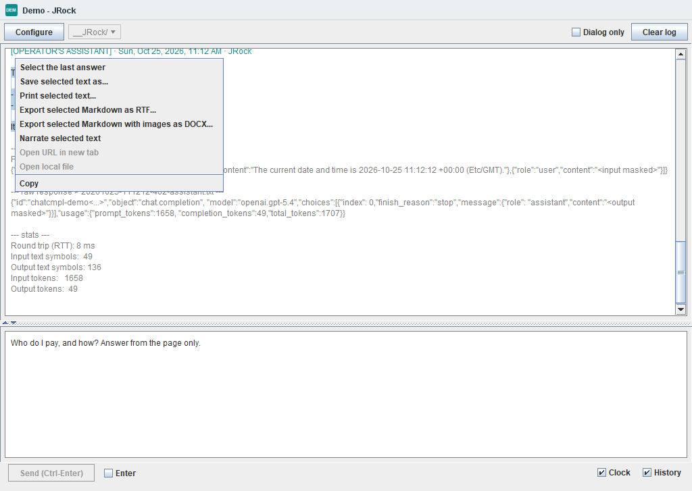

*Half of this menu acts on a selection, so the last answer is selected here: without one, five of
the items are greyed out. The same menu opens on a phone from a long press —*

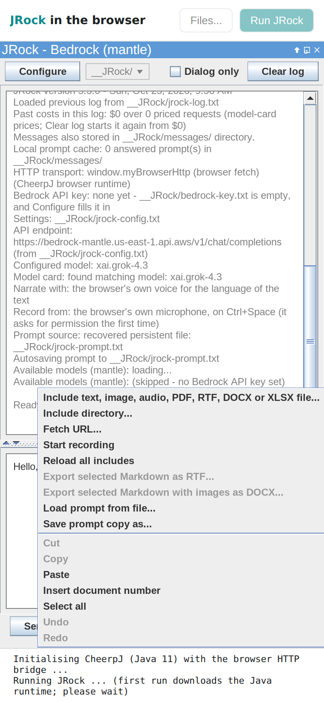

*— which is the prompt's own menu, and the only gesture a touch screen has for everything the
Ctrl shortcuts do.*

- **Log pane** — *Select the last answer*, Save log copy as..., Print... The first
  (**Ctrl+Shift+A**) selects the **body of the most recent answer, whole** — not the teal role
  header above it, not the gray lines under it — which is the selection everything else in this
  menu acts on: ask for a letter to be drafted, select the answer, export it as a document. It
  is greyed out until the model has answered. When text is selected in the log, Save and Print
  act on the **selection only**, and the menu says so (*Save selected text as...*, *Print
  selected text...*). A partial export doesn't count as saving the log, so Clear log still
  warns about unsaved changes. Two more items, *Export selected Markdown as RTF...* and
  *Export selected Markdown with images as DOCX...*, need a selection to mean anything and are
  greyed out without one — and they act on the **log's** selection, the prompt's own menu having
  the same two items for the prompt's (see [**Markdown
  export**](#markdown-export-rtf-and-docx)). On
  **Windows**, *Narrate selected text* reads the selection aloud, and is *Stop narrating* while
  it does (see [**Narrate**](#narrate-windows-and-the-browser) §31). *Open URL in new tab* (**Ctrl+Shift+U**)
  opens the address the
  selection holds or sits inside, so selecting ` - https://example.com/ ;` or just `xample.co`
  out of it opens `https://example.com/` — in the default browser on the desktop, in a new tab of
  the page in the browser. It is greyed out when the selection points at no address, and the log
  says what was opened, or why it could not be.

  *Open local file* (**Ctrl+Shift+L**) is the same idea for the other kind of address in a log:
  **select a path and
  it opens with whatever this desktop opens it with** — a `.docx` in the word processor, a `.wav`
  in the player, a **folder** in the file manager. The log is full of paths JRock wrote itself
  (every include, every conversion, every recording, every export), and this is how you open one
  without going to Explorer to find it again.

  **The whole selection is the name.** Unlike the URL item, nothing is hunted for inside it: a
  path holds spaces — `C:\Program Files\...` — and nothing in running text says where one ends,
  so select the name, all of it, and nothing else. Surrounding spaces, a trailing newline and a
  pair of quotation marks around it are forgiven.

  **Two checks, at two moments.** What the selection *looks like* decides whether the item is
  live, and costs nothing on a right-click: a drive and a separator, a UNC share, or an absolute
  POSIX path — for *this* machine, so `/usr/share/x` is greyed on Windows and `C:\x` is greyed on
  Linux — with no newline, no wildcard and none of the characters a name cannot hold. Whether
  anything is really **there** is asked on the click, and only then does an external process see
  the name: a file that has moved since is a line in the log and nothing is started. A menu that
  stats a file every time it opens stutters on a network path, and the answer would be stale by
  the time anyone clicked.

  The name is yours out of the text in front of you, and the file opens as double-clicking it
  would. A path a model printed into its answer sits in the log like any other, so it is worth
  the same glance Explorer would ask for. Not in the browser build: there is no disk of yours
  there to open anything on.
- **Prompt area** — Include text, image, audio, PDF, RTF, DOCX or XLSX file... (multi-select), *Include
  with copy...* (the same dialog, keeping a copy of each file under `__JRock/includes/` — see
  [**includes that outlive the session**](#includes-that-outlive-the-session) §14), *Fetch
  URL...* (which downloads an address into `__JRock/urls/` and includes it as text or as a
  picture, according to what it answered with — see [**fetching a
  URL**](#fetching-a-url)), *Start recording* / *Stop recording* (the
  [**Ctrl+Space**](#recording-from-the-microphone-ctrlspace) §31 toggle; not in the browser),
  *Mic always on* (see [**Mic always on**](#mic-always-on) §31),
  *Reload all includes* (every include in the **whole** log, where a start reads only the last
  few requests — see [**includes that outlive the
  session**](#includes-that-outlive-the-session)),
  *Export selected Markdown as RTF...* and *Export selected Markdown with images as DOCX...* —
  the same two items the log's menu has, on the **prompt's** selection, which is the one a
  correction is made in (see [**Markdown export**](#markdown-export-rtf-and-docx) §30),
  Load prompt from file..., Save prompt copy
  as..., then Cut / Copy / Paste / *Insert document number* / **Select all** / Undo / Redo.
  *Insert document number* types a random 10-digit number, never starting with 0, at the caret —
  a fresh reference for an invoice, a ticket or a letter, which keeps all ten digits in a
  spreadsheet cell or a numeric field. The edit items are there for a touch device, which has no
  keyboard to press Ctrl+A on: *Select all* followed by Backspace is how a prompt gets cleared
  with no keyboard at all, and dragging a selection from the top of a long prompt to the bottom
  of it on a phone is its own small ordeal.
- **The file name box of any file dialog** — Copy / Paste / Select all. Also for touch, and for
  one thing in particular: the include dialog is multi-select, but a tap selects a single file
  and there is no Shift to hold. Several names typed or pasted into that box, each in quotes —
  `"cat.png" "dog.png"` — is how a phone attaches more than one file at a time.
- **The `__JRock/` label beside Configure** — the window's own menu, and the one that opens on a
  plain click or tap rather than a right-click, the label being there for nothing else. *What is
  in the JRock folder...* first, naming every file and subfolder JRock can keep there (see
  [**Persistence**](#persistence-crash-recovery--full-local-history) §10), then Merge two-sided
  (duplex) PDF scans... and Merge PDFs... above their own separator (see [**merging duplex
  scans**](#merging-duplex-scans-ghostscript) and [**merging
  PDFs**](#merging-pdfs-ghostscript)), then Backup log..., Load from backup... and
  Cleanup JRock files... (see [**backup and restore**](#backup-and-restore) §12 and [**cleaning
  up**](#cleaning-up-the-window-menu)); in the **browser**, also Show/hide the page
  header & footer. The Explorer entries are not here at all — they are the
  [installer's](#the-installer-installerinstalljrockjava) §36, which is what keeps this window the
  same window on three platforms. A label with a caret is a target that is always there,
  always the same size and visibly for this, which the empty part of a bar is not — least of all
  on a phone, where there is hardly any of it. The window's own size and position are **not**
  here: they are Configure's [**Window** tab](#window-size-and-position-configure--window-ctrlm) §29,
  where a Set button applies them without closing anything.
- **Every button and checkbox in the window, and every checkbox in Configure** — its own name and
  a few plain sentences on what it does, on a right-click or a long press. *Clock* and *History*
  in particular say which of them the model is told about: Clock sends the model the local time,
  while the date the log prints after a role header is written for you and is never sent. A
  tooltip says the same thing in one line, but only to a mouse — a phone has nothing to hover
  with, and short labels like *Clock*, *History* and *Enter* are otherwise names to be guessed at.

## Windows: the Explorer entries

### Windows: Explorer right-click integration

The right-click entries are the **[installer's](#the-installer-installerinstalljrockjava) §36**
work, and nobody else's. JRock itself writes nothing to the registry and has no menu item
that does — which is the point: a registry is the one thing on a Windows machine with no
counterpart on the other two platforms JRock runs on, and keeping `reg.exe` out of
`JRock.java` leaves every line of it doing the same thing on Windows, macOS and Linux.
Page 8 of the installer writes three kinds of entry:

- **"JRock here!"** — on a folder's empty space or on a folder icon. Launches JRock in that
  folder, so its `__JRock/` files (prompt, log, messages) are created right there. **It carries
  no `--working-dir`**, and that is the whole of what it means: Explorer starts a right-click
  command in the folder that was clicked, JRock roots its files in the folder it was started
  in, and so the folder you clicked is the folder it works in. A working folder on that
  command line would send every click everywhere to one fixed place instead.
- **"Open as prompt with JRock"** — on a **`.txt`** file. The same command with the file
  appended, so it opens as the initial (read-only) prompt. A verb is added; the default open
  action for `.txt` is untouched.
- **One per agent and per flow** — see [the section below](#windows-agents-and-flows-one-entry-each).

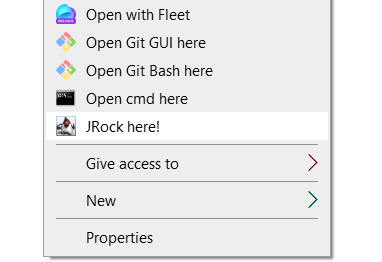

*The installed entry, sitting with the other developer verbs and carrying JRock's own icon.
Clicking it starts JRock in that folder — no path argument, no console window.*

Details:

- **Per-user.** Entries are written under `HKEY_CURRENT_USER`, so no administrator is needed
  and nothing lands outside your own account.
- **Cleared out first.** Before writing anything, the installer finds **every JRock entry on
  the machine** — in all eight shell roots, including the two under `HKEY_LOCAL_MACHINE` it
  never writes to itself — and removes them. A stale entry from an install you no longer have
  runs a jar that may not be there any more, and an installer that only added would leave a
  menu full of them. Untick *Install the Explorer right-click entries* and the page does the
  removal and nothing else: **that is how the entries are uninstalled.**
- **What was removed is written down.** The removal is exported first to
  `__JRock/jrock-context-menus-removed.reg`, and `reg import` on that file puts every one of
  those entries back exactly as it was. What was written is kept beside it as
  `__JRock/jrock-context-menus.reg`.
- **The whole command line goes into the log.** Every entry, with its label and the command it
  runs, so which jar runs from where with which arguments is readable without opening
  `regedit`.
- **No console window.** All of them launch `javaw.exe`, so nothing flashes on screen.
- **The prompt library comes along.** "JRock here!" and the `.txt` verb carry
  `--prompts-dir <install folder>`, so **Ctrl+O opens your prompt library from whichever
  folder you right-clicked**. Explorer supplies the working directory; this supplies the
  prompts directory — the install folder, with your own saved prompts in it and
  `SimplePrompts\` the first folder in the chooser.
- On **Windows 11** the entries may appear under **"Show more options"**.

### Windows: agents and flows, one entry each

Every agent and every flow you install gets **one entry with two commands**:

- **inside or on a folder** — it runs with **no file**, so it asks which one to work on. Its
  chooser opens in **the folder Explorer ran it from**, which is the folder you clicked — no
  flag carries that, the process working directory already is it.
- **on a file of any type, in any folder** — it gets **that file's full path** as its single
  argument, and works on it.

Both are `javaw -cp <install folder>\jrock.jar <its own .java> --working-dir <its folder>
--prompts-dir <its folder>`. The `--working-dir` flag is the trick: Explorer starts a
right-click command in the folder that was **clicked**, which is the opposite of what an agent
needs. An agent belongs to the folder it was installed into — that folder's model, its images
DPI, its Bedrock key, all in that folder's [`__JRock/jrock-config.txt`](#settings-files) §11 — and
may be run on a document anywhere on the disk. Its own folder is also where its prompt files
are, because that is where it looks for them.

| | Comes from | Is |
|---|---|---|
| the **process working directory** | Explorer, from the folder you right-clicked | where the document is, and where the chooser opens |
| `--working-dir <its folder>` | the registry entry the installer wrote | where the agent's key, model, DPI and `__JRock/` live |
| `--prompts-dir <its folder>` | the same entry | where its prompt files are, so Ctrl+O opens there |
| the **argument**, when there is one | the file you right-clicked | the document to work on |

Which is why the samples open their chooser in the folder they were **started** in and not in
the working directory: the settings folder is the one folder the document is certainly not in.
They read it once at startup, before JRock's `--working-dir` handling moves `user.dir`, and no
flag is involved — the process already knows the folder it was started in, so the command line
is the wrong place to carry it, and there is nothing in the registry entry to get wrong.

The label says which **kind** it is and which **installation** it belongs to:

```
JRock agent: Timer (JRockAssistant)...                started with JRock, stays up
JRock agent: Push To Talk (JRockAssistant)...         started with JRock, stays up
JRock flow: Translate To French (JRockAssistant)...   one run, when you pick it
JRock flow: Doc Inventory (JRockAssistant)...         one run, when you pick it
JRock agent: Timer (ScanStation)...                   a second install, its own settings
```

It is built from the file name — `JRockDocInventory.java` → `Doc Inventory`, camel case split
into words, the `JRock` prefix moved to the front so every one of them sits next to *JRock
here!* in a menu full of other applications' verbs — with **the install folder** in
parentheses. Not the agent's own folder: `Timer (Timer)` would say the same thing twice, while
the install folder is what tells two installations apart. The registry key adds a short hash of
that folder's path, so two installations in folders of the same name stay apart.

**Names Windows cannot put on a command line.** A path holding a character the system ANSI
code page has no room for — Cyrillic, Greek, CJK on a Cp1252 install — reaches a Java program
with a literal `?` in place of each one: `C:\Документы\Документ.rtf` arrives as
`C:\?????????\????????.rtf`, which is not a path at all (`InvalidPathException: Illegal char
<?>`). Windows itself is not the problem — it passes a command line in Unicode, which is why
**Open with Acrobat** on that same file works — the narrowing happens in the Java launcher, on
the way to `main(String[])`, and every Java program started from Explorer shares it.

Nothing tries to guess what those `?` stood for: the characters were thrown away rather than
encoded, and a name pieced together from whatever the folder contains would be a guess wearing
the shape of a path. An unreadable path is reported as unreadable, and the message names both
ways round it, both yours:

- **The lasting fix: turn on Unicode UTF-8.** Region settings → **Administrative** tab →
  **Change system locale…** → tick **Beta: Use Unicode UTF-8 for worldwide language support**,
  then restart Windows. The system code page becomes UTF-8, the arguments come through
  untouched, and right-clicking a file with a Cyrillic name works like any other — tried, and
  it helped. It is a machine-wide setting, so an old non-Unicode program may show its own text
  differently afterwards.
- **Without changing anything:** right-click **the folder** and pick the file in the chooser (a
  chooser never goes through a command line — include a file that way and it works whatever its
  name looks like).

## Keyboard shortcuts

One principle: **plain `Ctrl` acts on the prompt**, and **`Ctrl+Shift` acts on the log or is the
second variant** of its plain twin. The same list is in the window itself, behind **F1**.

| Shortcut | Action |
|---|---|
| Ctrl+Enter | Send (and plain Enter, with the **Enter** checkbox on) |
| Shift+Enter | A new line in the prompt, always — whatever the **Enter** checkbox says |
| Ctrl+I | Include text/image/audio files, a PDF, an RTF, a DOCX or an XLSX (multi-select) |
| Ctrl+Shift+I | Include a whole **folder** |
| Ctrl+U | Fetch a URL and include what it answers with |
| Ctrl+Shift+U | **Open** the address the log's selection points at — any part of one will do — in the default browser, or a new tab in JRock Web |
| Ctrl+Shift+L | **Open** the file or folder the log's selection names, with whatever this desktop opens it with (desktop only; *L* for local) |
| Ctrl+Space | Start recording from the microphone; again to stop and include it as `@audio` (or type it into the prompt, with Transcribe on) |
| Ctrl+N | Narrate the selected text, or stop what is playing |
| Ctrl+S | Save prompt as (a copy) |
| Ctrl+Shift+S | Save log as (a copy, or just the selected text) |
| Ctrl+O | Load prompt from a file (any file; binary ones are refused on load) |
| Ctrl+Shift+A | **Select the last answer** in the log, whole — the body of it, without the role header above it; says so in the log when nothing has been answered yet |
| Ctrl+Shift+D | Export the selection as **DOCX** — the prompt's selection, or the log's (each menu has its own item for its own side) |
| Ctrl+Shift+R | The same selection as **RTF** |
| Ctrl+P | Print log (or the selected text) / save as PDF |
| Ctrl+D | Toggle Dialog only |
| Ctrl+E | Toggle History (send the prior dialog too) |
| Ctrl+M | Open Configure on its **Window** tab (size and on-screen position) |
| Ctrl+, | Configure |
| F1 | Help |
| Ctrl+Z / Ctrl+Y | Undo / redo in the prompt |

Saving the log is `Ctrl+Shift+S`, under the rule above: `Ctrl+S` saves the prompt, and the log
is its `Ctrl+Shift` twin. **`Ctrl+E`** for History is the one letter that fits nothing — `H` is
unusable, since the toolkit makes `Ctrl+H` a backspace inside a text area. `Ctrl+Space` and
`Ctrl+N` are bound only where the machine can record and narrate, and the window's own list
leaves out whichever it cannot do.

Deliberately **without** a shortcut: Clear log (destructive, and one keystroke from the log it
clears), Backup log, Load from backup, Merge two-sided scans, the page header and footer, and
*What is in the JRock folder*.

## Tests

Tests live in **`tests/`** and run on **JUnit 5**. Most are GUI tests, using
[AssertJ-Swing](https://github.com/assertj/assertj-swing) (the maintained descendant of
FEST-Swing) to find the real widgets and read them: each one starts the actual application
via `JRock.main(...)` and then works its window.

They do **not** move the mouse or type on the keyboard. Both are delivered by the operating
system, to whichever window it believes is focused or under the pointer, and on a headless
runner with no window manager that need not be JRock's. So a test presses the real buttons,
picks the real filters and sets text in the real fields, then waits on what JRock logs.

**What is in there, and not in here.** One class per concern, each with its own javadoc
saying what it proves: the startup report, the prompt's autosave and its recovery, every kind
of include, the RTF/DOCX/XLSX readers and the two exporters, the merges, the model cards and
their prices, what narration is handed, what the microphone's ears accept, the geometry of
every window. A roll-call of them in this README would be a second copy to keep in step with
the first, and it would go stale the day somebody adds a test - so the classes are the list,
and this is how they are run:

```sh
cd tests/
mvn test
```

Nothing is stubbed and no credentials are needed: every test runs in a throwaway working
directory of its own, so its `__JRock/bedrock-key.txt` is the empty one JRock creates and the
startup model-list fetch is skipped for want of a key. Your own key cannot be picked up by a
test, because nothing is read from the environment. No test contacts AWS: of the two that set
a key at all, one points the endpoint at a host that doesn't resolve, so the fetch fails at
DNS, and the other points it at a server of its own on 127.0.0.1.

Two external programs are needed: **Ghostscript on `PATH`** (`gs`, or `gswin64`/`gswin64c` on
Windows) for the PDF test, and **xpdf's `pdftohtml` and `pdftotext`** (from
https://www.xpdfreader.com/ — not poppler's, whose `pdftohtml` takes other options) for the
xpdf test. Both convert a real PDF rather than pretending to. CI installs them; each test fails
with that as its message if its program is missing.

`JRock.java` is compiled **in place** from the repository root — the root keeps its single
Java file, and nothing is copied. Maven writes everything to `tests/target/`, which is
git-ignored, and that's also where the app's own `__JRock/` folder goes during a test run.

CI runs this on every push (`.github/workflows/tests.yml`), under `xvfb` since the Linux
runners are headless, on JDK 11 — the minimum JRock supports.

## The installer (`installer/InstallJRock.java`)

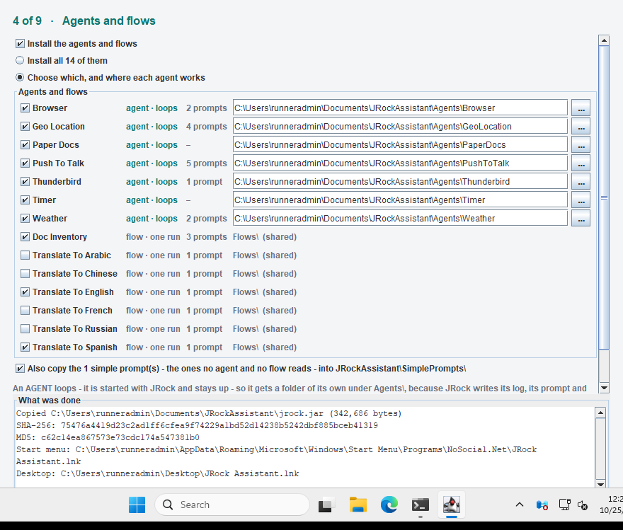

*Page four is the catalogue: an agent gets a folder of its own, the flows share one, and each is
installed with the prompt files its own source names.*

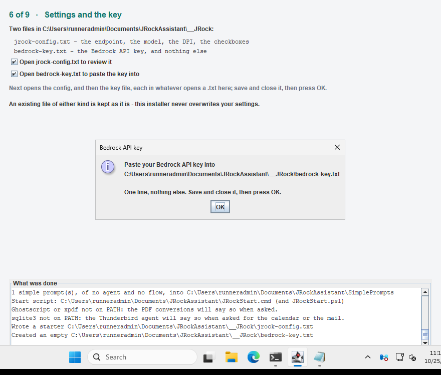

*And the last page says what it did - which is the page to read before pressing Close, because
it is the only account of where everything went.*

One Swing wizard, one Java source file, no build step — shipped **at the root of every
release artifact**, beside `jrock.jar`. Unpack a release, and from that folder:

```sh
java InstallJRock.java            # the wizard
java InstallJRock.java --check    # what it would find, printed; changes nothing
```

**One folder holds the installation**, and that is the only thing to decide:

```
Documents\JRockAssistant\             jrock.jar + its SHA-256 and MD5
                                      __JRock\ — the window's own files
                                      jrock-prompt-*.txt — your own prompts, where
                                        Ctrl+O opens
    Agents\PushToTalk\                the agent, its prompts, its own __JRock\,
                                        and PTTFiles\ for what it is handed
    Agents\Timer\                     …one folder each, because they all run at once
    Agents\Weather\
    Flows\                            every flow, their prompts, one __JRock\
    SimplePrompts\                    the prompts of no agent and no flow, to open
                                      by hand
```

An **agent** loops: it is started with JRock and stays up — a timer, a push-to-talk listener, a
calendar reader answering a port. It gets a folder to itself, because JRock writes its log, its
prompt and its transcript into a `__JRock/` inside the folder it works in, and three agents
sharing one folder would write over each other.

A **flow** runs once, on something you point it at, and asks you for it: translate this
document, inventory that scan. Nothing loops, nothing is ever started behind you, and one
folder does for all of them. The installer reads which is which out of the folder each one was
shipped in — `samples/agents/` or `samples/flows/`.

A **simple prompt** has no program at all — no `.java`, nothing to run, nothing to loop: it is a
`.txt` from `samples/simple-prompts/` that you open with Ctrl+O, fill in and send yourself. They
are one tick on the same page, and they go **together into `SimplePrompts\`**, which is their
only copy — a prompt that lives in two folders is a prompt you edit in one of them. Ctrl+O opens
at the top of the installation, where your own saved prompts are and where that folder is the
first thing in the chooser.

| What the installer finds | What it does |
|---|---|
| `jrock.jar` | **replaced** — that is what installing a release means |
| `jrock-config.txt`, `bedrock-key.txt` with something in them | **kept**, and the log says so |
| either of them **empty** | filled in: an empty file is nobody's setting |
| a prompt file of yours | kept |
| a `JRock\` folder from 5.2.0 or earlier | **renamed** to `__JRock\`, before anything is written into it |
| its own Explorer entries | removed first, kept as a `.reg` that puts them all back, then rewritten |
| its own shortcuts | written, or taken away by unticking one |
| any folder, document or settings file | **never removed. Not one, ever.** |

**It removes no folder, no document and no settings file. Not one, ever.** A `jrock.jar` in the
folder is replaced, which is what installing a release means; a `jrock-config.txt`, a
`bedrock-key.txt` or a prompt file already there is **kept** — unless it is **empty**, which is
nobody's setting — and the log says so, because those
are yours. Nothing is deleted when you install somewhere else, and nothing is deleted when you
install again.

What it **may** remove is two kinds of pointer, and only when you say so: its own Explorer
right-click entries (page 8, which clears every JRock entry on the machine before writing the
new ones — and clears them even when you install none) and its own shortcuts (page 4, where
unticking one that is there takes it away). A pointer is not data: the entries are written out
to a `.reg` that puts every one of them back, and a shortcut is one tick away from being
written again.

Nine pages, in this order:

1. **What was unpacked** — `jrock.jar` and `samples/` have to be in the folder it was started
   from, which is where a release unpacks to. Missing, it says so and waits for Retry. It also
   names **what is running right now** — *JRock (javaw.exe 17880), Browser, PaperDocs, Timer…* —
   with a **Stop them all now** button: Windows will not replace a file a process has open, and
   `jrock.jar` is open in every one of them. Stopping them loses nothing (the log is written as
   it goes and the prompt is autosaved) and the last page starts them again.
2. **Where everything goes** — default `~/Documents/JRockAssistant`, with the tree above drawn
   on the page. The jar is copied there with its **SHA-256 and MD5** written beside it, computed
   from the copy that just landed. The **folder name** is what every Explorer entry is labelled
   with, so it is worth one you will recognise. If something is still running, this page asks
   once more before copying; a **no** keeps the page.
3. **Shortcuts** — Start menu and Desktop, both called **JRock Assistant**, both opening JRock
   in that folder. A real `.lnk` on Windows (written through `WScript.Shell`, the only way
   without a native library), a `.desktop` file on Linux, a `.command` script on macOS.
   **Unticking one that is already there removes it**, and the page says which file will go.

   A third tick adds **JRock Assistant CLI** to the Start menu: the same folder, the same key,
   the same log and the same prompt library, with the questions typed at a prompt and the
   answers printed (JRock's own `--cli`). It points at **java.exe** rather than `javaw.exe`,
   because that is what gets a console window — and a prompt nobody can see is not a prompt.
   Off unless it is already there, read rather than assumed, like the login entry: an installer
   that adds menu entries nobody asked for is an installer people uninstall.
4. **Agents and flows** — all of them, or pick them one by one. **Where something is installed
   already**, this page offers *that* set and nothing else, ticked, each in the folder its
   Explorer entry names; the full catalogue is one radio button away (*Show all 14 and let me
   change the set*), and it opens with **what is installed already ticked** — or everything,
   when nothing is. Leaving *Update these 10* alone installs **those ten**: page 1 reads the
   artifact again every time it is left, which used to rebuild the catalogue from scratch and
   quietly re-tick all fourteen while the page went on saying ten. A re-read now carries over
   what was already decided, ticks and typed folders both.

   The table has **no scrollbar of its own** either: a scrolling box inside a scrolling page is
   two bars side by side, each moving a different thing. An agent that is installed but not in this artifact is named on the page:
   its right-click entry goes with the rest, and its files stay where they are. The table says
   whether each one loops or runs once, how many prompt files it brings, and the folder it works
   in — editable for an agent, `Flows\` for a flow. Each is copied with the prompt files its own
   source names, and the **simple prompts** — the ones no agent and no flow reads — are offered
   their own tick into `SimplePrompts\`, together, as the library they are.
5. **Ghostscript, xpdf and sqlite3** — looked for on `PATH`, with where to get each and a
   **Retry** when you have. After the agents, because which tools are wanted depends on which
   agents are going in: `sqlite3` is only looked for when the **Thunderbird** agent is in the
   set, since nothing else here reads your calendar and mail index. Or continue without any of
   them: everything else works, and JRock or the agent names the missing tool when something is
   asked of it that needs one.
6. **Settings and the key** — **two ticks**: whether Next stops to *open* `jrock-config.txt` in
   whatever opens a `.txt`, waiting while you edit and save it, and then `bedrock-key.txt` the
   same way. **On for a fresh install, off for an update** — the same jar into the same folder,
   where the config is the one being updated and the key is already in it, and two editors and
   two dialogs on every run is what teaches somebody to press Next without reading it. Both files
   are written either way; that is the page's actual work, and the ticks are there to be put back
   on by anybody who does want to look. **The key's tick comes back on when there is no key in
   the file yet**, update or not, that being the one thing this page exists to fix. With the key
   file still empty afterwards,
   it says the key can go in later and what already works without one: merging duplex scans,
   converting and including documents, fetching a URL, exporting to DOCX or RTF, printing. Only
   asking a model needs the key.
7. **Settings for the agents and flows** — every folder that runs a JRock of its own is offered
   a copy of `jrock-config.txt`, and the key as a **separate tick**: an agent cannot ask a model
   without one, and JRock itself never copies a key into a folder it was not typed for.

   **Nothing is overwritten.** The page says what will happen to each file in each folder before
   it happens — `jrock-config.txt - KEPT as it is - this folder has its own`, or `copied,
   because there is none yet` — and the ticks read *Fill in a missing jrock-config.txt (never
   replaces one)*. The one exception is an **empty** file, which is filled in: the home folder's
   key file starts empty, so an install done before the key was typed leaves a blank key in every
   agent folder. Nothing is copied **from** an empty file either, so a key you typed into one
   agent's folder yourself stays.
8. **Right-click entries** — "JRock here!", "Open as prompt with JRock", and one per installed
   agent and flow, [as described above](#windows-explorer-right-click-integration) §33. Every JRock
   entry already on the machine is removed first and written out to a `.reg` that restores it;
   with nothing ticked, the page **only** cleans up, which is how these entries are uninstalled.
   An entry under `HKEY_LOCAL_MACHINE` that somebody else wrote needs an administrator to
   remove: it is named in the log and left alone, and nothing else waits for it. The whole
   command line of every entry written goes into the log.
9. **Installed** — two ticks and one button: **Run JRock and its agents at login**, and **Run
   JRock and its agents now, as this installer finishes**. The button says what the ticks
   mean — **Finish & run >** when *now* is ticked, **Finish >** when it is not — and it is
   the only way off the page, because the **Close** button is hidden here.

   **Because starting it now is a question, not the way out.** *"Install it, I will reboot
   and let it come up at login"* is an ordinary thing to want, and a last page whose only
   forward button runs JRock answers that with Close — which throws the page's answers away
   instead of applying them: the login entry you had just unticked, with *Will be removed*
   printed under it, stayed on the machine and started JRock again at the next login. Both
   ticks are applied by the button now, whichever way they are set, and `JRockStart.cmd`
   (see below) runs only if you asked for it.

   With *now* ticked the page also reports anything of JRock already running (a JVM with the
   jar or a sample on its command line, which is not a shell whose folder is named after
   JRock nor an editor with `jrock-config.txt` open), because the script is about to ask what
   to do about it. With *now* unticked it says the opposite: nothing is started, anything
   running is left alone, and here is where the start script lives for when you want it.

**One script starts the installation, and it looks before it starts.** The installer writes
`JRockStart.cmd` and `JRockStart.ps1` beside the jar, with the command lines it would have used
itself — JRock and **the agents**, not the flows, since a flow is one run you ask for and
starting one behind you would open a file chooser nobody asked for.

Why a script rather than the installer starting nine processes: the day after the install,
*"start all of it"* is still something you want, and starting it twice is the one thing you must
not do — two JRocks in one folder write the same log and the same prompt file over each other. A
script can look first, every time, for ever; an installer can only look the once. So:

- **Nothing running** → it starts everything and says nothing at all, which is what it does at
  login.
- **Some of it running** → it names what it found and asks whether to **stop all of it and start
  again**. Yes is a restart; No leaves the machine exactly as it was.
- **It stops only what it starts.** A running *flow* names the same jar and is deliberately left
  alone: a flow is a document three model passes deep, this script cannot start one again, and
  killing somebody's conversion to restart the agents would be a poor trade. Verified against a
  real machine: twelve processes of JRock and its agents claimed, one running translation flow
  untouched.

**Run at login** is a shortcut in the Startup folder (`~/.config/autostart` on Linux) pointing at
that script — all of it, agents included, because *run it at login* means all of it or there is
no point. Unlike the Start menu and Desktop ticks it does **not** default to on: it starts as
whatever you chose last time, read off the disk, because adding an autostart entry is a decision
about somebody's machine. Unticking it when it is there removes it, the same way the other two
work — written or removed when the last page's **Finish** button is pressed, whether or not
JRock is being started now.

**A previous install is read, not guessed.** The Explorer entries already hold the folder the
jar is in, which agents and flows are installed and where each one works, so those become the
folder, the ticks and the folder of each agent — installing again **updates** what is there
instead of asking everything twice.

A sample that has been **renamed** is still the same install: the installer maps the old name
to the new one, keeps the folder it was working in - so its settings and its log carry over -
and the rename never reads as one agent gone and another appeared. (`JRockCalendarEvents` is
`JRockThunderbird` now, and the agent reads its old settings file when the new one is not there
yet.)

It reads **every** shell root for them, including the two under `HKEY_LOCAL_MACHINE` it never
writes to itself. An entry can be in any of them — an older release wrote the same agent to
three, JRock's own window menu wrote them before that — and an agent that was looked for in one
place and missed would come back as *not installed*, which is how you end up being offered a
fresh install of what you already have.

`--check` prints every one of those detections — including every JRock registry entry it would
clear — and writes nothing, which is what CI runs on all three platforms so the installer
cannot rot unnoticed.

## No window at all: `--cli`

A shell version, for a question that does not need a window:

```sh
java JRock.java --cli                       # ask, read, ask again; Ctrl+C or an empty line ends it
java JRock.java --cli "what is 2 + 2"       # one answer, then exit
java JRock.java --include report.pdf        # attach that file and exit
```

| | In the window | Under `--cli` / `--include` |
|---|---|---|
| The session report | the log pane | printed, indented, to stdout |
| The log and the transcript | `__JRock/jrock-log.txt`, `messages/` | the same files, the same folder |
| Includes from earlier runs | reloaded | **reloaded** — the point of going through startup |
| The model list at startup | fetched | skipped, and the report says so |
| Narration, recording, file dialogs | yes | no: desktop features that live in the same file |
| [Leftover folders](#persistence-crash-recovery--full-local-history) §10 | named, and offered up | named only — nothing is asked |
| The prompt file | autosaved on every keystroke | read, then dropped; written only when something is asked |
| Exit code | — | `0` answered, `2` bad arguments, `3` the folder needs renaming |

**It goes through the whole startup**, deliberately: the log is restored, the folder's settings
are adopted, the session report is printed, and — the reason it is worth doing — **the includes
are reloaded**, so a file attached in an earlier run can still be referred to. The components it
needs are a text area and a text pane, and neither is a window: Swing only refuses to make
*windows* without a display, so the whole of the existing startup runs unchanged rather than
being written a second time. There is no narration, no recording and no file dialogs — those are
desktop features that happen to live in the same file.

**`--include` attaches and exits**, printing the token to refer to it by:

```
$ java JRock.java --include figures.txt
Attached: @txt b26e46c5cfd7
Refer to it by that token in the next --cli question.

$ java JRock.java --cli "@txt b26e46c5cfd7 what was the revenue? Answer with the number only."
1,240,000
```

**The saved prompt is read and then dropped.** Read, because an include is only mapped back to
its file if something *refers* to it, so the prompt has to be in front of the reload — and
dropped, because a shell asks a fresh question every time and carrying yesterday's prompt into
today's question would send it. It is not written over either: the prompt file keeps what it
held until something is actually asked, and then holds the question. What is attached is listed
at startup with the token to mention it by, since a hash nobody has been shown is a file they
cannot refer to.

## Finally: reproducible builds

*The last section of this README — which its title says so that the next thing added to this
file goes above it. The hashes below are what somebody scrolling to the bottom is looking for.*

CI compiles `JRock.java` with a **pinned OpenJDK 11 patch (Temurin 11.0.32+9)** and repacks
the classes into a **byte-for-byte reproducible** `jrock.jar` (see `.github/build/BuildJar.java`).
The same source therefore yields the **same SHA-256 and MD5 on any machine or OS**.

For robustness the build runs on **three operating systems** and publishes three artifacts:

- `jrock-macos-latest.zip`
- `jrock-ubuntu-latest.zip`
- `jrock-windows-latest.zip`

| What makes the bytes the same everywhere | How |
|---|---|
| the compiler | a **pinned** JDK — Temurin 11.0.32+9, not "11" |
| the class files | `--release 11`, `-encoding UTF-8`, `-g:source,lines,vars` — no platform defaults left to vary |
| the entry order in the zip | sorted, every time |
| the timestamps | fixed to 2026-01-01T00:00:00Z, not the build's own clock |
| the compression and the manifest | fixed, and hand-written |
| what is left out | `__JRock/`, any stray `.class` or `.jar` under `samples/` |
| the proof | three runners, three artifacts, **one** SHA-256 |

Each archive contains the **same bit-perfect `jrock.jar`** plus its checksum files
(`jrock.jar.sha256`, `jrock.jar.md5`), the
[installer](#the-installer-installerinstalljrockjava) §36 (`InstallJRock.java`), the zipped
source (`jrock-src.zip`, which holds `JRock.java` and every sample) and `samples/` loose
beside it, so the prompts, the agents and the flows can all be read without unpacking
anything. `java InstallJRock.java` is what puts the jar and each sample in a folder
where it runs; by hand, `-cp` has to name the jar wherever you keep it. Because the
build is reproducible, the `jrock.jar` inside all three archives is identical.

To verify and run JRock from a build artifact, unzip it, then:

```sh
cd jrock-ubuntu-latest/

sha256sum jrock.jar
md5sum jrock.jar

java -jar jrock.jar
```

Build hashes, the same from all three runners — straight out of CI, which is the only place
these numbers can honestly come from:

```
75476a4419d23c2ad1ff6cfea9f74229a1bd52d14238b5242dbf885bceb41319  jrock.jar
c62c14ea867573e73cdc174a547381b0  jrock.jar
```

Or, if you want to modify the source and run it in place (no build step):

```sh
java JRock.java
```
